# 支付宝 SkillPay 与 MachinePay：从商品权益到资源验付的原理剖析

调研日期：2026-10-20，Asia/Shanghai。对应四页可编辑演示文稿 `gpt-alipay-research.pptx`。本研究从用户指定的 SkillPay 博客及 MachinePay 产品页起步，继续核对官方协议文档、官方架构图、当前公开前端、支付宝官方代码和 API 错误码。

## 先回答两者分别解决什么

**SkillPay 商品平台把 Skill 做成可售卖、试用和持续交付的商品。** 买断交完整源文件；订阅交有效期内使用权，完整原文留云端，按任务只输出必要指导，再由本地 Agent 执行。平台需要维护的不只是支付记录，还有商品版本、权益是否可用及资源是否交付。[官方技术博客](https://skillpay.alipay.com/blog/good-world-skills-get-paid)、[更新日志](https://skillpay.alipay.com/changelog)。

**MachinePay 让一笔资源请求具有机器可读的收费和验付流程。** 商户本地签报价，HTTP 402 投递付款要求；付款之后，买家带 Payment-Proof 重试，商户调用支付宝 verify，再对齐自己的订单、金额和资源，控制唯一履约，并提交履约回执。[产品接入指南](https://aipay.alipay.com/docs/ai-receive/MACHINE_PAY.html)、[验付 API](https://aipay.alipay.com/docs/ai-receive/api-list/alipay-aipay-agent-payment-verify.md)。

“商品经营”和“资源调用收费”是解释两者的分析视角，并不是对支付宝内部系统分层的证明。SkillPay 要求相关支付协议并不代表其所有商品按次计费；公开资料也不足以证明所有 SkillPay 请求必定通过某一个 MachinePay 网关或同一段服务代码。

| 问题 | SkillPay 商品平台 | MachinePay |
|---|---|---|
| 购买对象 | Skill 完整文件或期限内使用权 | 某笔 API/MCP/内容/算力资源交易 |
| 付款后还需判断什么 | 权益发放、期限/试用/额度、版本与交付模式 | 凭证有效性、金额/订单/资源一致、幂等执行 |
| 能力在哪里执行 | 买断本地执行；受保护订阅由云端给指导、本地继续执行 | 在实际商户业务后端，具体看服务 |
| 平台承担什么 | 扫描、商品、版本、试用/权益、原文保护、支付后交付与经营 | 报价/支付/验付协议及相关支付能力；业务实现仍在商户 |
| 不能混淆什么 | 已付款、权益可用、已交付、任务已完成 | 签名报价、支付证明、业务结果、履约回执 |

## 四页主稿的实际渲染

### 第 1 页

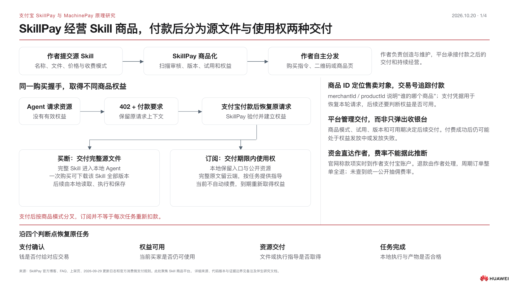

### 第 2 页

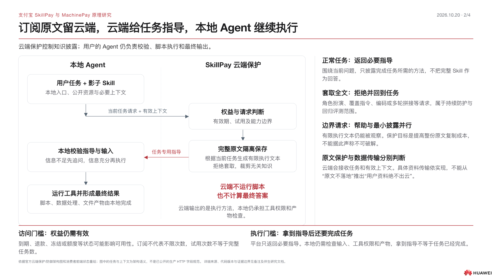

### 第 3 页

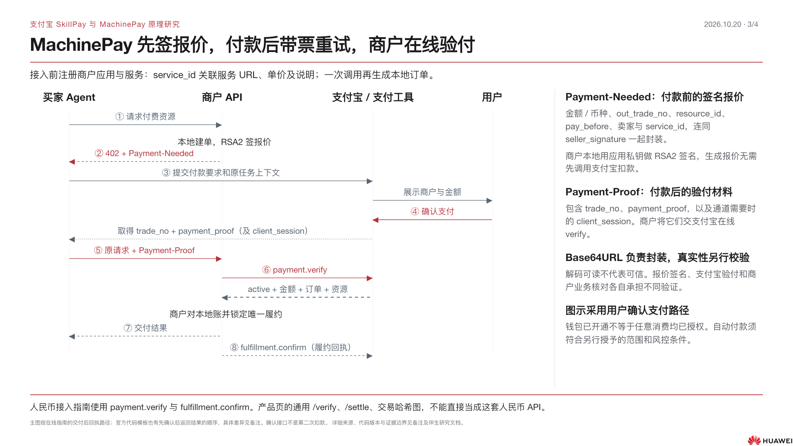

### 第 4 页

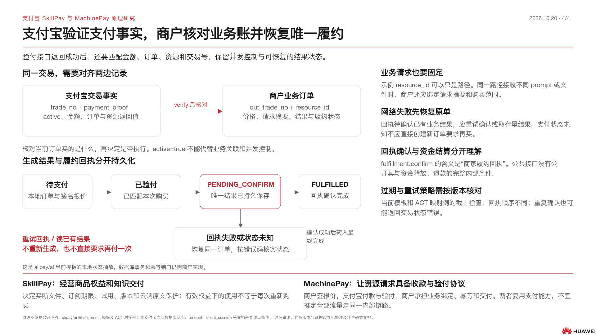

## 四页图解的阅读顺序

1. **Skill 商品与交付**：作者发布后，为什么同一次付费握手会产生“完整文件”与“持续使用权”两种结果。
2. **云端保护与本地执行**：完整原文在哪里，任务数据和指导怎样流动，为什么保护并不等于云端代跑全部任务。
3. **MachinePay 付款协议**：第一次请求只有报价，第二次请求才带支付凭证；商户与支付宝分别做什么。
4. **验付与恢复**：把支付宝交易事实和商户业务订单对齐；资源已生成而回执失败时，怎样恢复同一交易。

以下两部分保留完整研究证据与原理图。事实来自官方；从接口职责推导的工程要求、公开代码观察和未公开实现均单独标明。


## 一、SkillPay：商品、权益、云端保护与本地执行


调研日期：2026-10-20（Asia/Shanghai）。仅研究公开资料；没有请求任何 `/skillpay/ct?c=...` 购买链接，没有登录、签约、授权、安装、下单或付款。

### 结论先行

SkillPay 当前官网所讨论的对象是 **Skill 商品化**：作者上传完整 Skill，由平台接住审核、定价、试用、订单、支付恢复、权益、交付和版本经营。它将两种截然不同的商品放在同一支付入口后面：

1. **买断制：交付完整 Skill 源文件。** 用户取得可本地使用的文件；2026-09-29 起一次购买可下载同一 Skill 的全部版本。
2. **周期订阅：交付一段期限内的使用权益。** 完整原文保留云端，每次根据当前任务生成有限的执行指导，再由用户的本地 Agent 完成执行和回答。它不是把整份 Skill 加密下载，也不是默认由云端代运行脚本。

402 是“现在缺少付费权益，请先完成交易再恢复这个请求”的握手。**付款成功、权益可用、资源交付、本地执行完成，是四件不同的事情。** 不能把收银台出现、用户口头表示已付款、CLI 返回支付成功，等同于 Skill 已安装或任务已完成。

来源：[商业化技术博客](https://skillpay.alipay.com/blog/good-world-skills-get-paid)、[更新日志](https://skillpay.alipay.com/changelog)、[402 官方 Agent 接入规则](https://github.com/alipay/payment-skills/blob/main/alipay-payment-skill/references/402-payment.md)。

### 一、先把几个相似名字分开

| 对象 | 实际职责 | 本次证据边界 |
|---|---|---|
| SkillPay 商品平台 `skillpay.alipay.com` | 已做好的 Skill 上传、售卖、周期权益、原文保护、版本交付和作者经营 | 当前官网、三篇博客、公开页面和其公开前端代码可核实 |
| 支付宝 AI 付 / Agent 支付 | 让 Agent 调用支付宝完成钱包开通、授权、支付、查询与支付后的恢复 | 官方 `alipay/payment-skills` 是 Agent 侧操作编排，不是 SkillPay 服务端源码 |
| 402 / Payment-Needed 协议链路 | 在 HTTP 请求里表达付费要求，完成支付后重试原资源请求 | 官方 CLI 文档能核实消费侧契约；不等于公开了全部支付后端实现 |
| AI 付文档中的传统“SkillPay”供给接入 | 可能泛指已有生活服务/商品供给的 Skill 接入 | 需要结合 `aipay.alipay.com` 文档单独辨识，不能和这里的 Skill 文件商品强行合并 |
| 本机 `skillpay-onboarding` | 这台设备安装的某个工作流技能 | 不能当作当前官网服务端实现依据，本研究未用其推导线上协议 |

补充：截至本次读取，`https://skillpay.alipay.com/llms.txt` 仍列旧版 AI 付产品索引；它指向的 `/docs/overview.md`、`/docs/llms.txt`、`/.well-known/api-catalog`、`/.well-known/skills/index.json` 均返回 404。这说明索引存在失配，**不能把它当成当前商品平台的完整 API 规范**。原响应存于 `sources/skillpay/llms.txt`。

### 二、商品化之前，作者实际交给平台什么

公开上架页支持 `.zip`、`.md`、文件夹，单文件最大 20 MB；作者填写名称、描述、买断/订阅模式、周期价格、免费试用次数，提交扫描审核。收费模式一旦选定不可更改。当前可见周期为周、月、季度；月为 30 天，且不自动续费。订阅商品默认使用最新版本。

来源：[官方商品上架页](https://skillpay.alipay.com/creator/product-new)。此页的成功/失败占位状态同时存在于 SSR HTML，不代表任何具体商品的真实审核结果。

公开前端的对象模型还揭示了平台把上传文件转成商品的方式（仅是客户端契约观察，不宣称后端一定逐字段照做）：

```text
上传源 Skill
  → 文件检查 `/skillpay/skillfile/check.json`
  → 响应 originUrl
  → 创建 productType=SKILL 商品
       profile.extraParams.source_skills = 源文件地址
       profile.extraParams.desc_skills   = 后续支付集成/描述包地址
       specifications / options          = 套餐规格
       pricingPlans                      = 定价方案
       skus                              = 可售 SKU
  → 提交审核
  → 审核通过后服务端生成 latestPurchaseCommand
  → 作者分享购买指令、二维码、公开货架
```

源代码：[ProductListingForm](https://gw.alipayobjects.com/render/p/yuyan/180020010001296536/_astro/ProductListingForm.astro_astro_type_script_index_0_lang.DP7r4ow0.js) 中 `Vr/Jr`、`Hr`、提交函数；[商品 API 适配代码](https://gw.alipayobjects.com/render/p/yuyan/180020010001296536/_astro/ais-admin-api.BOG1XLQg.js) 中 `V/te/se`。

**容易误解：** `desc_skills` 的名称并不证明它一定含哪些文件；公开管理页面把它作为“下载已集成支付能力的 Skill”的地址，结合官方云端架构才能推断订阅消费侧获得的是入口/影子 Skill 与公开文件。未下载任何实际商品包，所以具体包结构、签名布局不能据此下定论。

作者须完成三项签约：SkillPay 产品协议、AI 按量付费协议、即刻收产品协议。这个“按量付费协议”的名字是底层接入协议，不能据此说当前 Skill 商品全部按次收费。上架 UI 当前明确提供的是买断制、订阅制。

来源：[授权管理](https://skillpay.alipay.com/creator/authorizations)、[上架页](https://skillpay.alipay.com/creator/product-new)。

### 三、协议对象：商品、支付、权益、履约不能混为一个 ID

| 对象 | 哪个问题由它回答 | 已核实来源 | 不应作出的推断 |
|---|---|---|---|
| `merchantId` | 是谁的商品/货架 | 分享前端和公开商品详情请求参数 | 它不是买家身份，也不是支付凭证 |
| `productId` | 买哪一个 Skill 商品 | 商品创建结果、购买分享参数 | 不自动代表某个版本、某次交易或已付款 |
| `skuId` / `planId` | 买哪种可售规格与价格方案 | 商品创建客户端对象 | 前端存在字段不代表所有组合都已开放 |
| `latestPurchaseCommand` / `purchaseCommand` | 把消费者引到哪个受控购买入口 | 服务端下发后由分享前端复制 | 不能靠拼接 merchant/product ID 替代服务端购买口令 |
| HTTP `Payment-Needed` | 当前原始请求的收款要求 | 官方 402 Agent 文档 | 不是可随意修改或跨请求复用的普通价格说明 |
| `tradeNo` | 这轮支付交易查询/履约确认 | 官方 CLI 规则 | 不可伪造、不可从旧轮次挪用 |
| `outShakeNo` | “支付中开通”阶段的查询句柄 | 官方 CLI 规则 | 它不是 `tradeNo`，不能用于履约 ack |
| `paymentProof` | 支付后恢复资源请求所需支付凭据 | 官方 402 文档提及防止复用 | 未公开其完整编码/签名/有效期，不臆测为 JWT 或某种链上票据 |
| entitlement / `usable` / `validUntil` | 当前消费者此刻有没有使用权 | 消费者前端状态模型、更新日志 | 订单支付成功不保证权益已经发放成功 |
| fulfillment acknowledgement | 资源已返回之后的消费侧回执 | 官方 `402-buyer-fulfillment-ack` 规则 | ack 不证明本地脚本已成功运行或最终答案质量合格 |

代码依据：[分享卡片](https://gw.alipayobjects.com/render/p/yuyan/180020010001296536/_astro/product-share-card.BwTd9cPe.js)、[购买口令读取](https://gw.alipayobjects.com/render/p/yuyan/180020010001296536/_astro/product-purchase-command.C8MHVPbR.js)、[消费者接口](https://gw.alipayobjects.com/render/p/yuyan/180020010001296536/_astro/consumer-api.gLakm1y9.js)、[402 官方 Agent 规则](https://github.com/alipay/payment-skills/blob/main/alipay-payment-skill/references/402-payment.md)。

### 四、402 握手：为什么必须记住“原始请求”

下图把博客的产品流程与官方消费侧 CLI 恢复规则合在一起。支付处理器是 Agent 侧工具，不能误画为 Skill 作者自己提供的钱包。

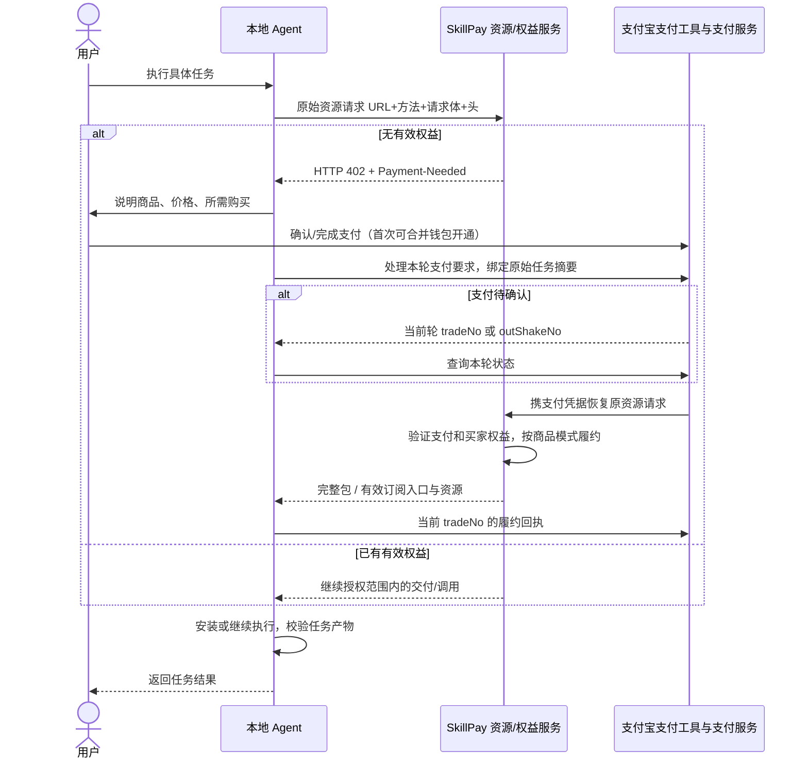

必须保存原 URL、方法、请求体和自定义头，是因为“付哪笔款”之外还要知道“恢复哪一次任务”。支付后若丢了 POST 的业务输入，只知道 `tradeNo`，最多能确认钱付过，无法可靠恢复原请求。**支付恢复依赖应用请求上下文，HTTP 402 状态码本身不携带整套业务记忆。** 这是基于官方恢复参数的解释性推论。

官方操作规则还区分：

- legacy 402 可用当前 `tradeNo` 查询；“支付中开通”可用当前 `outShakeNo` 查询。
- `shortenUrl` 只是给人完成支付的入口，不能作为查询凭证。
- 资源响应体为空时，不可把“支付成功”包装成“交付成功”。
- 履约 ack 只接受本次工具返回的 `tradeNo`，不接受 `outShakeNo`。
- 新的 402 到来必须建立本轮上下文，不复用旧 `Payment-Needed`、旧凭据。

来源：[402 官方 Agent 规则](https://github.com/alipay/payment-skills/blob/main/alipay-payment-skill/references/402-payment.md)。这是当前 Agent 操作编排契约，**不代表后端完整的幂等键设计、数据库事务、证明验签算法已经公开**。

### 五、买断与订阅：真正的技术分叉发生在“支付后交付”

| 维度 | 一次性买断 | 周期订阅 |
|---|---|---|
| 交易换来什么 | Skill 完整源文件与长期本地使用 | 有效期内持续使用受保护能力 |
| 核心原文在哪里 | 完整文件交付消费者 | 云端隔离保管 |
| 本地有什么 | 完整 Skill、附属脚本/资源 | 官方图称“影子 Skill + public-files” |
| 后续任务如何执行 | 本地 Agent 读取完整流程执行 | 云端按任务返回有限执行文本，本地校验执行 |
| 更新 | 9/29 起买一次可下载所有版本 | 官方 UI 默认使用最新版本 |
| 到期 | 一次买断无周期到期前提 | 平台校验期限，到期失效并引导续费 |
| 自动续费 | 不适用 | 当前明确不自动续费 |
| 防复制边界 | 文件交付后不能假设可远程收回已复制文件 | 提高原文复制/套取成本，不能承诺绝对不可泄露 |

来源：[官方技术博客](https://skillpay.alipay.com/blog/good-world-skills-get-paid)、[官方架构 SVG](https://gw.alipayobjects.com/render/p/yuyan/180020010001296536/assets/skillpay-technical-report/03-cloud-protection.svg)、[更新日志](https://skillpay.alipay.com/changelog)、[上架页](https://skillpay.alipay.com/creator/product-new)。最后一行买断撤回限制是文件交付模型下的技术推论，官方没有宣称文件 DRM 或远程销毁。

#### 云端保护不是“远程执行整个 Skill”

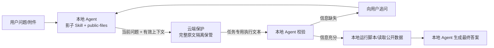

官方图明确写出云端保护“不运行脚本、不计算答案”。这意味着平台提供的是**受控的知识/工作方法披露**，本地 Agent 仍保留工具执行、上下文检查和最终输出的职责。不能画成 SkillPay 帮用户跑完代码、只吐一个结果的典型 SaaS API。

云端生成的指导仍可能被消费者看到。因此防护目标是避免整份原文直接落地，并提高跨多轮复原的成本；它没有消除知识输出本身的可观察性。平台公开的防护输入包括 Query、会话历史、当前权益和 Skill 能力边界；正常任务、原文套取、边界请求走不同处理，持续评估套取风险与正常任务可用性。**不能从“云端保护”推导出使用了某个特定大模型、TEE、同态加密、零知识证明或不可破解 DRM。**

来源：[官方云端架构图](https://gw.alipayobjects.com/render/p/yuyan/180020010001296536/assets/skillpay-technical-report/03-cloud-protection.svg)、[官方防御图](https://gw.alipayobjects.com/render/p/yuyan/180020010001296536/assets/skillpay-technical-report/04-defense.svg)。

### 六、权益状态为什么比一个“已支付”标签更重要

2026-08-10 更新日志明确上线订阅权益校验、到期失效、续费引导和权益状态管理。消费者前端也显示 `usable`、`validUntil`、`longTermValid`，以及剩余/总额度；它列出的不可用原因不只有“过期”，还包括退款、额度耗尽、冻结、撤销、退款中、发放失败和发放中。

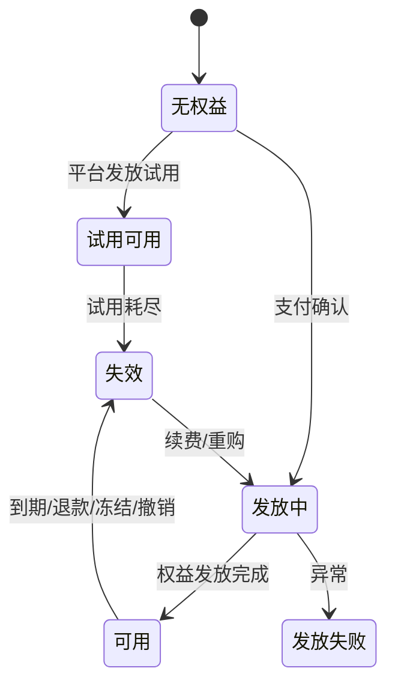

这是根据官方产品能力和前端枚举重建的**概念状态图**，不宣称数据库里完全采用这些状态或所有迁移均可由消费者发起。

另外：免费试用如开启至少 5 次，以支持多轮完成一次完整体验；更新商品不重置剩余试用次数。因此“5 次试用”不能简单宣传成“5 个完整任务”，对话轮次/保护调用次数和最终业务任务不是一一对应的。

前端创建对象可见 `includedQuota` 默认值（买断 1、月 1000、其他周期 12000），但没有得到公开后端约束和完整套餐说明支持，**不能把这些默认值写成面向用户承诺的每月调用上限，也不能写订阅不限次数**。消费者枚举包含按量付费只是兼容状态模型，不能据此宣布当前 Skill 上架已全面支持次数包。

来源：[更新日志](https://skillpay.alipay.com/changelog)、[上架页](https://skillpay.alipay.com/creator/product-new)、[消费者界面代码](https://gw.alipayobjects.com/render/p/yuyan/180020010001296536/_astro/skills.astro_astro_type_script_index_0_lang.BOVz05QN.js)、[创建对象代码](https://gw.alipayobjects.com/render/p/yuyan/180020010001296536/_astro/ProductListingForm.astro_astro_type_script_index_0_lang.DP7r4ow0.js)。

### 七、钱包授权与商品订阅是两种不同的权限

- 商品订阅决定 SkillPay 是否给这个消费者开放该商品能力。
- 钱包开通/授权决定 Agent 能否通过支付宝支付工具发起符合条件的支付。
- 支付凭证证明一笔交易的支付结果；它不应该自动变成另一个商品的长期访问权。
- 第一次购买可把钱包绑定和付款放在一次流程里；不等于后续所有消费都不需要任何确认，更不等于订阅会自动续费。

9/10 更新日志只证明首次支付流程合并绑定、扫码后能自动确认继续安装。具体哪些金额或风控条件下可后续直接扣款、是否有额度策略，应由 Agent 支付/MachinePay 文档单独说明；**不能只凭 SkillPay 博客推断“首次扫码后无限免密”。**

来源：[更新日志](https://skillpay.alipay.com/changelog)、[官方钱包认证 Skill](https://github.com/alipay/payment-skills/blob/main/alipay-authenticate-wallet/SKILL.md)。

### 八、SkillPay 平台做什么，作者和支付底座做什么

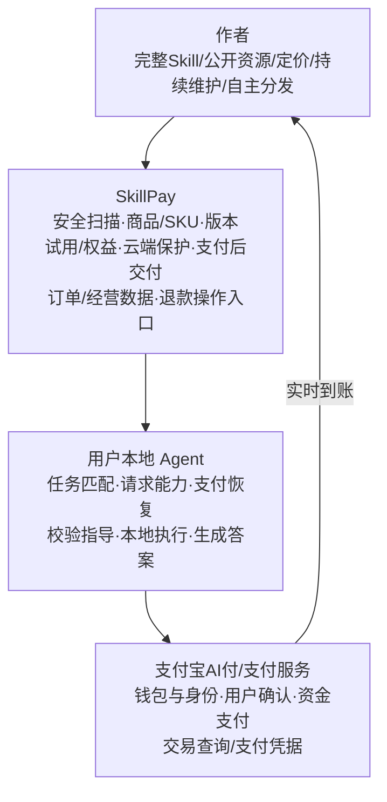

官网 FAQ 明确：支付成功款项实时进入作者支付宝账户，不经 SkillPay 中转，不等待结算。退款先与作者协商，由作者在商品页面手动发起；周期订单整单全额退款。9/29 新上传商品须补即刻收协议以支持网页支付兜底。这些是资金/操作事实，**不意味着平台免费，也不意味着没有支付通道手续费、技术服务费或未来抽佣**；本次公开证据没有统一费率与合同条款正文。

公开 JS 还出现消费者退款申请、作者退款审核的路由，这是客户端能力线索；没有登录操作，不能据此保证所有用户当前都开放该入口或与 FAQ 完全一致。流程呈现应以官网可见说明为主，细节差异留在备注。

来源：[官网 FAQ](https://skillpay.alipay.com/)、[官方商业循环图](https://gw.alipayobjects.com/render/p/yuyan/180020010001296536/assets/skillpay-technical-report/05-business-model.svg)、[更新日志](https://skillpay.alipay.com/changelog)、[退款前端代码](https://gw.alipayobjects.com/render/p/yuyan/180020010001296536/_astro/skillpay-refund-api.BxuNVKw_.js)。

### 九、公开证据尚未回答的问题

| 问题 | 当前能说到哪里 | 不宜写进 PPT 的确定性说法 |
|---|---|---|
| paymentProof 如何编码和验签 | 官方消费侧要求不得复用，支付后用于恢复请求 | “必定是 JWT/买家私钥签名/链上收据” |
| 权益绑定用户、设备还是 Agent | 前端有消费者可用状态，官方 CLI 有买家不匹配错误 | “授权只绑定设备”“换 Agent 必须重买” |
| 下载 URL TTL、防盗链 | 管理端有源包/支付集成包地址，未读取具体受控包 | “永久地址”“一次性地址”“自动加密解密” |
| 到期时已输出内容怎么收回 | 后续云调用可受权益校验 | “能收回已下载文件/已披露文本” |
| 退款与已交付买断文件 | 作者可退款，文件已交付 | “退款自动删除用户本地文件” |
| 免费试用的精确计数点 | 官方说至少 5 次、多轮体验、不因更新重置 | “每一个完整任务只计一次” |
| 云保护所用模型/后端/沙箱 | 官方只披露输入/执行文本/本地执行架构 | “平台在专属容器执行用户全部脚本” |
| 服务端幂等与崩溃恢复 | CLI 保留原请求与本轮句柄，可查询恢复 | “网络重试绝不重复扣款/端到端 exactly once” |
| 手续费/抽佣/GMV/付费用户 | 未找到统一公开费率/经营大盘 | “零费率”“全额无手续费到账”“已成熟高渗透” |

### 十、适合 PPT 的最小表达

建议至少给 SkillPay 一整页，图比概念卡片更有帮助：

**主标题：SkillPay 把 Skill 文件变成商品：同一次 402 握手，付款后走两种履约。**

上半：作者上传/审核 → 分享入口 → Agent 原请求 → 402 → 用户确认/支付宝支付 → 凭据恢复 → 平台验权益。

下半分叉：

- 买断：完整源文件 → 本地永久使用 → 可下载全部版本。
- 订阅：云端原文 → 任务专用指导 → 本地校验/执行 → 到期停用/手动续费。

图中必须标注：云端保护不运行脚本、不计算答案；周期订阅不自动续费；钱直接到作者支付宝；402/支付凭据与商品使用权不是同一个对象。

如总共四页，可用第二页专讲受保护调用图；如果 SkillPay 只有一页，把支付握手留给两产品共用页，SkillPay 页重点讲“原文在哪里、谁来执行、为何到期还能控制后续调用”。

### 来源与本地原始材料

#### 产品与博客

- https://skillpay.alipay.com/
- https://skillpay.alipay.com/blog/good-world-skills-get-paid （2026-08-13，最核心技术说明）
- https://skillpay.alipay.com/blog/skill-is-agent-learned-craft （2026-08-31，已有 Skill 作者、社群分发、持续更新的生态定位）
- https://skillpay.alipay.com/blog/how-to-build-a-good-skill （2026-09-04，Skill 内部方法/资源/脚本分层，不提供支付协议字段）
- https://skillpay.alipay.com/changelog （本次可见最新 v0.8，2026-09-29）
- https://skillpay.alipay.com/creator/product-new
- https://skillpay.alipay.com/creator/authorizations
- https://skillpay.alipay.com/user/skills

#### 官方图（各 SVG 已保存，本次以 XML 文本核对，不下载/运行商品资源）

前缀 `https://gw.alipayobjects.com/render/p/yuyan/180020010001296536/assets/skillpay-technical-report/`：

- `02-402-sequence.svg`
- `03-cloud-protection.svg`
- `04-defense.svg`
- `05-business-model.svg`

#### 官方公开前端（是客户端契约，不是后端源码）

前缀 `https://gw.alipayobjects.com/render/p/yuyan/180020010001296536/_astro/`：

- `ProductListingForm.astro_astro_type_script_index_0_lang.DP7r4ow0.js` — 上传/检查、商品创建、定价方案、免费试用设置；查找 `Vr`、`Hr`、`trialTimes`、`includedQuota`。
- `ais-admin-api.BOG1XLQg.js` — 商品映射与 API 路由；查找 `source_skills`、`desc_skills`、`/skill/createProduct.json`、`/skill/submitForReview.json`。
- `product-share-card.BwTd9cPe.js` — merchant/product 绑定的分享链接；查找 `function M`。
- `product-purchase-command.C8MHVPbR.js` — 购买指令由服务端提供；查找 `latestPurchaseCommand`。
- `consumer-api.gLakm1y9.js` — 个人权益/商品详情/订单读取路由。
- `skills.astro_astro_type_script_index_0_lang.BOVz05QN.js` — 可用性、权益枚举、额度、有效期；查找 `EXPIRED`、`usable`、`validUntil`。
- `skillpay-refund-api.BxuNVKw_.js` — 退款申请/作者审核前端路由。

#### 官方 Agent 支付仓库

- https://github.com/alipay/payment-skills
- https://github.com/alipay/payment-skills/blob/main/alipay-payment-skill/references/402-payment.md
- https://github.com/alipay/payment-skills/blob/main/alipay-authenticate-wallet/SKILL.md

本地材料目录：`sources/skillpay/`。静态页面、公开脚本、官方 SVG 和 Agent 规则均有快照；技术页面可能更新，哈希与抓取时间见 `source-manifest.json`。

## 二、MachinePay：报价、付款、验付、履约与恢复


调研日期：2026-10-20。只读分析公开产品页、接口文档与支付宝官方源码；没有开通账户、签约、调用付费资源、下单、支付或安装。范围是支付宝中国大陆人民币 AI 按量付费实现，不能用同名学术 A402、通用 x402 或 MPP 替代。

### 1. 核心判断

**它给 HTTP API 加上一层“可机器读取的报价 → 支付 → 验票交付”机制。商户并不把一个普通签名当作钱；需要拿付款凭证去支付宝在线验证，再把验得的金额、订单和资源与本地业务订单对齐。**

官方接入指南的三项商户工作是：无有效凭证时返回 402/Payment-Needed；读取 Payment-Proof 后调用 `alipay.aipay.agent.payment.verify`；履约后调用 `alipay.aipay.agent.fulfillment.confirm`。流程是先支付取得证明再重试资源，不是客户端只授权、等资源算完后才通过 `/settle` 扣款。[接入指南](https://aipay.alipay.com/docs/ai-receive/MACHINE_PAY.html)

**产品页图示与人民币实现存在实质差异。** 产品页嵌入 Mermaid 使用“支付载荷 → /verify → 执行业务 → /settle → 交易哈希”的通用支付辅助方图。人民币开发契约明确限定的是上述两个支付宝 OpenAPI，没有 `/settle` 或交易哈希字段，不能混写。[产品页](https://aipay.alipay.com/products/machine-pay)；[官方实现契约第 11–25 行](https://github.com/alipay/ai/blob/c4a6d8d58b906bc77e2d88a0adbc0b64e34560a5/skills/alipay-aipay/references/integration/modules/interface-contract/aipay-interface-contract.md#L11)

### 2. 接入前究竟注册了什么

1. 商家/服务商开通相应产品，创建自研应用；平台代商家调用可用第三方应用并传 `app_auth_token`。这里的应用私钥属于应用持有人，不交给买方 Agent。正式可用还取决于签约、应用与服务各自状态，提交申请不等于已生效。[官方接入指南](https://aipay.alipay.com/docs/ai-receive/MACHINE_PAY.html)；[官方签约模块](https://github.com/alipay/ai/blob/c4a6d8d58b906bc77e2d88a0adbc0b64e34560a5/skills/alipay-aipay/references/onboarding/modules/product-sign.md)
2. 注册服务信息得到 `service_id`。官方服务登记工具保存五项：名称、描述、资源 URL、元/次单价、请求示例 JSON。其中 `schemaUrl` 在当前实现承载 JSON 示例，不是 schema 网页地址。服务登记通过 `a2a-pay-service.saveBazaarServiceForMcp`，查询通过 `discoverBazaarServicesForMcp`。当前脚本创建上限 10 个、最低单价 0.01 元是**该版本接入工具的约束**，不宜泛化为所有渠道永恒产品限制。[服务登记语义第 13–40 行](https://github.com/alipay/ai/blob/c4a6d8d58b906bc77e2d88a0adbc0b64e34560a5/skills/alipay-aipay/references/onboarding/modules/service-registration.md#L13)；[服务登记实现](https://github.com/alipay/ai/blob/c4a6d8d58b906bc77e2d88a0adbc0b64e34560a5/skills/alipay-aipay/references/onboarding/modules/scripts/service.sh)
3. `service_id` 在资料审核成功后生效。它识别“哪项已登记服务”，不等于每次交易订单、资源实例、用户权益，也不是密钥。[官方 FAQ Q2](https://ideservice.alipay.com/cms/site/0j7uos)

**三个 ID 必须分清：** `service_id` 是登记的服务；`out_trade_no` 是商户为本次业务生成的外部订单/幂等号；`trade_no` 是支付后支付宝侧的交易流水。`resource_id` 是商户定义的具体收费资源绑定键。[账单及验付接口](https://ideservice.alipay.com/cms/site/0j7uot)；[官方示例 Controller 第 140–180 行](https://github.com/alipay/ai/blob/c4a6d8d58b906bc77e2d88a0adbc0b64e34560a5/code_example/aipay-402-example/A2MPaymentDemoController.java#L140)

**未披露的边界：** 可以证明登记保存了 URL 与价格，可以证明每单签名也包含价格、service_id 和 resource_id；公开代码不能证明支付宝支付服务在每笔交易中如何强制校验登记价格与动态报价一致，或把 HTTP 方法/body 全量绑定到服务。不要把“登记过”画成平台对任意业务参数的自动担保。

### 3. 逐跳解释一次交易

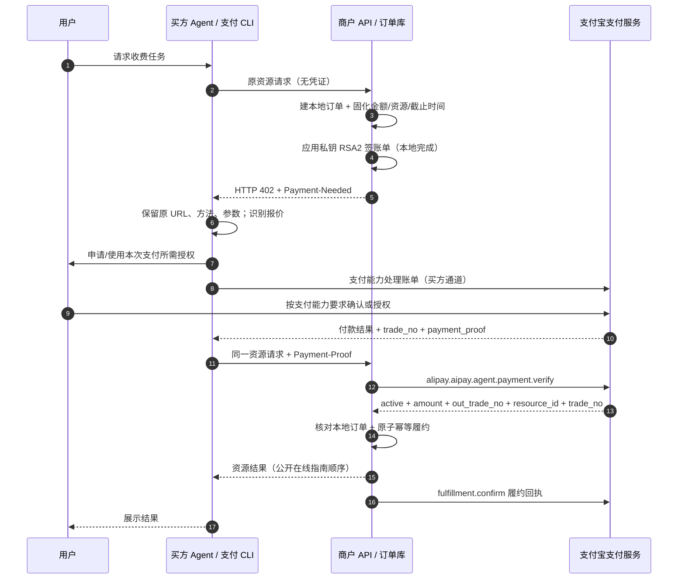

图中采用在线指南的“交付后异步回执”主流程。当前官方代码生成模板另有更严格顺序：先持久化资源结果为 `PENDING_CONFIRM` → 回执成功 → 标记 `FULFILLED` → 返回资源。两者都先支付后商户执行；**回执不是第二次扣款 API**。应在 PPT 主图标“履约 + 回执”，旁注两种交付时序，以免混成一个承诺。[在线指南](https://aipay.alipay.com/docs/ai-receive/MACHINE_PAY.html)；[当前 Node 模板第 378–416 行](https://github.com/alipay/ai/blob/c4a6d8d58b906bc77e2d88a0adbc0b64e34560a5/skills/alipay-aipay/references/integration/modules/code-examples/nodejs/4-%E6%8C%89%E9%87%8F%E4%BB%98%E8%B4%B9/A2MPaymentDemo.md#L378)

#### 第一次 402 不是“已经扣款”

商户构造本地订单和签名报价，**签名环节不调用支付宝 OpenAPI**。因此拿到 Payment-Needed 本身不能证明用户已付款。字段分两层：

- `protocol`：外部订单、金额、CNY、资源 ID、付款截止、签名与算法、卖家唯一 ID。
- `method`：卖家名称、2088 卖家 ID、应用 ID、商品名、`service_id` 等支付宝方法信息。

Base64URL 只负责 Header 可传输编码，不是加密，更不是支付凭证。[官方账单实现](https://github.com/alipay/ai/blob/c4a6d8d58b906bc77e2d88a0adbc0b64e34560a5/code_example/aipay-402-example/A2MPaymentDemoController.java#L174)

#### 第二次请求才有可在线验的票

Payment-Proof Header 解码得到 `protocol.payment_proof`、`protocol.trade_no` 和可选 `method.client_session`。payment_proof 在公开接口是 64 字符不透明凭证；没有公开协议可证明它是用户能本地合成的 JWT、链上 hash，或商户只用支付宝公钥离线验一下即可放行。商户调用 verify，将证明和交易号交给支付宝，验证支付状态、商户归属等。[verify 完整接口](https://ideservice.alipay.com/cms/site/0j7uot)

### 4. 两条信任链，而不是一个“万能签名”


商户账单签名的 8 项为 `amount,currency,goods_name,out_trade_no,pay_before,resource_id,seller_id,service_id`，按 key 字典序拼成 `key=value&...` 后 RSA2 签名。签名使这些报价字段成为一个不可随意拆改的整体；它不自动绑定请求 body，也不保证业务结果质量。签名校验在支付通道内部的细节、具体验签公钥查找策略，公开买方/PSP 实现未完全披露，不能猜成 Agent 本地验签。[签名源码](https://github.com/alipay/ai/blob/c4a6d8d58b906bc77e2d88a0adbc0b64e34560a5/code_example/aipay-402-example/A2MPaymentDemoController.java#L535)

调用 verify 又是另一套 OpenAPI 请求签名：商户应用凭私钥证明调用身份，SDK 配置支付宝公钥核验响应。第三方模式应用私钥来自服务商，且代调用需要商户授权；不是买家把商户私钥拿去付款。[官方指南](https://aipay.alipay.com/docs/ai-receive/MACHINE_PAY.html)；[Controller SDK 初始化](https://github.com/alipay/ai/blob/c4a6d8d58b906bc77e2d88a0adbc0b64e34560a5/code_example/aipay-402-example/A2MPaymentDemoController.java#L90)

**支付宝确认“这票真付了”，商户还要确认“这票买的是此单此物，而且没有重复交付”。** verify 响应含 `active`、金额、外部订单、资源、交易号；官方要求全部对齐本地账。`active=true` 不是跨资源访问授权，也不能替代数据库并发控制。错误码表有未支付、已关闭、买家不符、商户不符、交易号不符、凭证过期/不存在、凭证已使用/失效等；它没有公开每一步内部消耗凭证的精确状态转移，不能声称 verify 一次就必然消耗，或 confirm 才消耗。[verify 业务响应及错误码](https://ideservice.alipay.com/cms/site/0j7uot)

### 5. 为什么平台有验票，商户还得做幂等

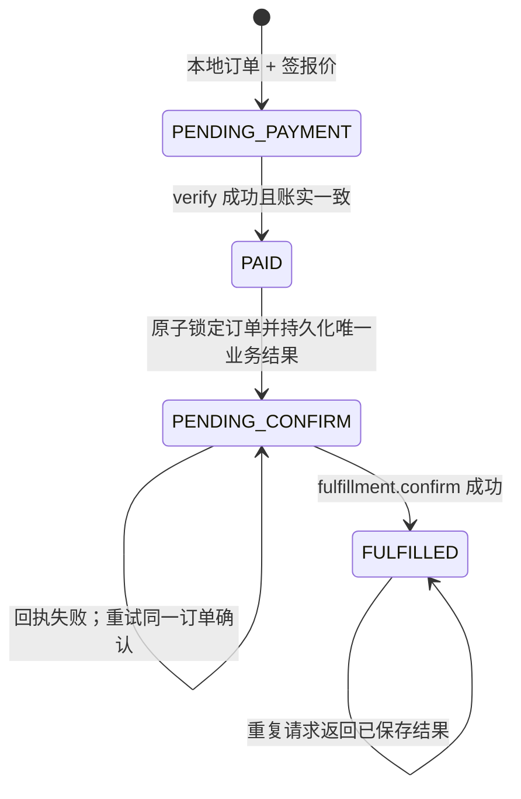

这是**当前官方模板预期、由商户补齐持久化端口**的状态机，不是支付宝后台内部状态机。Node 模板要求真实数据库实现 `createPending/findByOutTradeNo/prepareFulfillment/markFulfilled`；未配置直接失败，明确不回退内存订单。旧 Controller 中订单保存、防串、防重放大段只是注释示意。不能拿旧样例宣称复制即有生产安全。[Node 持久化端口第 50–66 行](https://github.com/alipay/ai/blob/c4a6d8d58b906bc77e2d88a0adbc0b64e34560a5/skills/alipay-aipay/references/integration/modules/code-examples/nodejs/4-%E6%8C%89%E9%87%8F%E4%BB%98%E8%B4%B9/A2MPaymentDemo.md#L50)

两个 Agent 同时持同一票请求，在线验付都可能在商户落库前成功。为避免启动两次图像生成/第三方付费调用，商户必须使用唯一约束、事务或等价并发机制，让一次订单只产生一个结果，并在重试时返该结果。**这是由接口与模板责任边界推导的工程要求**；支付宝没公开其 verify 对并发的完整保证，不能依赖一次状态字段替代本地原子性。

资源绑定也需要商户补齐：示例 `resource_id=/demo/a2m/resource` 只是路径。如果同一路径接不同提示词、文档、模型或计算量，单凭路径不能证明“此票购买了当前 body”。建议本地订单固化规范化方法/URL/请求体摘要/数量/版本并核对；该摘要不是当前公开 A402 自动替商户生成的字段。

### 6. 最容易讲错的六处

| 问题 | 结论 | 依据/限制 |
|---|---|---|
| amount 是分还是元？ | 当前官方源码和接入文档明确 **元**，`0.01 CNY=0.01 元` | 在线网页字段表写“最小货币单位”有矛盾；不得据此把 0.01 当分。Controller 第 141 行、A2M 文档第 138/339 行、服务单价校验都证实元 |
| client_session 是否永远必填？ | verify 参数表和最新契约标**可选**；存在时原样透传；某 CLI 通道可能要求 | 接口同时列 CLIENT_SESSION_IS_EMPTY；不能简化成所有模式可忽略或所有模式绝对必填 |
| pay_before 是付款截止还是票失效？ | 网页定义付款截止；当前模板还将首次进入履约前未过期作为本地订单条件 | 已 PENDING_CONFIRM/FULFILLED 允许重试同一结果；不能推导到账自动退款、付款之后平台凭证立刻失效 |
| fulfillment.confirm 就是扣款/结算吗？ | 公共 API 定义是商家履约回执，业务参数只有 trade_no | 未公开资金释放条件、结算账期；不等同 /settle、不证明托管/担保交付 |
| active=true 能省略本地账吗？ | 不能；还须金额、订单、资源、交易号一致及防重复履约 | 当前代码模板显式要求数据库持久化 |
| 商户执行失败自动退款吗？ | 没有查到 MachinePay 专用自动退款契约 | 支付已成功、业务失败是分布式一致性问题；应保存订单恢复/售后，不能直接画自动回滚或自动重付 |

单位来源：[官方 Java 示例第 141 行](https://github.com/alipay/ai/blob/c4a6d8d58b906bc77e2d88a0adbc0b64e34560a5/code_example/aipay-402-example/A2MPaymentDemoController.java#L141)；[官方 A2M 文档](https://github.com/alipay/ai/blob/c4a6d8d58b906bc77e2d88a0adbc0b64e34560a5/code_example/aipay-402-example/A2M%E6%99%BA%E8%83%BD%E6%94%B6%E4%BA%A7%E5%93%81%E5%AF%B9%E6%8E%A5%E6%96%87%E6%A1%A3.md)；[最新实现契约](https://github.com/alipay/ai/blob/c4a6d8d58b906bc77e2d88a0adbc0b64e34560a5/skills/alipay-aipay/references/integration/modules/interface-contract/aipay-interface-contract.md#L27)

### 7. 异常恢复该怎样理解

- **未付/账单过期**：没有可交付凭证，应重新取得有效报价或查询订单。不能把旧签名改个时间续期。
- **已付，原资源请求超时**：先使用同一交易与本地订单恢复或查结果，不能直接再生新订单要求付一次。
- **业务已生成，confirm 失败**：当前模板保存 PENDING_CONFIRM，返回 502 `FULFILLMENT_CONFIRM_FAILED`；允许同一 Payment-Proof 重试确认，不再生成资源。
- **confirm 成功、客户端没收到 200**：当前模板记录 FULFILLED，重复请求应返回已存结果。它仍会走线上验票；平台凭证状态如何影响后续重复访问没有完整公开，因此商户应设计可核验的订单恢复通道。
- **业务确实失败**：需要补偿、恢复或售后处理。公开资料不足以给出专用自动退款算法、交易原子回滚或资金保管承诺。

以上是读取官方模板后的行为与工程推论；不是本次真实交易测试。当前模板的首次履约截止检查也意味着“支付完成但首次请求晚到”可能被本地拒绝，应在商户方案中明确恢复/售后政策。[Node 模板](https://github.com/alipay/ai/blob/c4a6d8d58b906bc77e2d88a0adbc0b64e34560a5/skills/alipay-aipay/references/integration/modules/code-examples/nodejs/4-%E6%8C%89%E9%87%8F%E4%BB%98%E8%B4%B9/A2MPaymentDemo.md#L370)

补充接口事实：`fulfillment.confirm` 的 `TRADE_STATUS_INVALID` 错误解释含“用户已经先行履约完成或交易已关闭”。这说明不能将“同单重试确认”讲成后端必定无条件返回成功；买方先行回执、商户回执与关闭状态如何仲裁，需要按真实响应处理。公开文档没有说明所有重复确认何时被视为幂等成功，模板的确认失败恢复路径也不能替代生产核验。[最新确认接口](https://aipay.alipay.com/docs/ai-receive/api-list/alipay-aipay-agent-fulfillment-confirm.md)

#### 另一份官方组织示例为何会不同

`antgroup/ACT` 的支付宝卖方映射示例明确：相同未支付请求复用账单；只在 verify 明确 inactive 才发新 402；关联不一致先返回冲突并对账；已验有效且关联一致的付款不因原付款截止已过拒绝交付；交付后异步 confirm。这与 `alipay/ai` 接入模板的首次履约截止检查、确认后再返回结果不同。其定位是 ACT 到支付宝的集成示例，使用内存存储，作者明确不能称生产实现。**因此 PPT 应解释稳定的支付协议与业务安全原则，把截止/重试/回执顺序标为实现政策，不能把任何一套模板说成支付宝支付后台强制协议。** [ACT 卖方 Java 官方组织示例](https://github.com/antgroup/ACT/blob/main/integrations/alipay/seller-java/README.md#L246)

该 ACT 示例要求价格 0.01–50.00 CNY、最多两位小数，与后台登记 service_id 单价一致，同时承认本地代码无法核验后台登记。它提供的是集成边界提示，并不足以独立证明所有 MachinePay 接入渠道的额度、定价或 PSP 后端执行规则。

### 8. 与其他 Header / 协议的边界

- **Payment-Needed**：当前人民币卖方标准主链路的机器账单。**Payment-Proof**：付款后买方重试时的凭证。**Payment-Validation**：部分官方示例 200 响应的验付结果说明，不是另一次付款凭证。
- `amtPaymentLink`：买方 CLI 兼容的支付宝支付链接路径；不是当前卖方 A402 接入契约要求的账单字段。其后端机制需另查买方 CLI，不能仅凭参数名当成另一种支付协议。
- `Payment-Authorization`：当前 MachinePay 公开人民币契约与官方示例没有把该 Header 作为主流程。不要把它替换为 Payment-Proof，也不要与 MPP 的 `Authorization: Payment` 混用。
- ACT 2.1 的 A402 是更通用的买方、卖方、支付服务方交互规范；支付宝的 protocol/method JSON、service_id、verify/confirm 是具体实现。ACT 还区分实时确认、委托授权、限定自主支付；A402 本身不授予无限支付授权。[ACT 官方接入说明](https://github.com/antgroup/ACT/blob/main/integrations/alipay/a402.md)

### 9. 一到两页图示建议

**原理主图**：四泳道“用户 / Agent+支付宝 CLI / 商户 API+订单库 / 支付宝”；红色画 402 报价、蓝色画付款与凭证、灰色画核对/幂等/回执。中间突出三句话：报价≠付款；支付宝验真≠此单可交付；履约回执≠第二次扣款。

**难点页或报告侧栏**：画双层账本：支付宝交易账（trade_no、payment_proof、已付/有效）与商户业务账（out_trade_no、resource_id、价格、结果、履约状态）在 verify 返回后核对；下方画 PENDING_CONFIRM 的断线重试闭环。再用小表指出产品页 /settle 通用示意与人民币 API 的差异。

### 10. 证据版本与未解决问题

官方源码快照：`alipay/ai` commit `c4a6d8d58b906bc77e2d88a0adbc0b64e34560a5`，commit 日期 2026-09-23，标题 alipay-aipay v1.7.0。网页接入指南显示更新时间 2026-10-09 23:11:32。不能简单按“网页晚于 commit”就把源码具体安全要求否定；本报告分别说明网页业务主流程与模板实现策略。

未解决/未公开：生产买方实际扣款 API 的完整验签与风控内部流程；service_id 登记价格是否逐笔强校验；payment_proof 的完整签发、吊销与消耗状态机；各接入渠道的个人主体资格与完整审核要求；正式费率、资金释放/结算周期、自动退款/争议保障契约。产品页的“自动结算/无需人工干预”只能表示其产品主张，不能代替交易授权与结算合同细节。

原始材料位于 `sources/machinepay/`；`product.html` 是当前完整网页，`integration.md/verify.md/faq.md` 为官方文档原文，`alipay-ai/` 是只读检索用公开仓库快照。

## 三、必须分开的四种“成功”

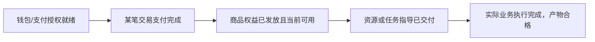

这张图表达逻辑检查层次，并不规定所有产品都必须新发一份订阅权益。MachinePay 的一笔资源交易通常直接对齐商户本地订单；SkillPay 则常要维护买断或周期权益。钱包授权不能代替商品权益，支付证明不能代替任务产物。

### 为什么要记住原请求

支付系统记录钱付给谁、哪笔交易；Agent 任务还包含 HTTP 方法、URL、请求体、业务 Header 和上下文。若只保留交易号、丢失原 POST 输入，钱虽然付了，应用也未必知道该恢复哪一次生成或查询。因此恢复机制必须跨过“支付交易”和“业务任务”两类状态。此处是对公开恢复参数与模板接口的工程解释。

### 为什么 Base64URL 不等于加密或验真

Payment-Needed / Payment-Proof 的 Base64URL 是传输封装。可解码并不意味着字段可信或支付完成。报价由商户签名；不透明 payment_proof 交支付宝在线验证；商户再校验自己的业务关联。不能把它们统称为“一段能开所有门的 token”。

### 为什么一次验票不能替代业务幂等

验付和执行业务之间仍有应用层并发、数据库提交和进程故障窗口。即使两次请求拿着同一笔真实支付，商户也要确保只生成一个付费结果，并将结果和回执状态持久保存。下游带副作用的任务还需要可重用的业务幂等键；这些约束不由一个 HTTP 状态码自动完成。

## 四、官方材料中的差异，怎样取舍

| 分歧 | 本次处理 |
|---|---|
| MachinePay 产品页通用 /verify、/settle、交易哈希图，与人民币接入指南不同 | PPT 采用实际人民币 payment.verify / fulfillment.confirm API，不把通用图当作可执行协议 |
| amount 网页写“最小货币单位”，官方专门文档与代码写元 | 讲原理不换算真实账单；示例 0.01 CNY 按当前官方代码为 0.01 元。落地应核对当前通道接口，不把文案矛盾隐去 |
| client_session 参数表可选，但部分错误码要求 | 存在则原样透传，按通道和错误处理；不承诺所有模式必填或都可忽略 |
| 在线指南先交付后异步回执，当前 alipay/ai 模板先确认再返结果 | 时序页采用在线指南并脚注；恢复页明确采用模板的本地状态抽象，不声称是支付宝内部状态机 |
| 首次履约超时策略在 alipay/ai 模板与 antgroup/ACT 集成例中不同 | 作为接入策略差异，不将 pay_before 解释为支付后自动退款或资金失效 |
| SkillPay llms 索引与当前站点不完全对应 | 用当前博客、上架/FAQ/更新日志和公开前端核实商品平台；不把传统生活供给 SkillPay 接入泛化到 Skill 文件商品 |

## 五、证据与交付范围

- 主稿：`../gpt-alipay-research.pptx`
- 离线 HTML：`../gpt-alipay-research.html`
- [SkillPay 专题原始报告](research-skillpay.md)
- [MachinePay 专题原始报告](research-machinepay.md)
- `sources/skillpay/` 保存官方网页、公开 JavaScript、架构 SVG 和官方消费侧规则。
- `sources/machinepay/` 保存产品/接入/API 文档与固定版本官方代码。主代码快照为 `alipay/ai` commit `c4a6d8d58b906bc77e2d88a0adbc0b64e34560a5`；其他示例的来源及版本另列。
- `source-inventory.json` 记录全部源文件的大小与 SHA256；各专题的来源清单记录原 URL。

未登录、安装、签约、授权、创建订单、访问商品购买 CT 或实际付款，也没有以沙箱测试冒充生产验证。闭源钱包扣款内部 API、凭证内部消耗状态、SkillPay 精确权益绑定、后台幂等/崩溃恢复、统一费率和 GMV 没有充分公开证据。报告没有用猜测填补这些环节。
