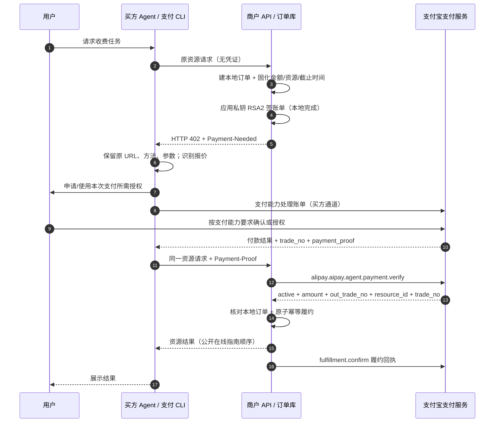
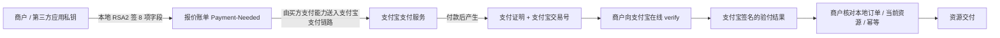
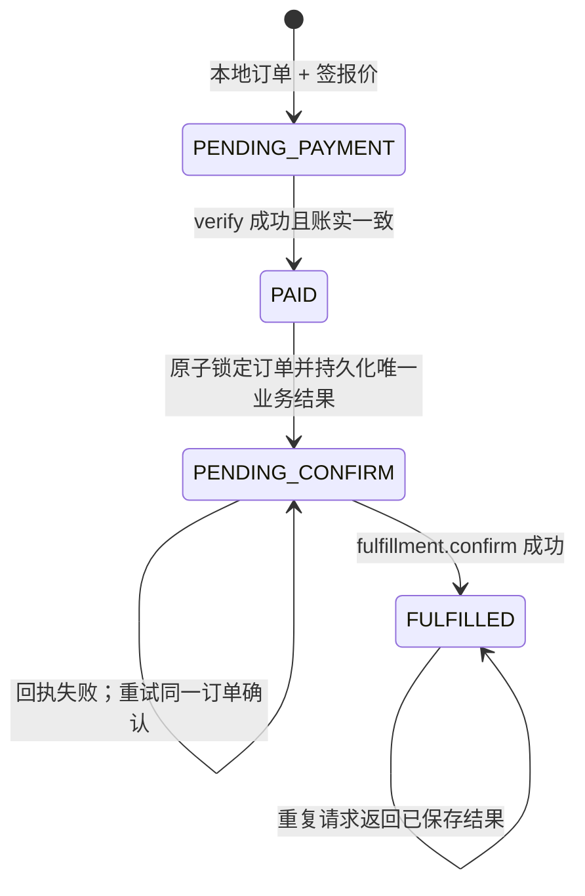

# Machine Pay 人民币 A402 原理剖析

调研日期：2026-10-20。只读分析公开产品页、接口文档与支付宝官方源码；没有开通账户、签约、调用付费资源、下单、支付或安装。范围是支付宝中国大陆人民币 AI 按量付费实现，不能用同名学术 A402、通用 x402 或 MPP 替代。

## 1. 核心判断

**它给 HTTP API 加上一层“可机器读取的报价 → 支付 → 验票交付”机制。商户并不把一个普通签名当作钱；需要拿付款凭证去支付宝在线验证，再把验得的金额、订单和资源与本地业务订单对齐。**

官方接入指南的三项商户工作是：无有效凭证时返回 402/Payment-Needed；读取 Payment-Proof 后调用 `alipay.aipay.agent.payment.verify`；履约后调用 `alipay.aipay.agent.fulfillment.confirm`。流程是先支付取得证明再重试资源，不是客户端只授权、等资源算完后才通过 `/settle` 扣款。[接入指南](https://aipay.alipay.com/docs/ai-receive/MACHINE_PAY.html)

**产品页图示与人民币实现存在实质差异。** 产品页嵌入 Mermaid 使用“支付载荷 → /verify → 执行业务 → /settle → 交易哈希”的通用支付辅助方图。人民币开发契约明确限定的是上述两个支付宝 OpenAPI，没有 `/settle` 或交易哈希字段，不能混写。[产品页](https://aipay.alipay.com/products/machine-pay)；[官方实现契约第 11–25 行](https://github.com/alipay/ai/blob/c4a6d8d58b906bc77e2d88a0adbc0b64e34560a5/skills/alipay-aipay/references/integration/modules/interface-contract/aipay-interface-contract.md#L11)

## 2. 接入前究竟注册了什么

1. 商家/服务商开通相应产品，创建自研应用；平台代商家调用可用第三方应用并传 `app_auth_token`。这里的应用私钥属于应用持有人，不交给买方 Agent。正式可用还取决于签约、应用与服务各自状态，提交申请不等于已生效。[官方接入指南](https://aipay.alipay.com/docs/ai-receive/MACHINE_PAY.html)；[官方签约模块](https://github.com/alipay/ai/blob/c4a6d8d58b906bc77e2d88a0adbc0b64e34560a5/skills/alipay-aipay/references/onboarding/modules/product-sign.md)
2. 注册服务信息得到 `service_id`。官方服务登记工具保存五项：名称、描述、资源 URL、元/次单价、请求示例 JSON。其中 `schemaUrl` 在当前实现承载 JSON 示例，不是 schema 网页地址。服务登记通过 `a2a-pay-service.saveBazaarServiceForMcp`，查询通过 `discoverBazaarServicesForMcp`。当前脚本创建上限 10 个、最低单价 0.01 元是**该版本接入工具的约束**，不宜泛化为所有渠道永恒产品限制。[服务登记语义第 13–40 行](https://github.com/alipay/ai/blob/c4a6d8d58b906bc77e2d88a0adbc0b64e34560a5/skills/alipay-aipay/references/onboarding/modules/service-registration.md#L13)；[服务登记实现](https://github.com/alipay/ai/blob/c4a6d8d58b906bc77e2d88a0adbc0b64e34560a5/skills/alipay-aipay/references/onboarding/modules/scripts/service.sh)
3. `service_id` 在资料审核成功后生效。它识别“哪项已登记服务”，不等于每次交易订单、资源实例、用户权益，也不是密钥。[官方 FAQ Q2](https://ideservice.alipay.com/cms/site/0j7uos)

**三个 ID 必须分清：** `service_id` 是登记的服务；`out_trade_no` 是商户为本次业务生成的外部订单/幂等号；`trade_no` 是支付后支付宝侧的交易流水。`resource_id` 是商户定义的具体收费资源绑定键。[账单及验付接口](https://ideservice.alipay.com/cms/site/0j7uot)；[官方示例 Controller 第 140–180 行](https://github.com/alipay/ai/blob/c4a6d8d58b906bc77e2d88a0adbc0b64e34560a5/code_example/aipay-402-example/A2MPaymentDemoController.java#L140)

**未披露的边界：** 可以证明登记保存了 URL 与价格，可以证明每单签名也包含价格、service_id 和 resource_id；公开代码不能证明支付宝支付服务在每笔交易中如何强制校验登记价格与动态报价一致，或把 HTTP 方法/body 全量绑定到服务。不要把“登记过”画成平台对任意业务参数的自动担保。

## 3. 逐跳解释一次交易

图中采用在线指南的“交付后异步回执”主流程。当前官方代码生成模板另有更严格顺序：先持久化资源结果为 `PENDING_CONFIRM` → 回执成功 → 标记 `FULFILLED` → 返回资源。两者都先支付后商户执行；**回执不是第二次扣款 API**。应在 PPT 主图标“履约 + 回执”，旁注两种交付时序，以免混成一个承诺。[在线指南](https://aipay.alipay.com/docs/ai-receive/MACHINE_PAY.html)；[当前 Node 模板第 378–416 行](https://github.com/alipay/ai/blob/c4a6d8d58b906bc77e2d88a0adbc0b64e34560a5/skills/alipay-aipay/references/integration/modules/code-examples/nodejs/4-%E6%8C%89%E9%87%8F%E4%BB%98%E8%B4%B9/A2MPaymentDemo.md#L378)

### 第一次 402 不是“已经扣款”

商户构造本地订单和签名报价，**签名环节不调用支付宝 OpenAPI**。因此拿到 Payment-Needed 本身不能证明用户已付款。字段分两层：

- `protocol`：外部订单、金额、CNY、资源 ID、付款截止、签名与算法、卖家唯一 ID。
- `method`：卖家名称、2088 卖家 ID、应用 ID、商品名、`service_id` 等支付宝方法信息。

Base64URL 只负责 Header 可传输编码，不是加密，更不是支付凭证。[官方账单实现](https://github.com/alipay/ai/blob/c4a6d8d58b906bc77e2d88a0adbc0b64e34560a5/code_example/aipay-402-example/A2MPaymentDemoController.java#L174)

### 第二次请求才有可在线验的票

Payment-Proof Header 解码得到 `protocol.payment_proof`、`protocol.trade_no` 和可选 `method.client_session`。payment_proof 在公开接口是 64 字符不透明凭证；没有公开协议可证明它是用户能本地合成的 JWT、链上 hash，或商户只用支付宝公钥离线验一下即可放行。商户调用 verify，将证明和交易号交给支付宝，验证支付状态、商户归属等。[verify 完整接口](https://ideservice.alipay.com/cms/site/0j7uot)

## 4. 两条信任链，而不是一个“万能签名”

商户账单签名的 8 项为 `amount,currency,goods_name,out_trade_no,pay_before,resource_id,seller_id,service_id`，按 key 字典序拼成 `key=value&...` 后 RSA2 签名。签名使这些报价字段成为一个不可随意拆改的整体；它不自动绑定请求 body，也不保证业务结果质量。签名校验在支付通道内部的细节、具体验签公钥查找策略，公开买方/PSP 实现未完全披露，不能猜成 Agent 本地验签。[签名源码](https://github.com/alipay/ai/blob/c4a6d8d58b906bc77e2d88a0adbc0b64e34560a5/code_example/aipay-402-example/A2MPaymentDemoController.java#L535)

调用 verify 又是另一套 OpenAPI 请求签名：商户应用凭私钥证明调用身份，SDK 配置支付宝公钥核验响应。第三方模式应用私钥来自服务商，且代调用需要商户授权；不是买家把商户私钥拿去付款。[官方指南](https://aipay.alipay.com/docs/ai-receive/MACHINE_PAY.html)；[Controller SDK 初始化](https://github.com/alipay/ai/blob/c4a6d8d58b906bc77e2d88a0adbc0b64e34560a5/code_example/aipay-402-example/A2MPaymentDemoController.java#L90)

**支付宝确认“这票真付了”，商户还要确认“这票买的是此单此物，而且没有重复交付”。** verify 响应含 `active`、金额、外部订单、资源、交易号；官方要求全部对齐本地账。`active=true` 不是跨资源访问授权，也不能替代数据库并发控制。错误码表有未支付、已关闭、买家不符、商户不符、交易号不符、凭证过期/不存在、凭证已使用/失效等；它没有公开每一步内部消耗凭证的精确状态转移，不能声称 verify 一次就必然消耗，或 confirm 才消耗。[verify 业务响应及错误码](https://ideservice.alipay.com/cms/site/0j7uot)

## 5. 为什么平台有验票，商户还得做幂等

这是**当前官方模板预期、由商户补齐持久化端口**的状态机，不是支付宝后台内部状态机。Node 模板要求真实数据库实现 `createPending/findByOutTradeNo/prepareFulfillment/markFulfilled`；未配置直接失败，明确不回退内存订单。旧 Controller 中订单保存、防串、防重放大段只是注释示意。不能拿旧样例宣称复制即有生产安全。[Node 持久化端口第 50–66 行](https://github.com/alipay/ai/blob/c4a6d8d58b906bc77e2d88a0adbc0b64e34560a5/skills/alipay-aipay/references/integration/modules/code-examples/nodejs/4-%E6%8C%89%E9%87%8F%E4%BB%98%E8%B4%B9/A2MPaymentDemo.md#L50)

两个 Agent 同时持同一票请求，在线验付都可能在商户落库前成功。为避免启动两次图像生成/第三方付费调用，商户必须使用唯一约束、事务或等价并发机制，让一次订单只产生一个结果，并在重试时返该结果。**这是由接口与模板责任边界推导的工程要求**；支付宝没公开其 verify 对并发的完整保证，不能依赖一次状态字段替代本地原子性。

资源绑定也需要商户补齐：示例 `resource_id=/demo/a2m/resource` 只是路径。如果同一路径接不同提示词、文档、模型或计算量，单凭路径不能证明“此票购买了当前 body”。建议本地订单固化规范化方法/URL/请求体摘要/数量/版本并核对；该摘要不是当前公开 A402 自动替商户生成的字段。

## 6. 最容易讲错的六处

| 问题 | 结论 | 依据/限制 |
|---|---|---|
| amount 是分还是元？ | 当前官方源码和接入文档明确 **元**，`0.01 CNY=0.01 元` | 在线网页字段表写“最小货币单位”有矛盾；不得据此把 0.01 当分。Controller 第 141 行、A2M 文档第 138/339 行、服务单价校验都证实元 |
| client_session 是否永远必填？ | verify 参数表和最新契约标**可选**；存在时原样透传；某 CLI 通道可能要求 | 接口同时列 CLIENT_SESSION_IS_EMPTY；不能简化成所有模式可忽略或所有模式绝对必填 |
| pay_before 是付款截止还是票失效？ | 网页定义付款截止；当前模板还将首次进入履约前未过期作为本地订单条件 | 已 PENDING_CONFIRM/FULFILLED 允许重试同一结果；不能推导到账自动退款、付款之后平台凭证立刻失效 |
| fulfillment.confirm 就是扣款/结算吗？ | 公共 API 定义是商家履约回执，业务参数只有 trade_no | 未公开资金释放条件、结算账期；不等同 /settle、不证明托管/担保交付 |
| active=true 能省略本地账吗？ | 不能；还须金额、订单、资源、交易号一致及防重复履约 | 当前代码模板显式要求数据库持久化 |
| 商户执行失败自动退款吗？ | 没有查到 MachinePay 专用自动退款契约 | 支付已成功、业务失败是分布式一致性问题；应保存订单恢复/售后，不能直接画自动回滚或自动重付 |

单位来源：[官方 Java 示例第 141 行](https://github.com/alipay/ai/blob/c4a6d8d58b906bc77e2d88a0adbc0b64e34560a5/code_example/aipay-402-example/A2MPaymentDemoController.java#L141)；[官方 A2M 文档](https://github.com/alipay/ai/blob/c4a6d8d58b906bc77e2d88a0adbc0b64e34560a5/code_example/aipay-402-example/A2M%E6%99%BA%E8%83%BD%E6%94%B6%E4%BA%A7%E5%93%81%E5%AF%B9%E6%8E%A5%E6%96%87%E6%A1%A3.md)；[最新实现契约](https://github.com/alipay/ai/blob/c4a6d8d58b906bc77e2d88a0adbc0b64e34560a5/skills/alipay-aipay/references/integration/modules/interface-contract/aipay-interface-contract.md#L27)

## 7. 异常恢复该怎样理解

- **未付/账单过期**：没有可交付凭证，应重新取得有效报价或查询订单。不能把旧签名改个时间续期。
- **已付，原资源请求超时**：先使用同一交易与本地订单恢复或查结果，不能直接再生新订单要求付一次。
- **业务已生成，confirm 失败**：当前模板保存 PENDING_CONFIRM，返回 502 `FULFILLMENT_CONFIRM_FAILED`；允许同一 Payment-Proof 重试确认，不再生成资源。
- **confirm 成功、客户端没收到 200**：当前模板记录 FULFILLED，重复请求应返回已存结果。它仍会走线上验票；平台凭证状态如何影响后续重复访问没有完整公开，因此商户应设计可核验的订单恢复通道。
- **业务确实失败**：需要补偿、恢复或售后处理。公开资料不足以给出专用自动退款算法、交易原子回滚或资金保管承诺。

以上是读取官方模板后的行为与工程推论；不是本次真实交易测试。当前模板的首次履约截止检查也意味着“支付完成但首次请求晚到”可能被本地拒绝，应在商户方案中明确恢复/售后政策。[Node 模板](https://github.com/alipay/ai/blob/c4a6d8d58b906bc77e2d88a0adbc0b64e34560a5/skills/alipay-aipay/references/integration/modules/code-examples/nodejs/4-%E6%8C%89%E9%87%8F%E4%BB%98%E8%B4%B9/A2MPaymentDemo.md#L370)

补充接口事实：`fulfillment.confirm` 的 `TRADE_STATUS_INVALID` 错误解释含“用户已经先行履约完成或交易已关闭”。这说明不能将“同单重试确认”讲成后端必定无条件返回成功；买方先行回执、商户回执与关闭状态如何仲裁，需要按真实响应处理。公开文档没有说明所有重复确认何时被视为幂等成功，模板的确认失败恢复路径也不能替代生产核验。[最新确认接口](https://aipay.alipay.com/docs/ai-receive/api-list/alipay-aipay-agent-fulfillment-confirm.md)

### 另一份官方组织示例为何会不同

`antgroup/ACT` 的支付宝卖方映射示例明确：相同未支付请求复用账单；只在 verify 明确 inactive 才发新 402；关联不一致先返回冲突并对账；已验有效且关联一致的付款不因原付款截止已过拒绝交付；交付后异步 confirm。这与 `alipay/ai` 接入模板的首次履约截止检查、确认后再返回结果不同。其定位是 ACT 到支付宝的集成示例，使用内存存储，作者明确不能称生产实现。**因此 PPT 应解释稳定的支付协议与业务安全原则，把截止/重试/回执顺序标为实现政策，不能把任何一套模板说成支付宝支付后台强制协议。** [ACT 卖方 Java 官方组织示例](https://github.com/antgroup/ACT/blob/main/integrations/alipay/seller-java/README.md#L246)

该 ACT 示例要求价格 0.01–50.00 CNY、最多两位小数，与后台登记 service_id 单价一致，同时承认本地代码无法核验后台登记。它提供的是集成边界提示，并不足以独立证明所有 MachinePay 接入渠道的额度、定价或 PSP 后端执行规则。

## 8. 与其他 Header / 协议的边界

- **Payment-Needed**：当前人民币卖方标准主链路的机器账单。**Payment-Proof**：付款后买方重试时的凭证。**Payment-Validation**：部分官方示例 200 响应的验付结果说明，不是另一次付款凭证。
- `amtPaymentLink`：买方 CLI 兼容的支付宝支付链接路径；不是当前卖方 A402 接入契约要求的账单字段。其后端机制需另查买方 CLI，不能仅凭参数名当成另一种支付协议。
- `Payment-Authorization`：当前 MachinePay 公开人民币契约与官方示例没有把该 Header 作为主流程。不要把它替换为 Payment-Proof，也不要与 MPP 的 `Authorization: Payment` 混用。
- ACT 2.1 的 A402 是更通用的买方、卖方、支付服务方交互规范；支付宝的 protocol/method JSON、service_id、verify/confirm 是具体实现。ACT 还区分实时确认、委托授权、限定自主支付；A402 本身不授予无限支付授权。[ACT 官方接入说明](https://github.com/antgroup/ACT/blob/main/integrations/alipay/a402.md)

## 9. 一到两页图示建议

**原理主图**：四泳道“用户 / Agent+支付宝 CLI / 商户 API+订单库 / 支付宝”；红色画 402 报价、蓝色画付款与凭证、灰色画核对/幂等/回执。中间突出三句话：报价≠付款；支付宝验真≠此单可交付；履约回执≠第二次扣款。

**难点页或报告侧栏**：画双层账本：支付宝交易账（trade_no、payment_proof、已付/有效）与商户业务账（out_trade_no、resource_id、价格、结果、履约状态）在 verify 返回后核对；下方画 PENDING_CONFIRM 的断线重试闭环。再用小表指出产品页 /settle 通用示意与人民币 API 的差异。

## 10. 证据版本与未解决问题

官方源码快照：`alipay/ai` commit `c4a6d8d58b906bc77e2d88a0adbc0b64e34560a5`，commit 日期 2026-09-23，标题 alipay-aipay v1.7.0。网页接入指南显示更新时间 2026-10-09 23:11:32。不能简单按“网页晚于 commit”就把源码具体安全要求否定；本报告分别说明网页业务主流程与模板实现策略。

未解决/未公开：生产买方实际扣款 API 的完整验签与风控内部流程；service_id 登记价格是否逐笔强校验；payment_proof 的完整签发、吊销与消耗状态机；各接入渠道的个人主体资格与完整审核要求；正式费率、资金释放/结算周期、自动退款/争议保障契约。产品页的“自动结算/无需人工干预”只能表示其产品主张，不能代替交易授权与结算合同细节。

原始材料位于 `sources/machinepay/`；`product.html` 是当前完整网页，`integration.md/verify.md/faq.md` 为官方文档原文，`alipay-ai/` 是只读检索用公开仓库快照。
