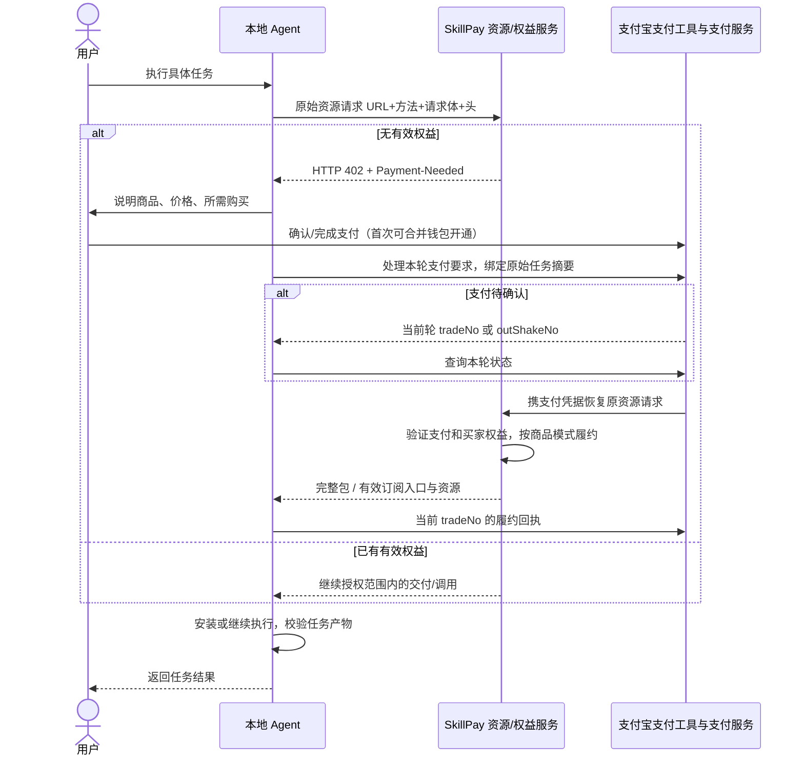
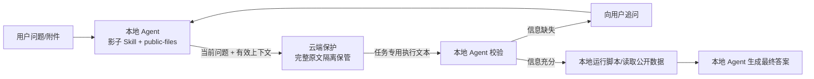
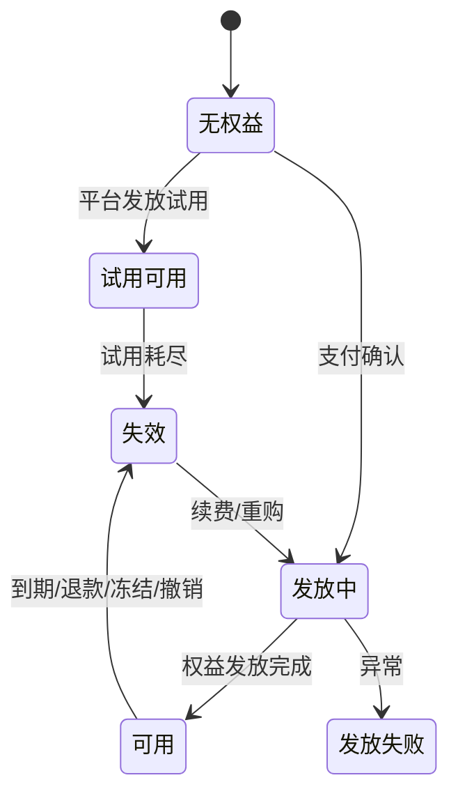
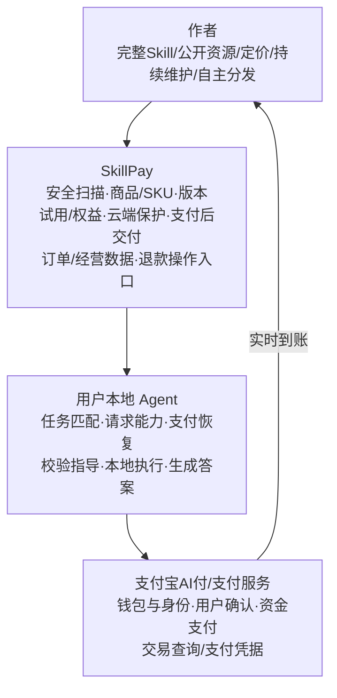

# 支付宝 SkillPay 原理剖析：支付之后，怎样把 Skill 变成可持续交付的商品

调研日期：2026-10-20（Asia/Shanghai）。仅研究公开资料；没有请求任何 `/skillpay/ct?c=...` 购买链接，没有登录、签约、授权、安装、下单或付款。

## 结论先行

SkillPay 当前官网所讨论的对象是 **Skill 商品化**：作者上传完整 Skill，由平台接住审核、定价、试用、订单、支付恢复、权益、交付和版本经营。它将两种截然不同的商品放在同一支付入口后面：

1. **买断制：交付完整 Skill 源文件。** 用户取得可本地使用的文件；2026-09-29 起一次购买可下载同一 Skill 的全部版本。
2. **周期订阅：交付一段期限内的使用权益。** 完整原文保留云端，每次根据当前任务生成有限的执行指导，再由用户的本地 Agent 完成执行和回答。它不是把整份 Skill 加密下载，也不是默认由云端代运行脚本。

402 是“现在缺少付费权益，请先完成交易再恢复这个请求”的握手。**付款成功、权益可用、资源交付、本地执行完成，是四件不同的事情。** 不能把收银台出现、用户口头表示已付款、CLI 返回支付成功，等同于 Skill 已安装或任务已完成。

来源：[商业化技术博客](https://skillpay.alipay.com/blog/good-world-skills-get-paid)、[更新日志](https://skillpay.alipay.com/changelog)、[402 官方 Agent 接入规则](https://github.com/alipay/payment-skills/blob/main/alipay-payment-skill/references/402-payment.md)。

## 一、先把几个相似名字分开

| 对象 | 实际职责 | 本次证据边界 |
|---|---|---|
| SkillPay 商品平台 `skillpay.alipay.com` | 已做好的 Skill 上传、售卖、周期权益、原文保护、版本交付和作者经营 | 当前官网、三篇博客、公开页面和其公开前端代码可核实 |
| 支付宝 AI 付 / Agent 支付 | 让 Agent 调用支付宝完成钱包开通、授权、支付、查询与支付后的恢复 | 官方 `alipay/payment-skills` 是 Agent 侧操作编排，不是 SkillPay 服务端源码 |
| 402 / Payment-Needed 协议链路 | 在 HTTP 请求里表达付费要求，完成支付后重试原资源请求 | 官方 CLI 文档能核实消费侧契约；不等于公开了全部支付后端实现 |
| AI 付文档中的传统“SkillPay”供给接入 | 可能泛指已有生活服务/商品供给的 Skill 接入 | 需要结合 `aipay.alipay.com` 文档单独辨识，不能和这里的 Skill 文件商品强行合并 |
| 本机 `skillpay-onboarding` | 这台设备安装的某个工作流技能 | 不能当作当前官网服务端实现依据，本研究未用其推导线上协议 |

补充：截至本次读取，`https://skillpay.alipay.com/llms.txt` 仍列旧版 AI 付产品索引；它指向的 `/docs/overview.md`、`/docs/llms.txt`、`/.well-known/api-catalog`、`/.well-known/skills/index.json` 均返回 404。这说明索引存在失配，**不能把它当成当前商品平台的完整 API 规范**。原响应存于 `sources/skillpay/llms.txt`。

## 二、商品化之前，作者实际交给平台什么

公开上架页支持 `.zip`、`.md`、文件夹，单文件最大 20 MB；作者填写名称、描述、买断/订阅模式、周期价格、免费试用次数，提交扫描审核。收费模式一旦选定不可更改。当前可见周期为周、月、季度；月为 30 天，且不自动续费。订阅商品默认使用最新版本。

来源：[官方商品上架页](https://skillpay.alipay.com/creator/product-new)。此页的成功/失败占位状态同时存在于 SSR HTML，不代表任何具体商品的真实审核结果。

公开前端的对象模型还揭示了平台把上传文件转成商品的方式（仅是客户端契约观察，不宣称后端一定逐字段照做）：

```text
上传源 Skill
  → 文件检查 `/skillpay/skillfile/check.json`
  → 响应 originUrl
  → 创建 productType=SKILL 商品
       profile.extraParams.source_skills = 源文件地址
       profile.extraParams.desc_skills   = 后续支付集成/描述包地址
       specifications / options          = 套餐规格
       pricingPlans                      = 定价方案
       skus                              = 可售 SKU
  → 提交审核
  → 审核通过后服务端生成 latestPurchaseCommand
  → 作者分享购买指令、二维码、公开货架
```

源代码：[ProductListingForm](https://gw.alipayobjects.com/render/p/yuyan/180020010001296536/_astro/ProductListingForm.astro_astro_type_script_index_0_lang.DP7r4ow0.js) 中 `Vr/Jr`、`Hr`、提交函数；[商品 API 适配代码](https://gw.alipayobjects.com/render/p/yuyan/180020010001296536/_astro/ais-admin-api.BOG1XLQg.js) 中 `V/te/se`。

**容易误解：** `desc_skills` 的名称并不证明它一定含哪些文件；公开管理页面把它作为“下载已集成支付能力的 Skill”的地址，结合官方云端架构才能推断订阅消费侧获得的是入口/影子 Skill 与公开文件。未下载任何实际商品包，所以具体包结构、签名布局不能据此下定论。

作者须完成三项签约：SkillPay 产品协议、AI 按量付费协议、即刻收产品协议。这个“按量付费协议”的名字是底层接入协议，不能据此说当前 Skill 商品全部按次收费。上架 UI 当前明确提供的是买断制、订阅制。

来源：[授权管理](https://skillpay.alipay.com/creator/authorizations)、[上架页](https://skillpay.alipay.com/creator/product-new)。

## 三、协议对象：商品、支付、权益、履约不能混为一个 ID

| 对象 | 哪个问题由它回答 | 已核实来源 | 不应作出的推断 |
|---|---|---|---|
| `merchantId` | 是谁的商品/货架 | 分享前端和公开商品详情请求参数 | 它不是买家身份，也不是支付凭证 |
| `productId` | 买哪一个 Skill 商品 | 商品创建结果、购买分享参数 | 不自动代表某个版本、某次交易或已付款 |
| `skuId` / `planId` | 买哪种可售规格与价格方案 | 商品创建客户端对象 | 前端存在字段不代表所有组合都已开放 |
| `latestPurchaseCommand` / `purchaseCommand` | 把消费者引到哪个受控购买入口 | 服务端下发后由分享前端复制 | 不能靠拼接 merchant/product ID 替代服务端购买口令 |
| HTTP `Payment-Needed` | 当前原始请求的收款要求 | 官方 402 Agent 文档 | 不是可随意修改或跨请求复用的普通价格说明 |
| `tradeNo` | 这轮支付交易查询/履约确认 | 官方 CLI 规则 | 不可伪造、不可从旧轮次挪用 |
| `outShakeNo` | “支付中开通”阶段的查询句柄 | 官方 CLI 规则 | 它不是 `tradeNo`，不能用于履约 ack |
| `paymentProof` | 支付后恢复资源请求所需支付凭据 | 官方 402 文档提及防止复用 | 未公开其完整编码/签名/有效期，不臆测为 JWT 或某种链上票据 |
| entitlement / `usable` / `validUntil` | 当前消费者此刻有没有使用权 | 消费者前端状态模型、更新日志 | 订单支付成功不保证权益已经发放成功 |
| fulfillment acknowledgement | 资源已返回之后的消费侧回执 | 官方 `402-buyer-fulfillment-ack` 规则 | ack 不证明本地脚本已成功运行或最终答案质量合格 |

代码依据：[分享卡片](https://gw.alipayobjects.com/render/p/yuyan/180020010001296536/_astro/product-share-card.BwTd9cPe.js)、[购买口令读取](https://gw.alipayobjects.com/render/p/yuyan/180020010001296536/_astro/product-purchase-command.C8MHVPbR.js)、[消费者接口](https://gw.alipayobjects.com/render/p/yuyan/180020010001296536/_astro/consumer-api.gLakm1y9.js)、[402 官方 Agent 规则](https://github.com/alipay/payment-skills/blob/main/alipay-payment-skill/references/402-payment.md)。

## 四、402 握手：为什么必须记住“原始请求”

下图把博客的产品流程与官方消费侧 CLI 恢复规则合在一起。支付处理器是 Agent 侧工具，不能误画为 Skill 作者自己提供的钱包。



必须保存原 URL、方法、请求体和自定义头，是因为“付哪笔款”之外还要知道“恢复哪一次任务”。支付后若丢了 POST 的业务输入，只知道 `tradeNo`，最多能确认钱付过，无法可靠恢复原请求。**支付恢复依赖应用请求上下文，HTTP 402 状态码本身不携带整套业务记忆。** 这是基于官方恢复参数的解释性推论。

官方操作规则还区分：

- legacy 402 可用当前 `tradeNo` 查询；“支付中开通”可用当前 `outShakeNo` 查询。
- `shortenUrl` 只是给人完成支付的入口，不能作为查询凭证。
- 资源响应体为空时，不可把“支付成功”包装成“交付成功”。
- 履约 ack 只接受本次工具返回的 `tradeNo`，不接受 `outShakeNo`。
- 新的 402 到来必须建立本轮上下文，不复用旧 `Payment-Needed`、旧凭据。

来源：[402 官方 Agent 规则](https://github.com/alipay/payment-skills/blob/main/alipay-payment-skill/references/402-payment.md)。这是当前 Agent 操作编排契约，**不代表后端完整的幂等键设计、数据库事务、证明验签算法已经公开**。

## 五、买断与订阅：真正的技术分叉发生在“支付后交付”

| 维度 | 一次性买断 | 周期订阅 |
|---|---|---|
| 交易换来什么 | Skill 完整源文件与长期本地使用 | 有效期内持续使用受保护能力 |
| 核心原文在哪里 | 完整文件交付消费者 | 云端隔离保管 |
| 本地有什么 | 完整 Skill、附属脚本/资源 | 官方图称“影子 Skill + public-files” |
| 后续任务如何执行 | 本地 Agent 读取完整流程执行 | 云端按任务返回有限执行文本，本地校验执行 |
| 更新 | 9/29 起买一次可下载所有版本 | 官方 UI 默认使用最新版本 |
| 到期 | 一次买断无周期到期前提 | 平台校验期限，到期失效并引导续费 |
| 自动续费 | 不适用 | 当前明确不自动续费 |
| 防复制边界 | 文件交付后不能假设可远程收回已复制文件 | 提高原文复制/套取成本，不能承诺绝对不可泄露 |

来源：[官方技术博客](https://skillpay.alipay.com/blog/good-world-skills-get-paid)、[官方架构 SVG](https://gw.alipayobjects.com/render/p/yuyan/180020010001296536/assets/skillpay-technical-report/03-cloud-protection.svg)、[更新日志](https://skillpay.alipay.com/changelog)、[上架页](https://skillpay.alipay.com/creator/product-new)。最后一行买断撤回限制是文件交付模型下的技术推论，官方没有宣称文件 DRM 或远程销毁。

### 云端保护不是“远程执行整个 Skill”



官方图明确写出云端保护“不运行脚本、不计算答案”。这意味着平台提供的是**受控的知识/工作方法披露**，本地 Agent 仍保留工具执行、上下文检查和最终输出的职责。不能画成 SkillPay 帮用户跑完代码、只吐一个结果的典型 SaaS API。

云端生成的指导仍可能被消费者看到。因此防护目标是避免整份原文直接落地，并提高跨多轮复原的成本；它没有消除知识输出本身的可观察性。平台公开的防护输入包括 Query、会话历史、当前权益和 Skill 能力边界；正常任务、原文套取、边界请求走不同处理，持续评估套取风险与正常任务可用性。**不能从“云端保护”推导出使用了某个特定大模型、TEE、同态加密、零知识证明或不可破解 DRM。**

来源：[官方云端架构图](https://gw.alipayobjects.com/render/p/yuyan/180020010001296536/assets/skillpay-technical-report/03-cloud-protection.svg)、[官方防御图](https://gw.alipayobjects.com/render/p/yuyan/180020010001296536/assets/skillpay-technical-report/04-defense.svg)。

## 六、权益状态为什么比一个“已支付”标签更重要

2026-08-10 更新日志明确上线订阅权益校验、到期失效、续费引导和权益状态管理。消费者前端也显示 `usable`、`validUntil`、`longTermValid`，以及剩余/总额度；它列出的不可用原因不只有“过期”，还包括退款、额度耗尽、冻结、撤销、退款中、发放失败和发放中。



这是根据官方产品能力和前端枚举重建的**概念状态图**，不宣称数据库里完全采用这些状态或所有迁移均可由消费者发起。

另外：免费试用如开启至少 5 次，以支持多轮完成一次完整体验；更新商品不重置剩余试用次数。因此“5 次试用”不能简单宣传成“5 个完整任务”，对话轮次/保护调用次数和最终业务任务不是一一对应的。

前端创建对象可见 `includedQuota` 默认值（买断 1、月 1000、其他周期 12000），但没有得到公开后端约束和完整套餐说明支持，**不能把这些默认值写成面向用户承诺的每月调用上限，也不能写订阅不限次数**。消费者枚举包含按量付费只是兼容状态模型，不能据此宣布当前 Skill 上架已全面支持次数包。

来源：[更新日志](https://skillpay.alipay.com/changelog)、[上架页](https://skillpay.alipay.com/creator/product-new)、[消费者界面代码](https://gw.alipayobjects.com/render/p/yuyan/180020010001296536/_astro/skills.astro_astro_type_script_index_0_lang.BOVz05QN.js)、[创建对象代码](https://gw.alipayobjects.com/render/p/yuyan/180020010001296536/_astro/ProductListingForm.astro_astro_type_script_index_0_lang.DP7r4ow0.js)。

## 七、钱包授权与商品订阅是两种不同的权限

- 商品订阅决定 SkillPay 是否给这个消费者开放该商品能力。
- 钱包开通/授权决定 Agent 能否通过支付宝支付工具发起符合条件的支付。
- 支付凭证证明一笔交易的支付结果；它不应该自动变成另一个商品的长期访问权。
- 第一次购买可把钱包绑定和付款放在一次流程里；不等于后续所有消费都不需要任何确认，更不等于订阅会自动续费。

9/10 更新日志只证明首次支付流程合并绑定、扫码后能自动确认继续安装。具体哪些金额或风控条件下可后续直接扣款、是否有额度策略，应由 Agent 支付/MachinePay 文档单独说明；**不能只凭 SkillPay 博客推断“首次扫码后无限免密”。**

来源：[更新日志](https://skillpay.alipay.com/changelog)、[官方钱包认证 Skill](https://github.com/alipay/payment-skills/blob/main/alipay-authenticate-wallet/SKILL.md)。

## 八、SkillPay 平台做什么，作者和支付底座做什么



官网 FAQ 明确：支付成功款项实时进入作者支付宝账户，不经 SkillPay 中转，不等待结算。退款先与作者协商，由作者在商品页面手动发起；周期订单整单全额退款。9/29 新上传商品须补即刻收协议以支持网页支付兜底。这些是资金/操作事实，**不意味着平台免费，也不意味着没有支付通道手续费、技术服务费或未来抽佣**；本次公开证据没有统一费率与合同条款正文。

公开 JS 还出现消费者退款申请、作者退款审核的路由，这是客户端能力线索；没有登录操作，不能据此保证所有用户当前都开放该入口或与 FAQ 完全一致。流程呈现应以官网可见说明为主，细节差异留在备注。

来源：[官网 FAQ](https://skillpay.alipay.com/)、[官方商业循环图](https://gw.alipayobjects.com/render/p/yuyan/180020010001296536/assets/skillpay-technical-report/05-business-model.svg)、[更新日志](https://skillpay.alipay.com/changelog)、[退款前端代码](https://gw.alipayobjects.com/render/p/yuyan/180020010001296536/_astro/skillpay-refund-api.BxuNVKw_.js)。

## 九、公开证据尚未回答的问题

| 问题 | 当前能说到哪里 | 不宜写进 PPT 的确定性说法 |
|---|---|---|
| paymentProof 如何编码和验签 | 官方消费侧要求不得复用，支付后用于恢复请求 | “必定是 JWT/买家私钥签名/链上收据” |
| 权益绑定用户、设备还是 Agent | 前端有消费者可用状态，官方 CLI 有买家不匹配错误 | “授权只绑定设备”“换 Agent 必须重买” |
| 下载 URL TTL、防盗链 | 管理端有源包/支付集成包地址，未读取具体受控包 | “永久地址”“一次性地址”“自动加密解密” |
| 到期时已输出内容怎么收回 | 后续云调用可受权益校验 | “能收回已下载文件/已披露文本” |
| 退款与已交付买断文件 | 作者可退款，文件已交付 | “退款自动删除用户本地文件” |
| 免费试用的精确计数点 | 官方说至少 5 次、多轮体验、不因更新重置 | “每一个完整任务只计一次” |
| 云保护所用模型/后端/沙箱 | 官方只披露输入/执行文本/本地执行架构 | “平台在专属容器执行用户全部脚本” |
| 服务端幂等与崩溃恢复 | CLI 保留原请求与本轮句柄，可查询恢复 | “网络重试绝不重复扣款/端到端 exactly once” |
| 手续费/抽佣/GMV/付费用户 | 未找到统一公开费率/经营大盘 | “零费率”“全额无手续费到账”“已成熟高渗透” |

## 十、适合 PPT 的最小表达

建议至少给 SkillPay 一整页，图比概念卡片更有帮助：

**主标题：SkillPay 把 Skill 文件变成商品：同一次 402 握手，付款后走两种履约。**

上半：作者上传/审核 → 分享入口 → Agent 原请求 → 402 → 用户确认/支付宝支付 → 凭据恢复 → 平台验权益。

下半分叉：

- 买断：完整源文件 → 本地永久使用 → 可下载全部版本。
- 订阅：云端原文 → 任务专用指导 → 本地校验/执行 → 到期停用/手动续费。

图中必须标注：云端保护不运行脚本、不计算答案；周期订阅不自动续费；钱直接到作者支付宝；402/支付凭据与商品使用权不是同一个对象。

如总共四页，可用第二页专讲受保护调用图；如果 SkillPay 只有一页，把支付握手留给两产品共用页，SkillPay 页重点讲“原文在哪里、谁来执行、为何到期还能控制后续调用”。

## 来源与本地原始材料

### 产品与博客

- https://skillpay.alipay.com/
- https://skillpay.alipay.com/blog/good-world-skills-get-paid （2026-08-13，最核心技术说明）
- https://skillpay.alipay.com/blog/skill-is-agent-learned-craft （2026-08-31，已有 Skill 作者、社群分发、持续更新的生态定位）
- https://skillpay.alipay.com/blog/how-to-build-a-good-skill （2026-09-04，Skill 内部方法/资源/脚本分层，不提供支付协议字段）
- https://skillpay.alipay.com/changelog （本次可见最新 v0.8，2026-09-29）
- https://skillpay.alipay.com/creator/product-new
- https://skillpay.alipay.com/creator/authorizations
- https://skillpay.alipay.com/user/skills

### 官方图（各 SVG 已保存，本次以 XML 文本核对，不下载/运行商品资源）

前缀 `https://gw.alipayobjects.com/render/p/yuyan/180020010001296536/assets/skillpay-technical-report/`：

- `02-402-sequence.svg`
- `03-cloud-protection.svg`
- `04-defense.svg`
- `05-business-model.svg`

### 官方公开前端（是客户端契约，不是后端源码）

前缀 `https://gw.alipayobjects.com/render/p/yuyan/180020010001296536/_astro/`：

- `ProductListingForm.astro_astro_type_script_index_0_lang.DP7r4ow0.js` — 上传/检查、商品创建、定价方案、免费试用设置；查找 `Vr`、`Hr`、`trialTimes`、`includedQuota`。
- `ais-admin-api.BOG1XLQg.js` — 商品映射与 API 路由；查找 `source_skills`、`desc_skills`、`/skill/createProduct.json`、`/skill/submitForReview.json`。
- `product-share-card.BwTd9cPe.js` — merchant/product 绑定的分享链接；查找 `function M`。
- `product-purchase-command.C8MHVPbR.js` — 购买指令由服务端提供；查找 `latestPurchaseCommand`。
- `consumer-api.gLakm1y9.js` — 个人权益/商品详情/订单读取路由。
- `skills.astro_astro_type_script_index_0_lang.BOVz05QN.js` — 可用性、权益枚举、额度、有效期；查找 `EXPIRED`、`usable`、`validUntil`。
- `skillpay-refund-api.BxuNVKw_.js` — 退款申请/作者审核前端路由。

### 官方 Agent 支付仓库

- https://github.com/alipay/payment-skills
- https://github.com/alipay/payment-skills/blob/main/alipay-payment-skill/references/402-payment.md
- https://github.com/alipay/payment-skills/blob/main/alipay-authenticate-wallet/SKILL.md

本地材料目录：`sources/skillpay/`。静态页面、公开脚本、官方 SVG 和 Agent 规则均有快照；技术页面可能更新，哈希与抓取时间见 `source-manifest.json`。
