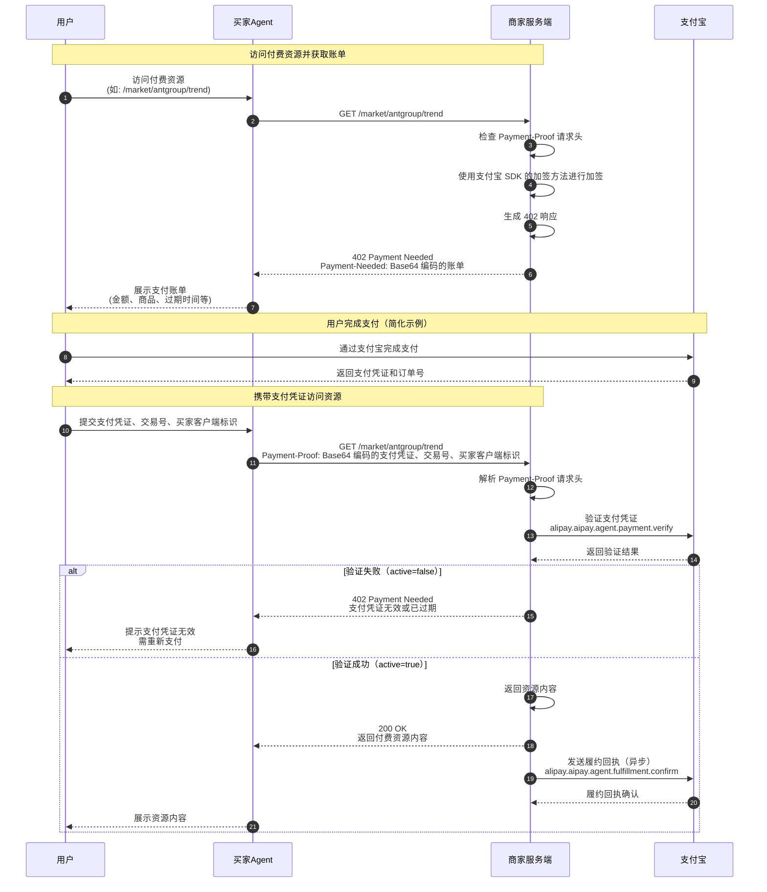

商家/服务商可根据本文指引快速接入 **AI按量付费** 产品。
说明：
- **AI按量付费** 产品支持自研商家/服务商通过 [自研应用](https://opendocs.alipay.com/common/02bijh#%E8%87%AA%E7%A0%94%E6%9C%8D%E5%8A%A1%E5%9E%8B%E5%BA%94%E7%94%A8) 或 [第三方应用](https://opendocs.alipay.com/common/02bijh#%E4%B8%89%E6%96%B9%E6%9C%8D%E5%8A%A1%E5%9E%8B%E5%BA%94%E7%94%A8) 代调用（传入 app_auth_token）方式，调用 API 接入。

# 产品特色
**AI按量付费** 是支付宝AI付推出的基于402 Payment Required HTTP状态码的 A2M 方案，可让您的 API、数字内容或算力资源，能够直接向访问它们的 AI 智能体（AI Agents） 发起自动收款。

- **按量收费**：每次调用都可以独立定价，不必强依赖包月订阅。
- **原生适配 AI 智能体**：通过 `402 Payment Required` 告诉智能体“这个资源需要先付款”。
- **链路更短**：用户不需要在商家侧注册、登录、跳转到复杂页面后再回来。
- **AI Agent 自动购买资源**：用户授权后，由智能体完成请求、支付、交付。
    
<a name="f7b22fd2"></a>
# 典型场景

1. 用户通过支付宝 App 支付并开通 AI付。  
2. 用户向智能体下达指令，智能体访问商家的付费资源。
3. 商家服务端发现这次请求没有有效支付凭证，于是返回 `402 Payment Required`，并在 `Payment-Needed` Header 里放入账单。
4. 智能体把账单交给支付宝支付能力，用户确认后完成付款。
5. 支付成功后，智能体拿到支付凭证，并携带 `Payment-Proof` 再次请求商家资源。
6. 商家服务端调用支付宝接口验证支付凭证。
7. 验证通过后，商家返回资源内容，并异步发送履约回执。  

# Vibe coding 快速集成（推荐）
```markdown
通过 npx -y @alipay/alipay-aipay@latest install 安装支付宝 AI 付 Skill，加载 alipay-aipay 技能为我的 api 接口集成按量付费，完成沙箱测试，并完成签约入驻
```
# 手动集成（传统）
你需要在自己的服务端完成三件事：

1. 用户未支付时，返回 `402 Payment Required` 和 `Payment-Needed` 账单。
2. 用户支付后，读取 `Payment-Proof` 并调用支付宝验凭证接口。
3. 验证通过并返回资源后，调用支付宝履约回执接口。

## 示例代码
请访问[AI按量计费示例代码](https://github.com/alipay/ai/tree/main/code_example/aipay-402-example)获取示例代码。

## 完整接口时序图



## 第一步：返回 402 账单

当商家服务端收到资源请求时，先检查请求头里是否有 `Payment-Proof`。

- 如果没有，说明用户还没支付，返回 `402 Payment Required`。
- 如果有，但验证失败，也返回 `402 Payment Required`，让用户重新支付。
- 如果有且验证成功，直接返回资源内容。

`402` 响应里最重要的是 `Payment-Needed` Header。它是一段经过 Base64URL 编码的账单，账单里包含本次交易的金额、商品名、资源 ID、收款方信息、支付截止时间和商家签名。


### 402 Payment-Needed

| 项目 | 规范 |
| --- | --- |
| HTTP 状态码 | 402 Payment Required |
| 响应数据 | 通过 `Payment-Needed` Header 传递（**Base64URL** 编码） |

```http
HTTP/1.1 402 Payment Required
Payment-Needed: <base64url 编码后的账单 JSON>
Content-Type: application/json
{
  "error": "Payment Needed",
  "message": "请先支付 0.01 CNY 以访问资源",
  "resourceId": "RES_1739836600000_abc123"
}
```
响应体主要用于让调试和日志更清楚。真正给智能体识别和支付使用的是 `Payment-Needed` Header。

### Payment-Needed Header 解码后的内容

```json
{
  "protocol": {
    "out_trade_no": "ORDER_1739836600000_abc123",
    "amount": "0.01",
    "currency": "CNY",
    "resource_id": "RES_1739836600000_abc123",
    "pay_before": "2026-03-25T12:00:00+08:00",
    "seller_signature": "YYYYxxxx=",
    "seller_sign_type": "RSA2",
    "seller_unique_id": "2088xxxxxxxx"
  },
  "method": {
    "seller_name": "测试商家",
    "seller_id": "2088xxxxxxxx",
    "seller_app_id": "app_123456",
    "goods_name": "测试商品",
    "seller_unique_id_key": "seller_id",
    "service_id": "xxxx_12344"
  }
}
```

### 字段说明

#### protocol 层字段

| 字段名 | 类型 | 必填 | 说明 |
| --- | --- | --- | --- |
| `out_trade_no` | String | 是 | 商户订单号。建议全局唯一，用于幂等和防重复支付 |
| `amount` | String | 是 | 应付金额（最小货币单位，字符串） |
| `currency` | String | 是 | 法币单位（默认 CNY） |
| `resource_id` | String | 是 | 资源唯一标识（用于资源防串，如 /market/alibaba/trend_001） |
| `pay_before` | String | 是 | 支付过期时间戳（ISO8601 格式，请设计合理有效期，过期账单不可继续支付） |
| `seller_signature` | String | 是 | 商家对本次账单关键信息的签名 |
| `seller_sign_type` | String | 是 | 签名算法（目前仅支持 RSA2） |
| `seller_unique_id` | String | 是 | 卖家唯一标识（此处是 `seller_id`） |

#### method 层字段

| 字段名 | 类型 | 必填 | 说明 |
| --- | --- | --- | --- |
| `seller_name` | String | 是 | 收款方名称 |
| `seller_id` | String | 是 | 收款方 userId（2088ID） |
| `seller_app_id` | String | 是 | 商户应用 ID（**如果你是第三方代调用，需使用三方应用的app_id**）|
| `goods_name` | String | 是 | 交易物品标题 |
| `seller_unique_id_key` | String | 是 | 卖家唯一标识键，默认 `seller_id` |
| `service_id` | String | 是 | 商户提供的服务 ID，如何获取请查看 [常见问题 Q2](https://ideservice.alipay.com/cms/site/0j7uos) |

### 商家签名

商家需要用自己的应用私钥（**如果你是第三方代调用，需使用三方应用的私钥**）对账单关键信息加签。加签只在本地完成，不会请求支付宝服务端。

加签字段包括：

- `amount`：支付金额
- `currency`：币种
- `goods_name`：商品或服务名称
- `out_trade_no`：商户订单号
- `pay_before`：支付截止时间
- `resource_id`：资源 ID
- `seller_id`：收款方 ID
- `service_id`：服务 ID

加签前，需要先把参数按 key 的字典序排序，再拼成 `key=value&key=value` 的格式。

```text
amount=0.01&currency=CNY&goods_name=测试商品&out_trade_no=ORDER_1739836600000_abc123&pay_before=2026-03-25T12:00:00+08:00&resource_id=RES_1739836600000_abc123&seller_id=2088xxxxxxxx&service_id=xxxx_12344
```
Java SDK 加签示例：

```java
public static String rsaSign(String content, String privateKey, String charset, String signType) throws AlipayApiException {
    return AsymmetricManager.getByName(signType).sign(content, charset, privateKey);
}
```

## 第二步：验证 Payment-Proof

用户支付成功后，智能体会再次请求商家资源，并在请求头里带上 `Payment-Proof`。

```http
GET /market/antgroup/trend HTTP/1.1
Payment-Proof: <base64 编码后的支付凭证信息>
```

商家服务端解析 `Payment-Proof` 后，可以得到支付凭证、支付宝订单号和买家客户端会话标识。

```text
Payment-Proof (Base64前): {
  "protocol": {
    "payment_proof": "7cf8a6a93c924e13eaa4bf20c3a487f30d1fbdb759a1f229b4091b7d0158xxxx",
    "trade_no": "2026040900828111317760000001xxxx"
  },
  "method": {
    "client_session": "xxxxxxxxxxxxxsCiAgICAic2Vzc2lvbklkIjogInh4IiwKICAgICJzaWduYXR1cmUiOiAi5Yqg562+5ZCO57uT5p6c77yM6YCa6L+HY3JlZGVudGlhbElk5Yqg562+YWdlbnRUb2tlbiArIHNlc3Npb25JZCkiCn0=",
  } 
}
```

解密后，商家需调用 [alipay.aipay.agent.payment.verify（A2A 商户支付凭证验证接口）](https://ideservice.alipay.com/cms/site/0j7uot) 接口验证支付凭证，支付宝会返回已支付订单的基本信息（如外部订单号、资源 ID 等，详细出参见 API 文档）。

入参均来自用户（买家）的 `Payment-Proof`：

- 支付凭证：`payment_proof`
- 支付宝订单号：`trade_no`
- 买家客户端会话标识：`client_session`

### 请求示例

```java
package com.java.sdk.demo;

import com.alipay.api.AlipayApiException;
import com.alipay.api.AlipayClient;
import com.alipay.api.DefaultAlipayClient;
import com.alipay.api.AlipayConfig;
import com.alipay.api.domain.AlipayAipayAgentPaymentVerifyModel;
import com.alipay.api.request.AlipayAipayAgentPaymentVerifyRequest;
import com.alipay.api.response.AlipayAipayAgentPaymentVerifyResponse;

import com.alipay.api.FileItem;
import java.util.Base64;
import java.util.ArrayList;
import java.util.List;

public class AlipayAipayAgentPaymentVerify {

    public static void main(String[] args) throws AlipayApiException {
        // 初始化SDK
        AlipayClient alipayClient = new DefaultAlipayClient(getAlipayConfig());

        // 构造请求参数以调用接口
        AlipayAipayAgentPaymentVerifyRequest request = new AlipayAipayAgentPaymentVerifyRequest();
        AlipayAipayAgentPaymentVerifyModel model = new AlipayAipayAgentPaymentVerifyModel();
        
        // 设置交易号
        model.setTradeNo("20260324008281172041220000012182");
        
        // 设置支付凭证
        model.setPaymentProof("62922589b11acfc70faf4ebab1da7a9bbc438554e40d0a1dcdc7f35b3085xxxx");
        
        // 设置买家客户端会话标识
        model.setClientSession("ImNsaWVudFNlc3N");
        
        request.setBizModel(model);
        AlipayAipayAgentPaymentVerifyResponse response = alipayClient.execute(request);
        System.out.println(response.getBody());

        if (response.isSuccess()) {
            System.out.println("调用成功");
        } else {
            System.out.println("调用失败");
            // sdk版本是"4.38.0.ALL"及以上,可以参考下面的示例获取诊断链接
            // String diagnosisUrl = DiagnosisUtils.getDiagnosisUrl(response);
            // System.out.println(diagnosisUrl);
        }
    }

    private static AlipayConfig getAlipayConfig() {
        String privateKey  = "<-- 请填写您的应用私钥，例如：MIIEvQIBADANB ... ... -->";
        String alipayPublicKey = "<-- 请填写您的支付宝公钥，例如：MIIBIjANBg... -->";
        AlipayConfig alipayConfig = new AlipayConfig();
        alipayConfig.setServerUrl("https://openapi.alipay.com/gateway.do");
        alipayConfig.setAppId("<-- 请填写您的AppId，例如：2019091767145019 -->");
        alipayConfig.setPrivateKey(privateKey);
        alipayConfig.setFormat("json");
        alipayConfig.setAlipayPublicKey(alipayPublicKey);
        alipayConfig.setCharset("UTF-8");
        alipayConfig.setSignType("RSA2");
        return alipayConfig;
    }
}
```

### 响应示例

```json
{
    "alipay_aipay_agent_payment_verify_response":{
        "msg":"Success",
        "amount":"0.01",
        "code":"10000",
        "out_trade_no":"ORDER_1774598472720_etm5dy",
        "trade_no":"20260324008281172041220000012182",
        "resource_id":"out_res_id_0000123",
        "active":true
    },
    "sign":"ERITJKEIJKJHKKKKKKKHJEREEEEEEEEEEE"
}
```
验证通过不只看接口调用成功，还要检查业务字段：

- `active` 必须为 `true`。
- `amount` 必须等于本次资源价格。
- `out_trade_no` 必须是你生成的商户订单号。
- `resource_id` 必须和用户本次访问的资源一致。
- `trade_no` 不应被重复履约，避免同一笔支付被多次使用。

如果任一检查不通过，返回 `402 Payment Required`，提示智能体重新支付。
## 第三步：履约回执

将资源返回给用户后，商家需异步调用 [alipay.aipay.agent.fulfillment.confirm（A2A 商家履约回执确认接口）](https://ideservice.alipay.com/cms/site/0j7sw0)，告知支付宝这笔订单已经完成履约。

入参：

- 支付宝订单号：`trade_no`

### 请求示例

```java
package com.java.sdk.demo;

import com.alipay.api.AlipayApiException;
import com.alipay.api.AlipayClient;
import com.alipay.api.DefaultAlipayClient;
import com.alipay.api.AlipayConfig;
import com.alipay.api.response.AlipayAipayAgentFulfillmentConfirmResponse;
import com.alipay.api.domain.AlipayAipayAgentFulfillmentConfirmModel;
import com.alipay.api.request.AlipayAipayAgentFulfillmentConfirmRequest;

import com.alipay.api.FileItem;
import java.util.Base64;
import java.util.ArrayList;
import java.util.List;

public class AlipayAipayAgentFulfillmentConfirm {

    public static void main(String[] args) throws AlipayApiException {
        // 初始化SDK
        AlipayClient alipayClient = new DefaultAlipayClient(getAlipayConfig());

        // 构造请求参数以调用接口
        AlipayAipayAgentFulfillmentConfirmRequest request = new AlipayAipayAgentFulfillmentConfirmRequest();
        AlipayAipayAgentFulfillmentConfirmModel model = new AlipayAipayAgentFulfillmentConfirmModel();
        
        // 设置交易号
        model.setTradeNo("20260324008281172041220000012182");
        
        request.setBizModel(model);
        AlipayAipayAgentFulfillmentConfirmResponse response = alipayClient.execute(request);
        System.out.println(response.getBody());

        if (response.isSuccess()) {
            System.out.println("调用成功");
        } else {
            System.out.println("调用失败");
            // sdk版本是"4.38.0.ALL"及以上,可以参考下面的示例获取诊断链接
            // String diagnosisUrl = DiagnosisUtils.getDiagnosisUrl(response);
            // System.out.println(diagnosisUrl);
        }
    }

    private static AlipayConfig getAlipayConfig() {
        String privateKey  = "<-- 请填写您的应用私钥，例如：MIIEvQIBADANB ... ... -->";
        String alipayPublicKey = "<-- 请填写您的支付宝公钥，例如：MIIBIjANBg... -->";
        AlipayConfig alipayConfig = new AlipayConfig();
        alipayConfig.setServerUrl("https://openapi.alipay.com/gateway.do");
        alipayConfig.setAppId("<-- 请填写您的AppId，例如：2019091767145019 -->");
        alipayConfig.setPrivateKey(privateKey);
        alipayConfig.setFormat("json");
        alipayConfig.setAlipayPublicKey(alipayPublicKey);
        alipayConfig.setCharset("UTF-8");
        alipayConfig.setSignType("RSA2");
        return alipayConfig;
    }
}
```

### 响应示例

```json
{
    "alipay_aipay_agent_fulfillment_confirm_response":{
        "msg":"Success",
        "code":"10000",
        "trade_no":"20260324008281172041220000012182"
    },
    "sign":"ERITJKEIJKJHKKKKKKKHJEREEEEEEEEEEE"
}
```
