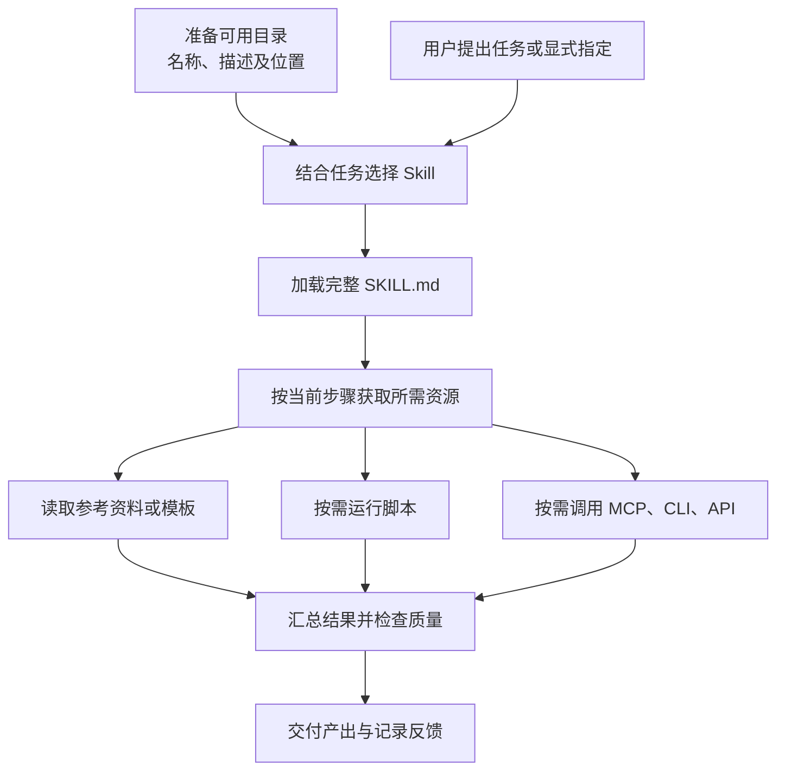

# Skill 资产形态与生命周期：生产、分发、安装、使用

整理日期：2026 年 10 月 19 日  
版本：详细分析稿  
用途：从 AI 资产平台建设视角，说明 Skill 的资产形态、四个旅程、实际机制和平台建设重点，作为后续汇报、方案和演示材料的内容基础。

## 1. 核心观点

**Skill 的生命周期，是把任务经验生产为可复用的方法，将其交付到合适的环境，在真实任务中产生结果，并通过反馈持续改进的过程。**

围绕这条主线，可以用四个旅程说明：

| 旅程 | 核心问题 | 价值转化 | 阶段交付物 |
| --- | --- | --- | --- |
| 生产 | 如何把任务经验沉淀为可复用的 Skill？ | 经验 → 方法资产 | 经过验证的 Skill 内容 |
| 分发 | 如何让目标使用者找到并获得明确的版本？ | 方法资产 → 可获取的发布版本 | 发布包、来源和版本信息 |
| 安装 | 如何让这个版本在目标环境中可用？ | 发布版本 → 环境中的安装实例 | 可发现且就绪的能力 |
| 使用 | 如何在合适的任务中使用并交付结果？ | 可用能力 → 任务价值 | 任务产出、验收和反馈 |

四个旅程构成持续循环。生产与分发主要围绕资产及其版本展开；安装与使用则与具体项目、用户、宿主和任务有关。这里的“宿主”，指承载 Agent 会话、上下文、工具和权限的运行程序。


本文中的阶段划分、完成标准、状态和指标，是面向资产管理的建议模型。涉及格式与加载机制的事实另附官方来源；各宿主的实际能力需要单独验证。

## 2. 先明确：生命周期中管理的是什么

### 2.1 资产本体：指令、知识、脚本与资源的组合

Skill 将某一类任务的专业知识、操作流程、工具使用方法和配套资源组织为可复用的能力包，供 Agent 按需使用。

按 Agent Skills 格式，目录中的 `SKILL.md` 是必需文件，包含元数据和正文。`scripts/`、`references/`、`assets/` 是可选约定；示例目录如下。[Agent Skills 格式规范](https://agentskills.io/specification)

```text
pdf-processing/
├── SKILL.md                    # 入口：场景、步骤与验收要求
├── scripts/                    # 可选：确定性的文件处理或计算
│   ├── extract_text.py
│   └── merge_pdf.py
├── references/                 # 可选：知识、规范与接口说明
│   └── pdf_processing_guide.md
├── assets/                     # 可选：模板与静态资源
│   └── report_template.docx
└── examples/                   # 自定义可选目录：输入输出示例
    └── sample_task.md
```

这个目录例子表达资产组织方式，不代表其中脚本和模板已经实现。Skill 可以只包含任务指令；需要工具时，也可以在指令中约定如何使用 MCP、CLI 或 API。

### 2.2 SKILL.md 应如何理解

以下是围绕 PDF 处理编写的简化示例：

```markdown
---
name: pdf-processing
description: 当用户需要合并 PDF 或提取其中的可选择文本时使用；扫描件识别需另行确认 OCR 能力。
---

# PDF 处理

1. 确认输入文件、处理目标和输出位置。
2. 检查文件能否读取，并识别是否需要 OCR。
3. 按任务选择 scripts/ 中的处理脚本。
4. 执行处理，检查页数、文本完整性和输出文件。
5. 返回结果文件，并说明未完成的部分。

需要处理规则时，读取 references/pdf_processing_guide.md。
```

从内容设计角度，名称用于识别，描述帮助选择，正文指导执行；参考资料、脚本和模板支持具体步骤。名称不宜直接充当平台全局 ID，因为不同来源可能提供同名 Skill。

| 内容 | 所在位置 | 作用 |
| --- | --- | --- |
| `name`、`description` | YAML 元数据，必填 | 识别及适用场景 |
| `license` | 可选元数据 | 许可说明 |
| `compatibility` | 可选元数据 | 环境要求 |
| `metadata` | 可选扩展映射 | 作者、版本等自定义信息 |
| Markdown 正文 | 元数据之后 | 指令、流程、示例与边界 |

正文没有统一的章节模板；上例中的步骤是示范写法。`metadata` 中的版本字符串也不意味着宿主自动提供版本管理。`allowed-tools` 等字段的支持情况需要检查，不能把声明当作实际授权。[格式字段与正文](https://agentskills.io/specification)

### 2.3 按能力组成分类：五类特征，可组合标记

下表是资产平台的分类建议，不是开放标准规定的五种类型；各类也不互斥。

| 类型 | 核心组成 | 典型任务 | 平台需要额外理解的条件 |
| --- | --- | --- | --- |
| Prompt 型 | 指令与输出要求 | 文案撰写、评审方法 | 输入要求、质量标准 |
| Knowledge 型 | 指令加参考知识 | 企业规范解读、行业分析 | 知识来源、适用范围与更新日期 |
| Script 型 | 指令加配套代码 | PDF 处理、数据计算、文件转换 | 运行时、依赖包、文件访问 |
| Tool/MCP 型 | 指令加外部工具使用方法 | 云资源查询、业务系统操作 | 工具可用性、连接和权限 |
| Composite 型 | 多种内容和能力组合 | 云成本分析、运维诊断 | 多项依赖、执行顺序与异常恢复 |

建议使用 `prompt`、`knowledge`、`script`、`mcp` 等多标签表达能力特征。例如“云成本分析”可以同时读取成本核算规范、查询账单、执行计算脚本并生成报告。

### 2.4 与 Model、MCP、Agent、Plugin 的关系

| 对象 | 主要解决的问题 | 平台管理视角 |
| --- | --- | --- |
| Model | 提供推理与生成能力 | 模型或推理服务 |
| Tool / MCP Server | 提供可调用操作及数据访问 | 工具实现、服务与连接 |
| Skill | 组织完成某类任务的方法 | 可复用的流程、知识与资源 |
| Agent | 理解任务并控制执行过程 | 角色、模型、工具和运行配置 |
| Plugin | 组合并交付扩展能力 | 含 Skill、连接配置等的安装包 |

Skill 可以指导如何组合工具；MCP 服务提供实际操作接口。以云运维为例，“查询实例指标”是工具动作，“结合指标和排障规则判断故障并生成报告”可以组织为 Skill。OpenAI 的官方说明也采用工作流指导与服务能力互补的划分。[Skills 与 MCP 的职责](https://developers.openai.com/plugins/concepts/skills)

一个 Agent 可以使用多个 Skills，一个 Skill 也可以被多个 Agent 复用。Plugin 是组合交付层：它可以承载一个或多个 Skills，并按需附带 MCP 连接配置。具体组合包规则属于平台实现。

### 2.5 生命周期中的四个管理对象

从资产管理角度，建议区分四个关联对象：

| 对象 | 表达什么 | 示例 |
| --- | --- | --- |
| Skill 资产 | 持续维护的某项任务方法 | “会议纪要整理” |
| 发布版本 | 某一时点确定的内容及发布信息 | “会议纪要整理 v1.2” |
| 安装实例 | 某个版本在某个环境中的部署与配置 | 项目 A 安装的 v1.2 |
| 使用记录 | 一次具体任务中的使用过程及结果 | 整理某次会议并通过验收 |

一个资产可以有多个版本；一个版本可以安装到多个环境；一个安装实例可以支持多次使用。仅以名称、文件路径或调用次数管理，难以完整回答“用了哪个版本、在哪个环境、效果如何”。

## 3. 旅程一：生产——把经验变成可复用的方法

### 目标与角色

生产要解决的是：**离开原作者的临场解释，Agent 能否理解适用场景，并按照方法交付合格结果。**

主要角色包括领域专家、Skill 作者和评测者；这些角色可以由同一个人承担，也可以由人与 Agent 协作完成。

### 关键动作

1. **识别可复用任务。** 从高频、耗时或质量要求明确的任务中提炼方法，确定目标用户、输入、输出和适用边界。
2. **编写方法。** 清楚描述何时使用、执行步骤、关键判断、异常处理和验收要求。
3. **组织资源。** 将需要重复执行的操作整理为脚本，将知识整理为参考资料，将固定输出样式整理为模板。
4. **声明环境要求。** 说明依赖的工具、运行时、外部服务和访问条件，便于后续判断是否可用。
5. **验证触发与结果。** 用应当使用、不应使用和边界任务检查选择是否合理，再检查执行结果是否达标。
6. **形成候选版本。** 汇总内容、样例、评测结果与已知限制，准备发布。

### 四种生产方式

| 方式 | 从哪里开始 | 主要生产过程 | 适用人群 |
| --- | --- | --- | --- |
| 人工编写 | 已明确的任务规范 | 创建目录、写指令、补资源、验证 | 开发者、领域专家 |
| AI 辅助生成 | 自然语言需求或已有样例 | 对话澄清、生成草稿、试用、修订 | 业务专家、开发者 |
| 现有资产封装 | MCP、API、CLI、脚本、SOP、知识文档 | 定义任务方法、关联依赖、组合资源 | 平台团队、工具维护者 |
| 二次开发 | 已有公共或内部 Skill | 导入、调整规范与工具、评测、独立发布 | 企业开发者、业务团队 |

**方式一：人工编写。** 适合流程明确、需要逐项审阅的任务。作者应把隐含的判断依据写清楚，尤其是输入不足时如何处理、哪些事实不能推断，以及结果如何验收。

```text
任务规范 → 创建目录 → 编写 SKILL.md → 添加资源 → 验证 → 候选版本
```

**方式二：AI 辅助生成。** 作者描述目标、输入输出、执行步骤和约束，由 AI 协助生成内容，再通过实际任务修正。以下为 Codex 中的生产需求示例，不表示已经执行了创建操作：

```text
$skill-creator

创建一个华为云 ECS 故障诊断 Skill。
输入：实例标识、时间范围和故障现象。
过程：通过已有云资源工具查询实例状态和监控，结合排障规范分析。
输出：诊断依据、可能原因、待确认项和建议操作。
约束：证据不足时标记待确认；涉及变更的操作单独处理授权。
请声明所需工具，并提供正常、缺失输入和工具失败的样例。
```

OpenAI 官方支持用 `$skill-creator` 辅助创建，也支持手工编写。AI 生成只改变内容生产方式，仍需验证触发和结果。[OpenAI Skill 创建指南](https://developers.openai.com/plugins/build/skills)

**方式三：现有资产封装。** 这是已有工具资产向业务任务能力转化的重要路径。例如，企业已有实例查询和监控接口，可以围绕它们编排诊断方法：

```text
已有工具：查询实例、查询监控、查询事件
                         ↓
业务方法：核对现象 → 收集证据 → 对照规则 → 形成诊断
                         ↓
Skill：指令 + 排障知识 + 报告模板 + 工具依赖说明
```

从工具封装 Skill，需要补充目标、步骤、分支判断、结果解释与验收。把工具列表复制到说明里，通常不足以形成完整的任务方法。

OpenAI 另有从 MCP 服务导入 Skill 文件的提交机制：它读取服务提供的 Skill 资源并形成发布草稿快照；普通工具接口不会因此自动变成完整 Skill。[从 MCP 导入 Skill](https://developers.openai.com/plugins/build/skills#import-a-skill-from-mcp)

**方式四：二次开发。** 将已有 Skill 导入后，加入企业规范、替换内部工具、调整模板，并形成自己的版本。建议保留上游来源与基准提交，便于后续比较更新、处理定制差异；复用范围以原始许可和组织要求为准。

### 资产平台在生产旅程中可以做什么

平台可提供标准模板、目录导入、内容编辑、AI 辅助生成、依赖关联、样例管理与评测入口。对已有 MCP 和文档资产较多的企业，可以优先打通“导入复用”和“现有资产封装”，再按需求建设更完整的 Skill Builder。

### 交付物与完成标准

建议交付：Skill 内容包、使用说明、任务样例、验收标准、评测记录和依赖说明。

生产完成应同时满足两类条件：一是内容完整、结构可解析、资源可访问；二是在约定的验证环境与任务集上，能够被合理选择并产出合格结果。语法通过只说明格式正确，不能证明任务方法有效。

### 典型断点

- 描述过宽，导致不相关任务也选中该 Skill。
- 步骤依赖作者的隐性经验，换一个使用者就难以复现。
- 只测试理想输入，遇到材料缺失或格式变化便失效。
- 将特定环境中的成功，直接当作跨环境可用。

**建议关注：触发准确率、应触发任务的覆盖率、任务验收通过率，以及代表性失败案例。**

## 4. 旅程二：分发——让合适的人获得明确的版本

### 目标与角色

分发要解决的是：**使用者能否找到、理解、评估并获得所需版本，后续还能追溯来源。**

主要角色包括发布者、资产平台或仓库维护者、组织管理员和潜在使用者。

### 关键动作

1. **确定发布内容。** 将生产内容整理为可获取的包，并明确发布者、版本或提交、许可与适用范围。
2. **选择渠道。** 根据受众选择代码仓库、内部资产库、市场、插件包或托管渠道。
3. **提供发现入口。** 展示场景、效果示例、环境要求、限制和获取方式，帮助使用者作出选择。
4. **交付确定内容。** 使展示信息与实际获取的内容对应，尽量避免“同一版本拿到不同内容”。
5. **维护发布状态。** 提供更新说明、弃用提示和撤回机制，并说明对已有安装的影响。

### 分发渠道与交付形态

| 渠道或形态 | 实际交付的内容 | 对使用者的价值 | 平台要处理的问题 |
| --- | --- | --- | --- |
| Git 仓库 | 目录及提交历史 | 源码可见、协作和二次开发 | 仓库、路径、ref 与实际提交的对应 |
| ZIP / 目录包 | 一次打包的内容 | 离线交付、人工导入 | 完整性、内容摘要、依赖说明 |
| Skill 目录或市场 | 展示索引，或平台托管的内容 | 检索、比较和获取入口 | 区分索引与实际存储位置 |
| Skill Pack | 多项 Skill 的获取集合 | 面向场景批量获取 | 每个成员的来源、版本与许可 |
| Plugin | Skill 与连接等组件的组合包 | 整体安装业务能力 | 组合清单、依赖、配置与组件兼容性 |
| 托管 API | 平台管理的内容和版本引用 | 自动化供给运行环境 | 上传、版本引用、环境关联 |

这些维度并不互斥：一个 Plugin 可以存放在 Git 仓库中，也可以通过市场展示和分发。市场存在某条记录，也不意味着它托管了所有文件。

### GitHub、Skills.sh 与安装工具各做什么

以 GitHub 来源的 Skill 为例，可以按以下职责理解这条链路：

```text
作者维护 GitHub 仓库中的 Skill 文件
                  ↓
Skills.sh 提供目录、排行与发现入口
                  ↓
用户选择来源，通过 Skills CLI 获取并安装
                  ↓
目标 Agent 宿主发现并使用 Skill
```

Skills.sh 的官方文档将目录发现与 CLI 管理联系起来，并提供 Packs，将多项 Skills 组合为可分享的安装入口。目录排行主要反映安装活动，不能直接当作任务效果评测。[Skills.sh 文档](https://www.skills.sh/docs)

Skill Pack 与 Plugin 应分开管理：前者可以只是多项 Skills 的集合，后者还可能包含连接和其他扩展。不能推定所有 Pack 都会部署 MCP 服务，或与某个平台的 Plugin 格式互通。

### OpenAI 插件分发的具体例子

OpenAI 当前文档将 Plugin 作为可安装的组合包。可移植包以根目录 `plugin.json` 描述，并可包含 `skills/` 与 `mcp.json`；另有兼容布局。下面仅展示组织关系，不是完整可安装包。[OpenAI 插件打包](https://developers.openai.com/plugins/build/plugins)

```text
cloud-operations-plugin/
├── plugin.json
├── mcp.json                         # 可选：MCP 连接配置
└── skills/
    ├── ecs-diagnosis/
    │   └── SKILL.md
    └── cost-analysis/
        └── SKILL.md
```

因此，平台可以把 Skill 作为独立资产管理，同时允许它成为组合包的成员。组合包发布、成员 Skill 发布、MCP 服务部署和用户授权，是需要关联的不同动作。

仓库和管理工具可以承担分发与维护职责。例如 Vercel Skills 提供获取、列举、更新和移除等操作；这些能力来自管理工具，不能由 `SKILL.md` 文件格式本身推导。[Vercel Skills 官方仓库](https://github.com/vercel-labs/skills)

### 交付物与完成标准

建议交付：发布包、资产介绍页或说明文件、获取入口、来源记录、版本标识及变更说明。

分发完成意味着目标使用者可以获取与说明一致的内容，并识别其来源和版本。“已经上架”只代表存在展示入口；能否获取、能否安装和能否完成任务，还需分别确认。

### 典型断点

- 介绍页信息齐全，实际下载包却缺少模板或脚本。
- 只提供随时变化的分支地址，无法确认安装时获取的内容。
- 来源、许可或兼容范围不明确，使用者无法判断是否适合。
- 新版本已发布，已有安装实例仍停留在旧版本且无人知晓。

**建议关注：发现到获取的转化、获取成功率、版本可追溯程度，以及更新信息的触达情况。**

## 5. 旅程三：安装——让版本在具体环境中就绪

### 目标与角色

安装要解决的是：**已获得的版本，能否在指定项目或用户环境中被发现，并具备执行任务所需的条件。**

主要角色包括使用者、组织管理员、安装工具和 Agent 宿主。

### 关键动作

1. **选择目标与作用域。** 明确安装到哪个宿主、哪个项目，以及个人、项目或组织范围。
2. **部署内容。** 将指定版本放到宿主能够访问的位置，或提供给远程执行环境。
3. **检查宿主发现。** 确认宿主解析到正确的名称、描述和位置，并处理冲突或不可见问题。
4. **准备运行条件。** 检查脚本依赖、工具、资源路径、外部连接和必要权限。
5. **记录安装实例。** 关联来源版本、环境、实际位置、启用状态和检查结果。
6. **执行最小验证。** 用一个代表性任务确认该环境能够使用此 Skill。

开放格式没有规定唯一安装路径；本地扫描、远程供给以及目录暴露方式由宿主集成决定。因此，内容已经下载，并不意味着当前会话一定能够发现它。[Agent Skills 客户端集成指南](https://agentskills.io/client-implementation/adding-skills-support)

### 四类安装或供给方式

| 方式 | 具体动作 | 要确认的结果 |
| --- | --- | --- |
| 手工部署 | 将 Skill 目录复制到宿主约定位置 | 文件完整、作用域正确、宿主可见 |
| CLI 安装 | 由工具解析来源、选择 Skill 并部署 | 来源、选中项、目标宿主和安装范围正确 |
| Agent 内安装 | 通过内置安装器，或从宿主插件目录安装 | 实际安装内容、组件和状态可追溯 |
| 平台 / API 供给 | 上传内容，再挂载或关联运行环境 | 上传成功且目标环境实际可访问 |

Skill 指令文件本身通常无须编译；脚本、包依赖、本地服务和外部连接仍可能需要配置。整个能力能否使用，要看具体组成。

### 手工部署：项目级与用户级路径

以下是官方文档中的常用本地发现位置，路径表示法中的 `<project>` 需替换为实际项目目录：

| 宿主 | 用户级位置 | 项目级位置 |
| --- | --- | --- |
| Claude Code | `~/.claude/skills/<skill-name>/SKILL.md` | `<project>/.claude/skills/<skill-name>/SKILL.md` |
| Codex | `~/.agents/skills/<skill-name>/SKILL.md` | `<project>/.agents/skills/<skill-name>/SKILL.md` |

来源：[Claude Code Skill 位置](https://code.claude.com/docs/en/skills#choose-where-skills-load)、[Codex 本地 Skill 位置](https://learn.chatgpt.com/docs/build-skills#where-codex-loads-local-skills)。

用户级适合个人跨项目复用；项目级适合随仓库共享任务方法。宿主还可能支持管理员、系统、插件或其他范围，需要按目标客户端验证。

```text
获取 Skill → 部署到目标位置 → 宿主发现和解析 → 进入可用目录
```

这里的“进入目录”可以只是宿主维护了本次可用列表，并不一定存在中心化注册服务。云端环境也不会因为用户电脑上有这些文件，就自然拥有同一份内容。

### CLI 安装：以 Vercel Skills 为例

以下命令用于说明操作方式，本文没有执行安装：

```bash
# 先查看来源仓库中有哪些 Skills
npx skills add vercel-labs/agent-skills --list

# 从来源仓库选择并安装
npx skills add vercel-labs/agent-skills

# 选择具体 Skill；名称以来源仓库实际内容为准
npx skills add vercel-labs/agent-skills --skill web-design-guidelines

# 安装到用户范围，并指定目标宿主
npx skills add vercel-labs/agent-skills --skill web-design-guidelines -g -a codex

# 查看、更新和移除安装项
npx skills list
npx skills update
npx skills remove web-design-guidelines
```

该工具支持选择项目或用户范围、目标 Agent，以及复制或符号链接。复制产生独立副本；链接指向共享内容，内容更新可能影响多个使用位置。具体落点和更新行为由工具及宿主共同决定。[Skills CLI 官方说明](https://github.com/vercel-labs/skills)

### Agent 内安装：独立 Skill 与组合包两条路径

Codex 提供 `$skill-installer`，可用于获取精选 Skills 或其他仓库中的 Skill。以下是安装需求的表达示例：

```text
$skill-installer

从指定 Git 仓库路径安装一个 Skill，完成后说明来源和安装位置。
```

独立目录适合本地创作与项目使用；插件适合共享分发，并可将多项 Skills 与连接组合交付。安装器与插件目录是不同入口，不能据此认为所有平台都提供同一种安装协议。[Codex Skill 安装与分发](https://learn.chatgpt.com/docs/build-skills)

### API 托管：上传、挂载、激活分开理解

OpenAI Responses API 的 Skill 指南提供 ZIP 上传方式。下面仅为文档示例，需要相应 API 环境、凭据和文件，未在本次调研中执行：

```bash
curl -X POST 'https://api.openai.com/v1/skills' \
  -H "Authorization: Bearer $OPENAI_API_KEY" \
  -F 'files=@./pdf-processing.zip;type=application/zip'
```

上传后的内容可用 Skill ID 和版本引用。对于 hosted shell，还需在 `tools[].environment.skills` 中关联，例如下面的引用片段；它不是完整 API 请求：

```json
{
  "type": "skill_reference",
  "skill_id": "<skill_id>",
  "version": 2
}
```

这条路径可以理解为“上传内容 → 关联环境 → 发现与激活 → 执行”。上传完成不能直接推导出当前任务已经使用该 Skill。[OpenAI API Skill 上传与使用](https://developers.openai.com/api/docs/guides/tools-skills)

### 安装就绪需要分层判断

| 检查层 | 要回答的问题 | 建议证据 |
| --- | --- | --- |
| 内容就位 | 指定版本及配套文件是否完整可访问？ | 文件检查、版本或内容摘要 |
| 宿主可见 | 目标宿主是否识别并提供了该 Skill？ | 目录、选择器或诊断记录 |
| 依赖满足 | 当前环境是否具备所需工具与资源？ | 依赖与路径检查结果 |
| 权限可用 | 当前任务需要的访问是否已具备？ | 连接与授权状态 |
| 使用验证 | 最小任务能否完成并通过检查？ | 验证结果与失败原因 |

以上层次是管理检查模型，不要求所有宿主都在安装时一次完成检查。某些连接或操作权限可能直到首次使用才可验证，界面应如实表达“待验证”或“使用时授权”。

### 交付物与完成标准

建议交付：安装实例、环境检查结果及最小验证记录。

“安装完成”需要注明口径：仅完成部署，还是已验证可用。文件写入成功不能直接作为“就绪”的唯一依据。

**建议关注：部署成功率、就绪率、首次成功所需时间，以及依赖、权限和发现问题的占比。**

## 6. 旅程四：使用——把方法转化为任务结果

### 目标与角色

使用要解决的是：**在合适的任务中选中 Skill，执行必要步骤，并交付可验收的结果。**

主要角色包括任务使用者、Agent、宿主、工具或服务，以及结果验收者。

### 关键动作

1. **提出任务。** 提供目标、输入、约束和验收要求。
2. **选择方法。** 由用户明确指定，或由 Agent 根据可用目录判断相关性。
3. **加载说明。** 取得选中 Skill 的完整指令，并按需访问配套材料。
4. **执行任务。** 按方法完成分析、生成和必要的工具操作；过程中处理缺失信息及失败。
5. **验收结果。** 检查任务目标、输出格式和质量要求是否满足。
6. **记录与反馈。** 关联所用版本、环境、结果和修正情况，为后续改进提供证据。

Agent Skills 的渐进加载分为名称与描述、完整指令、按需资源三个层次。因而“已安装”“已选中”“已加载”和“任务完成”应分别理解。[Agent Skills 渐进加载规范](https://agentskills.io/specification#progressive-disclosure)

### 两种使用入口：自动选择与显式调用

**自动选择：** 用户提出“把三个 PDF 合并成一个”，Agent 根据当前可用 Skill 的描述判断是否适用，再读取完整说明。描述负责提供选择依据；通常不能把这一过程简单理解为固定关键词匹配。

**显式调用：** 用户直接选择 Skill，再附上任务。以下为不同宿主中的示例，前提是对应 Skill 已经可用：

```text
# Claude Code
/pdf-processing 帮我合并这三个 PDF

# Codex CLI / IDE 中的 Skill 引用
$pdf-processing 帮我合并这三个 PDF
```

显式调用语法属于宿主实现。来源：[Claude Code Skills](https://code.claude.com/docs/en/skills)、[Codex 调用方式](https://learn.chatgpt.com/docs/build-skills#how-chatgpt-and-codex-use-skills)。

### 完整使用链路与渐进加载



目录准备可以发生在会话开始时，也可能随宿主刷新；图中资源分支表示可选动作，不要求每次使用都执行所有分支。

| 层次 | 取得什么 | 在任务中的作用 |
| --- | --- | --- |
| 目录层 | 名称、描述等摘要 | 判断有哪些可用方法 |
| 指令层 | 完整 Skill 说明 | 确定步骤、判断和输出要求 |
| 资源层 | 当前需要的资料、模板和脚本等 | 支撑具体步骤 |

渐进加载可减少初始上下文占用；读完指令后，Agent 才根据任务取得更详细的资源。读取脚本、执行脚本和取得结果，是不同动作。[Agent Skills 客户端集成指南](https://agentskills.io/client-implementation/adding-skills-support)

### Skill 由谁执行，运行条件在哪里

```text
Skill 提供任务方法与资源
            ↓
Agent 理解步骤并决定操作
            ↓
宿主提供工具、权限和执行环境
            ↓
脚本或外部服务完成具体动作
            ↓
Agent 检查并交付结果
```

因此，资产交付与运行环境可以解耦。同一份内容跨宿主使用时，建议逐层验证：

| 兼容层次 | 验证问题 |
| --- | --- |
| 格式与资源 | 能否解析说明并访问引用文件？ |
| 工具能力 | 所需文件、脚本、搜索或 MCP 工具是否存在？ |
| 运行环境 | 语言运行时、依赖包、网络和工作目录是否满足？ |
| 权限与连接 | 当前用户和任务是否具备所需访问？ |
| 行为与质量 | 在相同任务和验收要求下是否得到合格结果？ |

“可识别”与“已验证兼容”宜分别展示。已有生产环境中的成功记录，也需要绑定当时的宿主、模型、工具和版本，才能用于比较。

### 如何判断 Skill 实际生效

| 检查点 | 能证明什么 | 仍需进一步确认什么 |
| --- | --- | --- |
| 被发现 | 当前环境提供了此能力的入口 | 本次任务是否选择它 |
| 被选中 | 用户或 Agent 决定使用它 | 完整说明是否成功取得 |
| 被加载 | 指令进入了当前执行上下文 | 关键步骤是否落实 |
| 被执行 | 有方法步骤或必要工具操作的证据 | 结果是否满足任务要求 |
| 验收通过 | 在约定条件下交付了合格结果 | 其他任务与环境中的表现 |

纯指令 Skill 可以通过分析或写作步骤完成任务；不能将“有没有调用脚本”作为所有 Skill 的统一生效标准。记录应围绕任务所需步骤设计。

### 交付物与完成标准

建议交付：任务结果、验收结论，以及足以定位问题的使用记录。

使用完成以结果满足约定要求为准。调用量可以说明活跃程度；任务成功率、人工修正量和效率变化更接近实际价值。

**建议关注：验收通过率、误触发与漏触发、人工修正量、完成耗时，以及相同任务条件下的成本。**

## 7. 四个旅程如何形成闭环

### 用统一关联贯穿全过程

建议建立如下追溯链：

```text
资产标识 → 发布版本 → 安装实例 → 使用记录 → 评测与改进 → 新版本
```

| 管理对象 | 建议保留的信息 |
| --- | --- |
| 资产 | 标识、名称、负责人、任务范围、维护状态 |
| 发布版本 | 内容、来源、版本或提交、许可、依赖、变更说明、评测结果 |
| 安装实例 | 目标环境、作用域、来源版本、实际位置、就绪与启用状态 |
| 使用记录 | 所用版本、安装实例、任务类型、激活方式、结果、耗时、验收与反馈 |

这些是平台设计字段，不是对 `SKILL.md` 必填字段的扩展要求。版本标识用于区分发布；内容摘要用于检查内容一致性；若需确认发布者身份，还应有独立的来源验证机制。

### 把问题送回正确环节

| 使用中发现的问题 | 优先回到哪个环节 | 可能的改进 |
| --- | --- | --- |
| 不该使用时被选中，或该使用时没选中 | 生产 | 调整描述、场景边界与反例评测 |
| 获取的内容与介绍不一致 | 分发 | 修正发布包与说明的对应关系 |
| 找不到 Skill，或资源、工具不可用 | 安装 | 修正部署、发现、依赖或连接配置 |
| 方法已执行，结果仍不合格 | 生产与使用 | 检查方法、输入、执行过程和验收标准 |
| 更新后出现质量下降 | 版本维护 | 对比版本、定位变化并评估回滚 |

不应把所有失败都归因于 Skill 内容；同样的任务结果，也会受到输入、模型、宿主、工具和权限的影响。

### 将更新与退出纳入日常维护

- **更新：** 新内容重新经过验证与发布，再更新对应安装实例；不能默认所有实例会同步升级。
- **回滚：** 恢复指定历史内容，并核验环境配置和依赖；仅恢复 Skill 文件未必能恢复全部运行条件。
- **停用：** 保留资产及记录，限制后续使用，具体行为以宿主实现为准。
- **弃用或撤回：** 表达发布方的维护或获取策略，并说明已有安装如何处理。
- **卸载：** 移除对应部署或注册信息，连接授权和已产生的外部结果需要分别管理。

OpenAI 的托管版本机制是一个具体例子：`default_version` 表达默认引用，`latest_version` 跟踪最新上传；“新版本存在”和“默认使用新版本”是不同状态。这类语义来自管理系统，不能只靠内容中的版本标签实现。[OpenAI Skill 版本管理](https://developers.openai.com/api/docs/guides/tools-skills#versioning-and-management)

### 不同宿主的差异要记录到具体环境

| 差异 | 对资产平台的影响 |
| --- | --- |
| 扫描范围与目录不同 | 安装指引需要绑定宿主，避免提供一个通用落点 |
| 同名处理不同 | 来源与平台 ID 要独立于 Skill 名称 |
| 当前会话目录可能经过过滤 | 已安装数量与当前可见数量分别诊断 |
| 工具名称、依赖和扩展配置不同 | 支持声明与实际验证结果分别记录 |
| 刷新、更新与上下文保留方式不同 | 记录本次实际使用的内容版本，不能只查磁盘当前状态 |

例如 Codex 文档说明同名 Skill 不合并，初始目录还受上下文预算限制。不能把客户端集成指南中的建议，直接当作所有产品已经实现的规则。[Codex Skill 加载行为](https://learn.chatgpt.com/docs/build-skills)

## 8. 贯穿示例：ECS 故障诊断 Skill

以下为说明生命周期的假设示例，不代表已完成实际开发或验证。

| 旅程 | 示例动作 | 阶段结果 |
| --- | --- | --- |
| 生产 | 封装实例状态和监控查询方法，加入排障知识、证据要求及报告模板；覆盖信息不足和工具失败 | 形成经样例验证的 v1.0 内容 |
| 分发 | 发布独立 Skill，或与 MCP 连接配置组成运维 Plugin；展示依赖与使用样例 | 运维团队可以评估并获取 v1.0 |
| 安装 | 在团队项目安装，确认工具连接、访问范围及模板路径，执行最小验证 | 指定环境中的安装实例就绪 |
| 使用 | 输入实例标识、时间范围和现象，收集证据并生成诊断；验收依据和待确认事项 | 交付诊断报告，记录结果与修正 |
| 反馈迭代 | 发现监控缺失时出现无依据判断，补充数据缺失处理规则并重新评测 | 发布 v1.1，按需更新已有实例 |

这个例子也说明：发布了多少、安装了多少、使用了多少、成功了多少，分别对应不同问题，应分开统计。

## 9. 对华为云 AI 资产平台的建设建议

### 9.1 将 Skill 作为一等资产，并支持组合交付

建议支持 Skill 独立创建、检索、版本管理和复用，同时允许它成为 Plugin 或 Agent 包的一部分。资产类型表达内容职责，组合包表达交付关系，运行环境表达执行条件。

可用下列链路表达能力封装层次：

```text
Model → Tool / MCP → Skill → Agent → Application
```

这是一种讨论视角，不是强制依赖顺序。Agent 可以直接调用工具，也可以使用纯指令 Skill；模型、知识、工具和记忆都可能被多种上层能力复用。

### 9.2 四个旅程对应的平台能力

| 旅程 | 平台能力 | 建议起步范围 | 后续扩展 |
| --- | --- | --- | --- |
| 生产 | 导入、编辑、生成、校验与评测 | Git / ZIP 导入，格式与资源检查，样例管理 | AI Skill Builder，从 MCP / 文档辅助生成 |
| 分发 | 托管、版本、检索与组合交付 | 文件预览、来源许可、发布包和安装说明 | 企业目录、组合包、更新订阅 |
| 安装 | 环境适配、依赖检查与状态诊断 | 清楚的宿主指引、版本及部署结果 | CLI、安装实例登记、组织范围部署 |
| 使用 | 宿主集成、效果记录和反馈 | 代表性任务验证、结果反馈入口 | 在线试用、沙箱、评测和运行观测 |

平台可以先负责内容接入、管理与分发，再与已有 Agent 执行平台集成。若需要在线试用，就要补齐运行时、文件、网络、工具和权限条件，不能仅提供一个“运行 Skill”按钮。

### 9.3 建议的建设优先级

以下优先级针对“先形成资产复用闭环”的目标；若已有平台能力，可调整实施顺序。

| 优先级 | 能力模块 | 主要交付 |
| --- | --- | --- |
| P0 | 资产接入 | Git / ZIP 导入、格式与资源校验 |
| P0 | 资产管理 | ID、来源、许可、版本、预览、依赖及必要检查结果 |
| P0 | 分发与安装指引 | 搜索、详情、下载或仓库入口、按宿主生成安装说明 |
| P0 | 最小使用闭环 | 对接至少一个宿主、验证代表性任务、收集结果反馈 |
| P1 | AI 辅助生产 | 对话生成、现有工具封装、二次开发和版本比较 |
| P1 | 安装治理 | 安装实例登记、依赖诊断、更新和回滚策略 |
| P1 | 在线运行与持续评测 | 配套执行环境、试用、任务集和版本效果比较 |

“P0 最小使用闭环”可以借助已有宿主完成，不要求首期就自建完整 Agent 运行平台。

### 9.4 优先打通的三条业务链路

**链路一：资产接入到外部使用。** 解决已有 Skill 如何沉淀并被复用的问题。

```text
Git / ZIP / 已有 Skill
        ↓
导入、检查、版本化与托管
        ↓
资产详情与获取入口
        ↓
目标宿主安装 → 代表性任务 → 结果反馈
```

**链路二：需求到资产发布。** 解决业务专家如何把经验变成可复用方法的问题。

```text
业务需求与样例 → AI 辅助生成 → 人工审阅 → 任务评测 → 发布与复用
```

**链路三：MCP 工具到任务能力。** 解决已有工具如何被更有效组合的问题。

```text
已有 MCP / API + 业务 SOP
               ↓
任务方法与依赖说明
               ↓
Skill 或组合包 → 安装与连接配置 → 任务验证
```

第三条链路需要关联 MCP 端点、工具能力、网络与授权状态。组合包中的连接描述，不能替代实际服务部署或用户授权。

### 9.5 建议补充独立的资产元数据层

保留原始 Skill 内容格式，将平台管理字段与安装、执行字段分层存储：

| 字段 | 建议归属 | 作用 |
| --- | --- | --- |
| Skill ID、负责人、能力标签 | 资产 | 稳定识别、管理与检索 |
| 发布者、来源仓库、上游提交 | 版本 | 来源追溯和二次开发关联 |
| 版本、内容摘要、变更说明 | 版本 | 内容识别、比较与更新 |
| License | 版本 | 表达使用和再分发条件 |
| Runtime、包依赖 | 版本声明 / 环境检查 | 描述执行要求并验证实际满足情况 |
| Tool Dependencies | 版本声明 | 关联 MCP、CLI、API 等能力 |
| Compatible Agents | 验证记录 | 记录已验证宿主、版本、环境和任务集 |
| Security Status | 检查记录 | 保留检查时间、范围、方法和结果 |
| Evaluation Result | 评测记录 | 保留任务集、质量、耗时和限制 |
| 目标环境、启用及就绪状态 | 安装实例 | 管理某处安装的实际可用性 |
| 任务结果、失败原因、人工修正 | 使用记录 | 判断效果并指导改进 |

特别需要区分“作者声明兼容”和“平台已验证兼容”，以及“声明需要某工具”和“当前环境已连接该工具”。凭据本身留在相应连接和授权系统中，资产记录保存引用关系即可。

## 10. 可直接用于汇报的表述

> 我们把 Skill 资产的生命周期划分为生产、分发、安装、使用四个旅程。生产将任务经验沉淀为可复用的方法，分发让目标使用者获得明确的版本，安装让版本在具体环境中具备使用条件，使用则把方法转化为可验收的任务结果。使用中的反馈继续进入生产，推动新版本形成。资产管理需要贯穿这一闭环，既管理内容与版本，也管理安装状态和实际效果。

| 维度 | 汇报要点 |
| --- | --- |
| 资产形态 | 以 SKILL.md 为入口，按需组合指令、知识、脚本与模板 |
| 生产方式 | 人工编写、AI 辅助生成、现有资产封装、二次开发 |
| 分发方式 | Git、文件包、目录或市场、Pack、Plugin、托管 API |
| 安装方式 | 手工部署、CLI、Agent 内安装、平台供给与环境挂载 |
| 使用机制 | 自动或显式选择，加载指令，再按需取得资源并执行 |
| 管理主线 | 资产 → 发布版本 → 安装实例 → 使用记录 → 反馈迭代 |
| 平台定位 | 管好内容、交付、环境条件和使用效果，并与执行宿主协同 |

## 11. 依据与范围

本稿承接用户提供的[《Skills 资产形态分析》原稿](/Users/tpy/workspace/ai_gallery/skill-asset-ppt/references/skill-asset-analysis-original.md)，并结合项目已有的[《Agent 资产与 Skill 生命周期调研》](/Users/tpy/.codex/.chatgpt-projects/g-p-6ad580f7928c81918749abe21e86500e/research/agent-assets-and-skill-lifecycle.md)，围绕四个旅程组织为详细分析稿。原稿另存一份，保留其完整内容；主文中的具体机制以本次核对的官方文档为依据。

本次核对覆盖 Agent Skills 规范及客户端指南、Claude Code Skills、Skills.sh / Vercel Skills、OpenAI Skill 创建与插件打包、Codex 本地发现和调用、OpenAI API Skill 上传与版本管理。原稿中的操作细节经过重新核对，未将所有描述无条件沿用。

本文没有执行跨宿主安装和运行实验。阶段完成标准、管理字段、问题分类与指标均为设计建议；落地时应结合目标宿主、业务任务和实际数据验证。比较版本效果时，应尽量保持任务集、模型、环境和验收口径一致。
