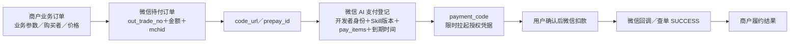

# SkillPay v2 原理复核：订单、凭据、信任与幂等

调研日期：2026-10-20。范围：公开官方文档、SkillHub 当前前端教程与官网 Demo 源码的只读复核；未登录、下单、付款或安装。`sources/v2/` 保存本次重新获取的微信支付文档、当前官网 JS、抓取清单与摘录。下文区分 **官方事实**、**源码事实**、**推论**、**生产建议**。

## 1. 两次下单，分别创建什么

**官方事实**：第一次传统 Native / JSAPI 下单创建“实际待付款的微信商业支付订单”：关联商户号、金额、币种、商户订单号和回调地址，返回 `code_url` / `prepay_id` 等。第二次 x402 预下单把这个预支付标识登记进微信 AI 支付后台，换成 Agent 能拉起的 `payment_code`。这是传统订单的 AI 支付入口登记，不应画成“对同一商品额外收第二次钱”。两步都不表示已经扣款，用户仍需授权支付。[微信 FAQ 产品 Q2](https://pay.wechatpay.cn/doc/v3/merchant/4035576771)、[Native 下单](https://pay.wechatpay.cn/doc/v3/merchant/4012791877)

**源码事实**：Go Demo `createPaymentOrder` 第 248 行生成 `out_trade_no`，254 行传统下单，264 行 AI 预下单，273–283 行保存两个标识；`callNativeOrder` 435–446 行设置金额与商户归属。见 [Go 源码](sources/mch-demo-mch-demo_go_main.go:245)。

**适合图示的对象关系**：

`out_trade_no` 是商户侧关联同一微信订单的标识；`transaction_id` 是微信成功交易的标识；`payment_code` 是发起支付的凭据；业务请求幂等键是商户自建的业务约束。四者不能互换。[回调字段](https://pay.wechatpay.cn/doc/v3/merchant/4012791882)

## 2. payment_code 绑定了什么，谁验签

**官方事实**：当前 x402 请求体含 `skill_info`、`pay_items[].product_id`、`pay_data` 和授权到期时间，整个请求体与方法、路径、时间戳、随机串共同签名；服务端返回不透明 `payment_code`，最长 15 分钟，过期或使用后需获取新的凭据。因此，能够确认的是“凭据对应这次登记的支付请求”，不能声称它内部必然包含某种 JWT、明文金额、购买者身份或某种公链支付证明；官方没有公开其内部编码。[当前 x402 API](https://pay.wechatpay.cn/doc/v3/merchant/4035576740)

**关键纠正：SkillHub 的运行时角色有一条直接证据。** SkillHub 现行官网教程明确称微信支付后台会向 SkillHub 验签以确认商户身份。2026-10-20 重新下载当前 `skill-hub.cpdwg332.js` 后仍有该说明（原 JS 字符偏移 2,982,254；[本次摘录](sources/v2/skillhub-current-evidence.txt)，旧可读抽取第 342 行）。因此可以画“微信 AI 支付 ↔ SkillHub 开发者身份／签名校验”的**逻辑信任关系**，不应把 SkillHub 描述成只在发布阶段出现。[SkillHub 最佳实践](https://skillhub.cn/tutorials#enterprise-best-practice)

**证据边界**：公开材料未披露该校验是每笔同步 RPC、批量公钥同步、缓存查询或其他实现，也没有披露超时、容灾、请求字段、流量路径与 SLA。商户源码的 AI 预下单 HTTP 请求直接发往微信域名（Go 57、655–663 行）；这不能证明微信内部不访问 SkillHub。准确表述是：“商户直连微信 AI 支付，使用 SkillHub 开发者身份；官方教程说明微信向 SkillHub 验签，内部实现未公开”。

**不得混淆**：上述“验签”验证的是商户发起的 AI 预下单身份与请求完整性；它不证明用户已经付钱。用户确认与微信扣款之后，商户还要验证微信支付结果。

## 3. 三种密钥用途与验付，谁信任谁

| 链路 | 谁签名／加密 | 谁验证／解密 | 解决什么问题 |
|---|---|---|---|
| 商户 → 传统微信 API | 商户 API 证书私钥 | 微信支付 | 哪个微信商户在请求下单、查单、退款 |
| 商户 → 微信 AI 预下单 | 商户持有的 SkillHub 开发者 RSA 私钥，携 `developer_id` 与 `pub_key_id` | 微信 AI 支付接收；SkillHub 教程说明向 SkillHub 验签 | 哪个已入驻开发者登记哪次 Skill 付款请求 |
| 微信 → 商户支付回调／响应 | 微信支付签名 | 商户使用 `Wechatpay-Serial` 对应的平台证书／微信支付公钥验签 | 支付结果是否来自微信、原文是否完整 |
| 加密回调 `resource` | 微信侧 AES-256-GCM | 商户用 APIv3 对称密钥解密 | 从密文取得订单支付状态、金额等 |

来源：[x402 签名指引](https://pay.wechatpay.cn/doc/v3/merchant/4035576740)、[支付成功回调](https://pay.wechatpay.cn/doc/v3/merchant/4012791882)、Go 68–96、518–520 行。Demo 自动下载的是微信支付平台证书，不是用 SkillHub 公钥验证支付回调。**APIv3 密钥用于解密，不是商户验回调签名所用的公钥；商户私钥用于签请求，也不是验证微信回调的公钥。**

**生产建议**：验签通过后仍核验 `mchid`、`appid`、`out_trade_no`、金额、币种和业务订单绑定；然后持久化支付终态，驱动履约。Agent 的“支付成功”文字、`payment_code` 和订单号本身都不构成验付证据。微信官方明确商户应以后台回调／查单为发货依据。[微信 FAQ 产品 Q3](https://pay.wechatpay.cn/doc/v3/merchant/4035576771)

## 4. HTTP 402 不负责收款，也不天然提供“买一次，执行一次”

**官方事实**：`WeixinPay-Required` 用于把 `payment_code` 交给 Agent；兼容模式甚至可以用 HTTP 200。故支付触发的有效契约是支付 Header／原文凭据与宿主支付能力，不能说 HTTP 状态码本身承担扣款、清算或履约。[微信 FAQ x402 Q1](https://pay.wechatpay.cn/doc/v3/merchant/4035576771)

**源码事实**：Demo 返回 `X-Out-Trade-No`，Agent 后续携该头继续业务请求（Go 234–242、287–304 行）。它是 SkillHub Demo 的订单关联约定，当前微信 x402 API 没规定它为跨平台标准付款证明。`verifyAndFulfill` 查询微信订单，仅 `SUCCESS` 才执行业务（333–363 行）；代码未校验 `payment_code` 来认定付款。

**三层幂等必须分开**：

| 层次 | 防止的重复 | 正确约束 | Demo 的现状 |
|---|---|---|---|
| 请求／建单幂等 | 网络重试创建多笔待付订单 | 稳定业务请求键 + 参数哈希 + 原业务订单复用 | 无 `X-Out-Trade-No` 就生成新随机订单号（241–248、721–727 行），没有首次请求幂等键 |
| 回调幂等 | 同一支付通知重复推动状态／重复触发任务 | 验签 + 去重通知／交易 + 原子状态迁移 | INIT→PAID 判断存在，但读取的是共享指针，检查与写入并非原子事务（532–537 行） |
| 履约幂等 | 同一笔付款重复生成／发货／调用付费上游 | 同业务订单唯一执行权 + 持久结果 + 下游幂等键 | 先看 FULFILLED、执行、最后保存（320–395 行），并发请求可能同时执行业务 |

## 5. Demo 为什么不能等同“生产保证”

以下是**静态源码审计推论**，没有做攻击或支付实测。

1. **进程重启失去订单、已付状态和结果**：`OrderStore` 是内存 map（105–140 行）；重启后已付款用户携原订单号会得“订单不存在”（312–317 行）。生产要持久存储业务订单、支付尝试、通知、履约结果，并能通过微信查单恢复。
2. **map 的锁不等于订单级锁**：Get 只在取 map 指针时持读锁，返回后释放；后续 `order.Status` / `Result` 读写均在锁外（137–140、321、393–395 行）。两个重试可同时穿过状态检查执行生成；回调和履约也可能读写竞态。需数据库条件更新、事务或工作队列取得唯一执行权。
3. **“执行完成，保存前掉电”仍可能二次执行**：即使加入简单 FULFILLING 状态，也需恢复策略；对外部不可回滚副作用，仍需向下游传稳定业务幂等键。不能把“有状态机”直接宣传成端到端恰好执行一次。
4. **原请求参数没有强绑定**：Demo 优先使用重试的新 query，仅为空时使用订单旧 query（358–363 行）。付款购买的请求与履约请求可能不同；也没有完整的用户授权校验。生产应固定购买者、请求哈希、价格及产品版本，拒绝任意替换，不能只拿订单号当访问权限。
5. **退款受理不等于退款成功**：Demo 在退款接口受理后立即写 REFUNDED（378–385 行），而退款回调另有 SUCCESS/CLOSED/ABNORMAL（574–583 行）。生产区分 REFUNDING、REFUNDED、REFUND_FAILED，避免把受理成功当到账完成。
6. **有效期存在错位**：Demo 传统订单 `time_expire` 为 870 秒（45、432–441 行），AI 凭据为 900 秒（615 行），可能出现凭据尚有效但原单已不能付。应统一有效期限，并以业务订单、传统订单、payment_code 三者最早到期点控制重试。

以上都不意味着微信支付本身存在同样问题；它们是商户 Demo 及应用层履约的边界。

## 6. 支付码过期，怎样避免重复业务订单

**官方事实**：FAQ 说取消／超时但码仍有效，可继续同一订单；码过期需重新走下单。x402 API 说过期／已使用需重新调用获取新码。Native API 又规定传统订单 `time_expire` 超时后已无法支付，建议先关单，再用新商户订单号下单。以上描述层级不同，不应拼成“码过期后一律沿用旧 prepay_id”的已验证规则。[FAQ](https://pay.wechatpay.cn/doc/v3/merchant/4035576771)、[x402 API](https://pay.wechatpay.cn/doc/v3/merchant/4035576740)、[Native API](https://pay.wechatpay.cn/doc/v3/merchant/4012791877)

**生产建议（不是现成的 SkillPay 自动能力）**：稳定 `business_order_id` 对应一次购买意图，允许下面有若干 `payment_attempt`。恢复时先查已有支付尝试：已付→履约；支付中→等待查单；未付且旧码仍有效→继续原尝试；码过期→核查传统订单有效性并按当前文档重走必要步骤；传统订单已过支付期限则关单、创建新商户订单，但仍关联同一业务订单。新旧尝试竞争付款时，商户应以同一业务订单的支付/履约约束防重复交付，必要时处理多付退款。

**关键结论**：更新支付入口不等于新建购买意图。把业务订单和支付尝试拆开，才可同时处理过期、重试、失败恢复和审计；单靠随机 `out_trade_no` 或一次性 `payment_code` 做不到。

## 7. v2 应明确标注的契约版本差异

当前微信官方 x402 文档（2026-09-01）是 `https://aipay.wxpapp.weixin.qq.com/aipay/preorder` + Authorization 签名 + JSON 对象 `payment_required` + `GOODS_PAY`；官网 Demo 仍为 `payapp.weixin.qq.com/palmpayminiapp/clawagentpay/preorder` + Body 签名 + Base64 payment_required + `SKILL_PAY`（Go 57、598–647）。原理图可采用两者稳定共识，但禁止混拼成一个可执行请求。产品 ID 当前 API 必填；旧 SkillHub 教程称 SPxxx 保留字段任填，不能用此证明现已具备统一商品计价与价格防篡改校验。[当前 API](https://pay.wechatpay.cn/doc/v3/merchant/4035576740)、[官网教程](https://skillhub.cn/tutorials#agent-pay-upgrade-x402)

## 建议 PPT 中保留的五句话

- 传统下单确定“向谁付、付多少”；x402 登记确定“Agent 怎样拉起这笔付款”。
- SkillHub 不只是货架：它提供开发者身份、商户绑定、密钥与验签信任，以及 Skill 发布分发。
- payment_code 是限时付款入口；微信后台的支付结果才是履约依据。
- 支付成功与服务交付是两件事；商户承担订单关联、验付、业务幂等、结果交付与退款补偿。
- 当前链路已经具备交易闭环；抽佣、GMV 与活跃付费消费规模仍不能由资产标签占比推断。
