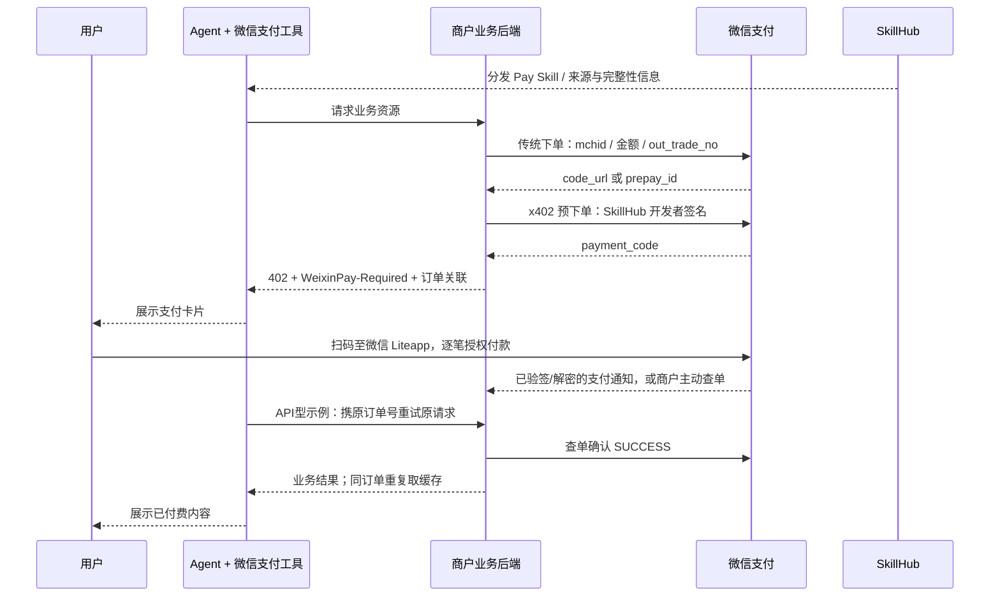

# 腾讯 SkillPay：微信支付 / x402 机制与职责边界

调研日期：2026-10-20（北京时间）。只读访问 SkillHub 官网、官网直接提供的商户 Demo 及微信支付官方文档；未登录、安装、创建预订单、触发支付或调用付费业务。当前官网仍加载 `skill-hub.cpdwg332.js`，与本地教程快照一致。微信支付文档 HTML、可读文本、Demo ZIP 和选定源码均保存于 `sources/`。

## 可用于机制页的结论

**SkillHub 把付费服务变成可分发的 Skill；微信 AI 支付把已有微信订单转换成 Agent 可拉起的支付请求；用户用 AI 专属卡逐笔确认；商户以微信后台支付结果验付并履约。** HTTP 402 是请求付费的信号，实际人民币资金仍通过微信支付渠道处理。[产品介绍](https://pay.wechatpay.cn/doc/v3/merchant/4035576700)、[开发指引](https://pay.wechatpay.cn/doc/v3/merchant/4035576716)、[常见问题](https://pay.wechatpay.cn/doc/v3/merchant/4035576771)

适合单页图的 8 步：

1. **发现与调用**：Agent 发现已上架的 Pay Skill，按指令请求商户业务 API。
2. **先建微信订单**：商户向微信支付 Native / JSAPI 等下单，设置金额、商户订单号及回调地址，获得 `code_url` / `prepay_id` 等。
3. **再建 AI 支付请求**：商户使用 SkillHub 开发者密钥调用微信 AI 支付 x402 预下单，换取一次性 `payment_code`。
4. **返回付费信号**：业务 API 返回 `402 + WeixinPay-Required: payment_code`；SkillHub Demo 还返回 `X-Out-Trade-No` 保存订单关联。
5. **用户逐笔确认**：Agent 支付工具展示卡片，用户扫码进入微信 Liteapp 授权，以 AI 专属卡余额完成付款。
6. **微信通知商户**：沿用微信支付回调 / 查单；商户验签、解密并校验订单结果，不信任 Agent 自述付款成功。
7. **继续业务请求**：SkillHub API 型 Demo 指导 Agent 携原订单号、原请求重试；商户查 `trade_state=SUCCESS` 后执行付费业务。
8. **交付与幂等**：商户保存履约结果，同订单重复请求返回缓存；失败补偿、退款沿用微信支付退款链路。

步骤 1–6 的共识来自微信支付官方产品/开发/FAQ 文档；步骤 7–8 的具体 Header 和缓存做法来自 SkillHub 官方 Demo。不能把 API 型 Demo 的“Agent 重试”概括为所有商户必须统一采用的微信支付协议字段。[官方 FAQ](https://pay.wechatpay.cn/doc/v3/merchant/4035576771)、[SkillHub 教程](https://skillhub.cn/tutorials#enterprise-best-practice)、[官方 Demo ZIP](https://skillhub-1388575217.cos.ap-guangzhou.myqcloud.com/mch-demo/mch-demo.zip)

## 1. 接入准备：两套身份、两套密钥、两种价格表达

### 商户资质及绑定

微信官方接入准备明确：申请微信商户号 → SkillHub 注册开发者、认证企业、开通 SkillPay 并绑定商户号 → 开发 Skill 与支付链路 → 上架分发。支持普通直连商户或经合作伙伴接入的子商户；不支持无营业执照的小微商户及部分银行子商户。具体以是否拥有微信商户平台网页端登录和操作权限判断。[开发接入准备](https://pay.wechatpay.cn/doc/v3/merchant/4035576711)

SkillHub 教程描述在商户中心获取 SkillHub 商户号及 Token，再到微信商户平台完成绑定；绑定成功后才具备发布、结算 Pay Skill 的前置条件。这不是把微信 `mch_id` 改成 SkillHub 编号：两者用途不同。[SkillHub 企业接入](https://skillhub.cn/tutorials#agent-pay-onboard)

| 身份/密钥 | 谁提供、由谁保存 | 用途 |
|---|---|---|
| 微信 `mchid` / `MCH_ID`、AppID | 微信商户体系；商户后端使用 | 传统微信下单、查单、退款归属 |
| 微信商户 API 证书私钥、APIv3 密钥 | 商户支付配置；保留在后端 | APIv3 请求签名、回调验签/解密等；不是 SkillHub 开发者私钥 |
| SkillHub `developer_id`（教程例 `sh-...`） | SkillHub 商户中心 | x402 请求中的开发者平台身份 |
| SkillHub `pub_key_id` + RSA 2048 私钥 | SkillHub 提供密钥生成；私钥交商户后端保管 | 以 `SKILLHUB-SHA256-RSA2048` 签名 x402 预下单 |

SkillHub 教程称私钥仅展示一次且平台不存储、每商户最多 3 组有效密钥；这是产品文档声明，未进入商户后台验证。微信当前 API 将该身份称为密钥提供方分配的开发者身份，示例 ID 与 SkillHub 教程格式不同，不应拿示例值当硬编码格式。[SkillHub 教程](https://skillhub.cn/tutorials#agent-pay-upgrade-key)、[微信 x402 API](https://pay.wechatpay.cn/doc/v3/merchant/4035576740)

### `pricing` 与 `product_id` 的边界

- SkillHub 发布页支持免费和按调用量计费；教程以 `pricing.model: per_call`、`pricing.amount_fen: 30` 举例，页面以元/次表达单价。它负责资产发布与价格呈现。[发布定价教程](https://skillhub.cn/tutorials#agent-pay-publish-pricing)
- 实际微信订单金额由商户后端调用 Native / JSAPI 时传入 `amount.total`（分）及币种，例如 Demo 固定 1 分。x402 对既有微信预订单做包装，本身不替商户生成业务金额。[Native 下单](https://pay.wechatpay.cn/doc/v3/merchant/4012791877)、[Demo 源码](sources/mch-demo-mch-demo_go_main.go)
- 当前微信 x402 文档要求 `pay_items[].product_id`，称产品标识，未说明如何在 SkillHub 注册、分配或与定价绑定；SkillHub 旧教程却称其为 `SPxxx` 保留字段、可任填，Demo 拼日期生成。这是文档差异，不能据此把它画成已验证的统一商品计费主键。[当前 API](https://pay.wechatpay.cn/doc/v3/merchant/4035576740)、[SkillHub 教程](https://skillhub.cn/tutorials#agent-pay-upgrade-x402)

## 2. 一次调用：业务流、支付流与钱流



**钱流**：当前产品只允许从用户 AI 专属卡余额内划扣，资金与用户微信主账户隔离；商户收款归属于传统订单中的微信商户号。公开材料没有披露 SkillHub 对所有交易的抽佣比例、清结算周期或统一分账方案，因此不画“先到 SkillHub 钱包再结商户”的资金路线，也不主张 SkillHub 承担支付机构职能。[产品介绍](https://pay.wechatpay.cn/doc/v3/merchant/4035576700)、[Native 订单契约](https://pay.wechatpay.cn/doc/v3/merchant/4012791877)

**用户确认**：微信产品介绍截至当前公开的是笔笔确认模式：每笔订单扫码到微信 Liteapp，由用户授权；示例包含支付密码验证。不能用“无需用户确认”“Agent 自主无感扣款”“全程不用手机”概括。[产品介绍，更新 2026-08-27](https://pay.wechatpay.cn/doc/v3/merchant/4035576700)

## 3. 当前微信官方 API 与 SkillHub 教程存在版本差异

这是本次调研的重要限制。两份材料均为官方来源，但预下单端点、鉴权位置、Body 形状及支付类型不同。不能把它们拼成一个可执行请求，也没有证据证明旧接口已经停用。

| 项目 | 当前微信支付 API（2026-09-01 更新） | SkillHub 当前教程 / Demo |
|---|---|---|
| 端点 | `POST https://aipay.wxpapp.weixin.qq.com/aipay/preorder` | `POST https://payapp.weixin.qq.com/palmpayminiapp/clawagentpay/preorder` |
| 鉴权位置 | HTTP `Authorization` 头 | HTTP Body 内签名元数据；教程强调不用 Authorization |
| 认证类型 | `SKILLHUB-SHA256-RSA2048` | 同名认证类型放 `signature_type` |
| `payment_required` | JSON 对象 | L2 JSON 经 Base64 编码成字符串 |
| `pay_type` | 当前支持 `GOODS_PAY` | `SKILL_PAY` |
| 签名第 2 行 | `/aipay/preorder` | `/palmpayminiapp/clawagentpay/preorder` |
| 签名第 5 行 | 完整 HTTP 请求 Body | Base64 的 `payment_required` 字符串 |
| product_id | 必填产品标识 | 教程称保留字段 SPxxx 可任填 |
| 成功响应 | `payment_code` | `payment_code` |

来源：[微信 x402 预下单 API](https://pay.wechatpay.cn/doc/v3/merchant/4035576740)、[SkillHub 改造教程](https://skillhub.cn/tutorials#agent-pay-upgrade-x402)、[官方 Demo 下载](https://skillhub-1388575217.cos.ap-guangzhou.myqcloud.com/mch-demo/mch-demo.zip)。

**PPT 处理建议**：机制图采用稳定共识“传统下单 → 微信 AI 支付 x402 预下单 → payment_code”，技术附注优先展示当前微信支付 API，保留“SkillHub 教程/Demo 有旧版契约，落地需对齐版本”的简短说明。

### 当前 API 的真实结构（只展示，不发请求）

```http
POST https://aipay.wxpapp.weixin.qq.com/aipay/preorder
Authorization: SKILLHUB-SHA256-RSA2048 developer_platform="SKILLHUB",developer_id="...",pub_key_id="...",nonce_str="...",timestamp="...",signature="..."
Accept: application/json
Content-Type: application/json
```

```json
{
  "payment_required": {
    "skill_info": { "skill_id": "...", "skill_version": "1.0.0" },
    "pay_type": "GOODS_PAY",
    "pay_mode": "AUTH_AND_PAY",
    "expires_at": "<Unix秒>",
    "pay_items": [{
      "product_id": "...",
      "pay_data": { "type": "prepay_id", "value": "<既有微信预支付标识>" }
    }]
  }
}
```

Body、URL、时戳及随机串按 5 行规则签名，末行也需换行；`payment_code` 是触发付款的一次性凭证，最长 15 分钟，已使用或过期需重新获取。它是付款前的拉起凭证，**不是“已支付证明”**。[微信 API](https://pay.wechatpay.cn/doc/v3/merchant/4035576740)

Native 对应 `pay_data.type=code_url`，JSAPI/小程序/APP 对应 `prepay_id`，H5 对应 `h5_url`。SkillHub 教程一处将 H5 与 prepay_id 混写，FAQ 的详细映射及微信官方 FAQ 则明确为 h5_url；本报告采用后者。[微信 FAQ](https://pay.wechatpay.cn/doc/v3/merchant/4035576771)

## 4. 业务 HTTP 402 契约与真正验付

### 商户 → Agent 的触发

```http
HTTP/1.1 402 Payment Required
WeixinPay-Required: <payment_code>
X-Out-Trade-No: <商户订单号，SkillHub Demo约定>
Content-Type: application/json
```

微信官方还支持 HTTP 200 兼容模式，以 `WeixinPay-Required` 是否存在作为支付触发依据；对只读 Body 的 Agent，建议同时投递等值支付码，保持原文不改写。`X-Out-Trade-No` 则来自 SkillHub 商户 Demo 的订单关联约定，未在当前微信预下单 API 中被规定为统一支付证明头。[微信 FAQ](https://pay.wechatpay.cn/doc/v3/merchant/4035576771)、[Demo `createPaymentOrder`](sources/mch-demo-mch-demo_go_main.go)

Agent 将 paymentCode 交给微信支付工具；当前产品由支付卡片引导用户授权。微信官方 FAQ 要求不要让 Skill 在对话内反复查支付或重复拉起支付，商户后端通过回调/查单驱动发货。对于 SkillHub API 型示例，支付完成后还需继续业务请求取回结果；二者并不冲突：**付款状态在商户后端验证，Agent 的重试只是继续获取业务结果。**[微信 FAQ](https://pay.wechatpay.cn/doc/v3/merchant/4035576771)、[SkillHub 最佳实践](https://skillhub.cn/tutorials#enterprise-best-practice)

### 商户验付：回调验签 / 主动查单

- Native 下单：`POST https://api.mch.weixin.qq.com/v3/pay/transactions/native`。[Native API](https://pay.wechatpay.cn/doc/v3/merchant/4012791877)
- 按商户订单号查单：`GET https://api.mch.weixin.qq.com/v3/pay/transactions/out-trade-no/{out_trade_no}?mchid={mchid}`，读取支付状态与微信订单号。[查单 API](https://pay.wechatpay.cn/doc/v3/merchant/4012791880)
- 回调：微信 POST 到下单时的 `notify_url`；头包含 `Wechatpay-Serial`、`Wechatpay-Signature`、`Wechatpay-Timestamp`、`Wechatpay-Nonce`。商户根据平台证书/微信支付公钥验证原文签名，再使用 APIv3 密钥解密 `resource` 中 AES-256-GCM 密文。[支付成功回调](https://pay.wechatpay.cn/doc/v3/merchant/4012791882)
- 回调需及时应答，可能重复，不能仅依赖回调，应结合查单补偿。商户仍需确认订单归属、金额及业务绑定，防止把无关订单用于当前请求；这是根据官方返回字段和服务边界归纳的生产实现要求。[回调说明](https://pay.wechatpay.cn/doc/v3/merchant/4012791882)

**没有找到微信这条链路使用支付宝式通用 `Payment-Proof` 的证据。** 当前 Demo 重试时仅读 `X-Out-Trade-No`，据此查本地订单再查询微信；即便 Prompt 建议带回 `WeixinPay-Required`，Go 代码也没有把此值当支付成功凭证。不能把两家 402 方案的 Header、验签或履约回执混合。[Demo 源码](sources/mch-demo-mch-demo_go_main.go)

## 5. 实际 Demo 展示了什么，尚未保证什么

官网直接链接的 `mch-demo.zip` 同时包含 Go / Java。当前 Go 代码使用微信支付官方 SDK 接口：

- `callNativeOrder` 建微信订单，`callAIPreorder` 调旧版 AI 预下单端点，返回 402 与两个 Header。
- `verifyAndFulfill` 根据订单号查本地记录；已 FULFILLED 返回缓存，否则查微信 `trade_state`，为 SUCCESS 才执行业务；保存结果并标记 FULFILLED。
- `handlePayNotify` 使用 SDK `ParseNotifyRequest` 验签及解密，成功时将 INIT 记录改为 PAID。
- 业务失败时申请退款，退款通知再更新结果；退款本身沿用传统微信支付接口。

来源：[官方 ZIP](https://skillhub-1388575217.cos.ap-guangzhou.myqcloud.com/mch-demo/mch-demo.zip)、[Go 快照](sources/mch-demo-mch-demo_go_main.go)、[Java 快照](sources/mch-demo-mch-demo_java_src_main_java_com_example_weixinpayx402demo_WeixinPayX402DemoApplication.java)。

需要明确三点边界：

1. **教程与 Demo 不完全同步。** 教程仍称 V3 签名占位、回调未实现；实际归档已经接 SDK 且实现支付/退款回调。以本次读取源码为当前证据，不照抄旧描述。
2. **这是示例级幂等。** 内存 map 保存状态和结果；“读状态 → 查单 → 业务执行 → 写完成”不是数据库事务包住的一次原子操作，不能宣传并发下已保证绝不重复执行。生产需要持久化与事务/业务幂等键。
3. **没有做线上支付实测。** 未检验旧预下单端点可用性、商户实际权限、支付卡片体验、真实扣款、回调时延、退款到账或清结算。示例代码存在不代表全部生产保障已经验证。

## 6. 四方职责边界

| 主体 | 核心职责 | 不应被混同 |
|---|---|---|
| SkillHub | 开发者/企业入驻、绑定关系、开发者密钥体系、Skill 发布/来源与完整性信息、价格展示、分发到 Agent 入口 | 不是代替商户承接所有业务执行，也不是 402 信号本身完成了人民币清算 |
| 微信支付 | 传统微信订单、x402 AI 支付预下单、一次性 payment_code、AI 专属卡及用户确认、支付结果通知/查询、退款 | 不能用“有 payment_code”替代“钱已付”；不代替商户执行付费 API 的业务 |
| 商户后端 | 业务定价与订单、两步下单、签名、402 返回、支付验真、订单/请求关联、业务执行、缓存幂等、失败退款及交付 | 不依赖大模型转述成功来发货；需承担 API 服务与履约可靠性 |
| Agent / 支付工具 | 发现并加载 Skill、确认支持支付能力、调用资源、保留原始支付码/订单信息、拉起用户授权、继续原任务并展示结果 | 不自行掌握商户签名私钥；对话文字不构成商户可据以发货的付款证明 |

依据：[微信接入准备](https://pay.wechatpay.cn/doc/v3/merchant/4035576711)、[微信开发指引](https://pay.wechatpay.cn/doc/v3/merchant/4035576716)、[微信 FAQ](https://pay.wechatpay.cn/doc/v3/merchant/4035576771)、[SkillHub 企业教程](https://skillhub.cn/tutorials#agent-pay-onboard)。

## 7. 建议用于两页汇报的表达

**页 1（定位/价值）**：SkillPay 连接“Skill 分发、Agent 调用与支付”，把服务变成可发现、可按次购买的能力。SkillHub 负责开发者与资产入口，微信支付负责资金及授权，商户保留原服务并负责履约；当前微信公开产品为笔笔确认。

**页 2（机制/边界）**：画“四方泳道＋用户授权”：发现调用 → 商户传统下单 → 微信 x402 预下单 → 402 交 payment_code → 用户 AI 专属卡逐笔授权 → 商户回调/查单验付 → 原订单续取结果 → 缓存幂等/失败退款。页脚标注“协议细节存在官方版本差异；本次基于文档与源码，未真实交易”。

术语建议：使用“Agent 发起、用户授权、微信扣款、商户验付履约”；不用“402 自动扣款”“用户无感”“payment_code=已付凭证”“平台托管业务资金”“下载 Skill 即购买所有权”。后两项未被本次官方资料证明。
