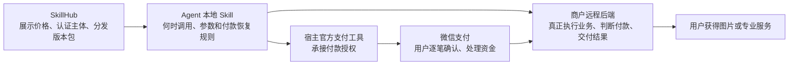
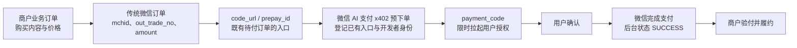
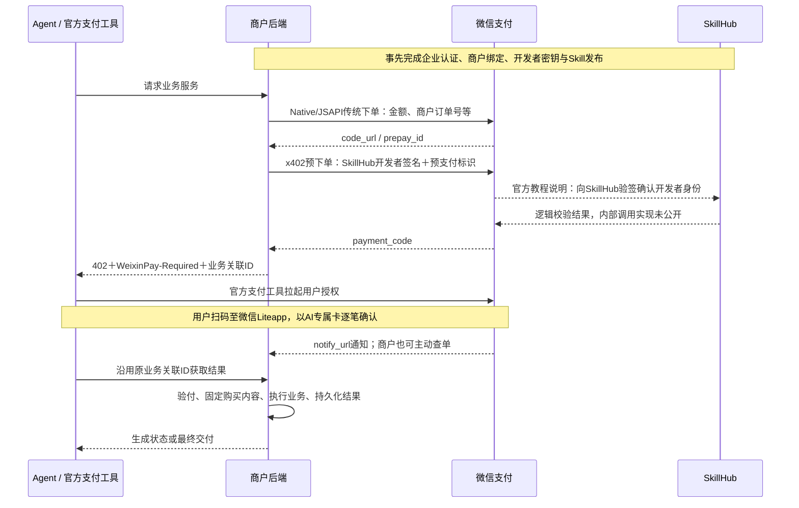
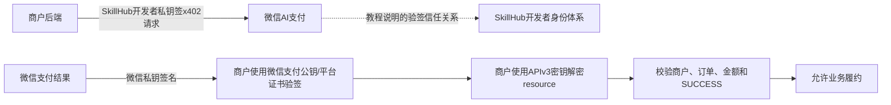
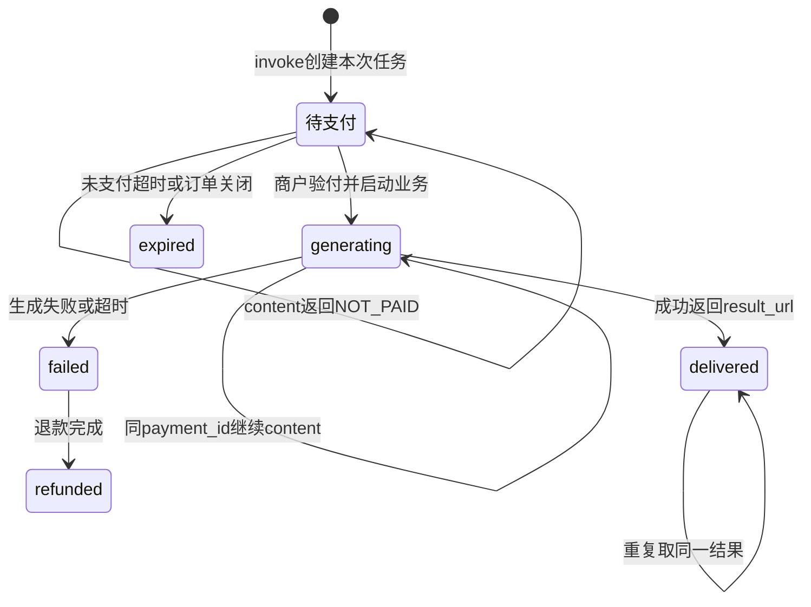
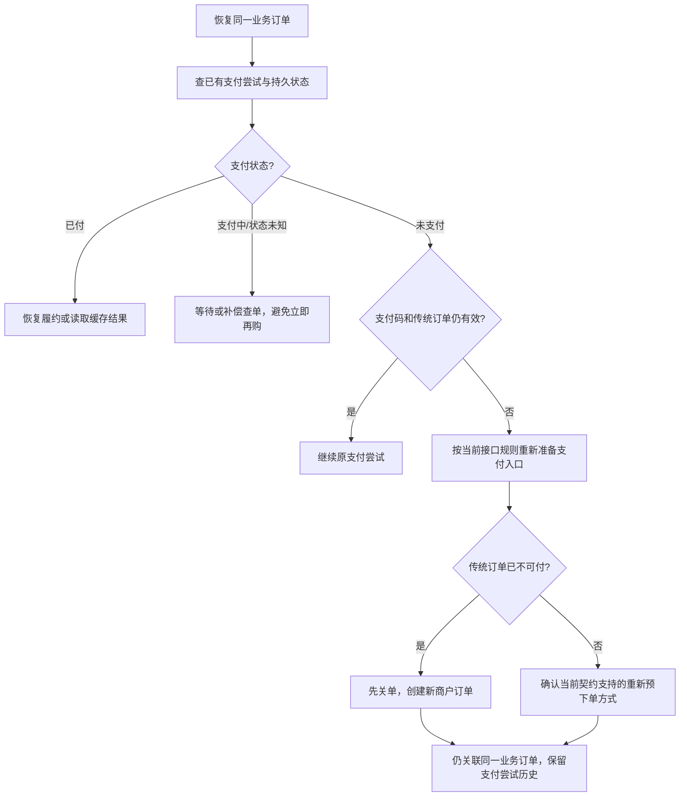

# 腾讯 SkillHub / SkillPay 商业化原理详解 v2

调研日期：2026-10-20。两页主稿与本文配套。本文按“资产为何能卖、订单如何变成 Agent 支付、谁验证谁、付款后怎样交付、异常如何恢复”展开。官方机制、公开服务契约、示例源码和生产建议分别说明，避免把样例行为当作全平台生产保证。

## 1. SkillHub 商业化的对象究竟是什么

一份 Skill 通常包含 SKILL.md、调用脚本和参考资料。它告诉 Agent 何时调用服务、如何组织参数、如何处理付费和取得结果。文件被安装进 Agent 环境，并不意味着生成模型、行业数据或远程业务后端也被下载到本地。

WorkRally 图片生成给出了清楚的样本：包内说明调用腾讯远程接口，展示价 0.36 元/次，用户无需配置该业务的 API Key。公开下载接口可以取得技能包，而有价值的图片生成仍由服务器按付款和任务状态提供。喜鹊标书解读也是公开技能文件调用第三方远程服务，展示价 1 元/次。这里只据两例解释模式，不推断全站所有 Pay Skill 均采用相同授权和收费方式。[WorkRally Skill](https://api.skillhub.cn/api/v1/skills/workrally-image/file?path=SKILL.md)、[WorkRally 详情](https://api.skillhub.cn/api/v1/skills/workrally-image)、[喜鹊 Skill](https://api.skillhub.cn/api/v1/skills/xique-tender-pay/file?path=SKILL.md)。



为什么公开指令文件不直接消灭收费能力：文件提供的是调用方法，付费资源的生产和访问控制仍在商户后端。用户即使能阅读 API 地址，也需要走后端的验付和履约流程。这是从公开架构得出的解释，不是对所有服务安全实现的实测结论。

### 与 API Key 类资产的区别

API Key 标记表示使用者可能需要准备外部服务凭证。第三方可能提供免费额度、订阅或按量 API，所以凭证依赖与付费不是同一个维度。

| 维度 | 常见 API Key 接入 | 已核实的 WorkRally Pay Skill |
|---|---|---|
| Agent 调用前准备 | 配置对应外部服务的 Key 或账户 | 检查宿主具备微信支付能力 |
| 如何关联业务消费 | 通常关联外部账户与其配额，具体依服务 | 商户业务关联 ID 与一次任务关联 |
| 如何发起本次付款 | 不能仅凭 Key 标签判断 | 业务请求返回支付码，用户确认本次付款 |
| 业务成本与收费 | 需阅读外部服务条款，不能从标签推算 | 商户提供远程生成服务并展示按次价格 |

平台标签里的“用户业务 API Key”，与商户后端使用的 SkillHub 开发者私钥、微信商户私钥不是同一种凭证。用户无需业务 Key，不意味着后端支付接入不需要身份和密钥。

## 2. 两次下单为何都需要

传统微信订单解决商户、金额、币种、商户订单号和回调地址等支付问题。它返回 code_url、prepay_id 等预支付标识，还没有完成扣款。微信 AI 支付的 x402 预下单接收这个已有标识及开发者身份、Skill 信息和授权到期时间，换成 Agent 支付工具能够使用的 payment_code。第二步登记付款入口，不会因为做了两次请求就扣两次钱。[微信开发指引](https://pay.wechatpay.cn/doc/v3/merchant/4035576716)、[微信 FAQ](https://pay.wechatpay.cn/doc/v3/merchant/4035576771)、[Native 下单](https://pay.wechatpay.cn/doc/v3/merchant/4012791877)。



两步之间最值得检查的是 **pay_data.value 来自哪里**。当前微信 x402 请求不是让 Agent 随意声明“我要付 0.36 元”，而是把既有微信订单的预支付标识放入 pay_data。实际交易金额由商户调用传统下单接口时提供。SkillHub 上架价、Skill 描述价与真实微信订单价应保持一致；公开材料不足以证明平台对所有服务都执行了统一的商品级价格强制绑定。

`product_id` 也不能替代这个判断。WorkRally 业务 API 的 `image-generation` 是它选择图片服务的业务参数；微信 x402 的 `pay_items[].product_id` 是支付协议字段。两者是否映射、怎样映射要看实现。旧 SkillHub 教程将后一字段称为 SPxxx 保留字段，当前微信文档要求产品标识，却未公开统一注册和价格绑定细节，故不能据此宣称平台已提供通用商品防改价机制。[当前 x402 API](https://pay.wechatpay.cn/doc/v3/merchant/4035576740)、[WorkRally 定价说明](https://api.skillhub.cn/api/v1/skills/workrally-image/file?path=references%2Fpricing.md)。

## 3. 一次交易里，四方到底谁调用谁



这是一条逻辑成功路径。用户界面显示支付成功、微信回调到达、Agent 恢复请求，三者在真实网络中不保证严格顺序。商户要用可恢复的状态和查单处理回调延迟，而不是假定“Agent 下一句说成功，后台就一定已记账”。[微信产品介绍](https://pay.wechatpay.cn/doc/v3/merchant/4035576700)、[微信 FAQ](https://pay.wechatpay.cn/doc/v3/merchant/4035576771)、[支付成功回调](https://pay.wechatpay.cn/doc/v3/merchant/4012791882)、[SkillHub 最佳实践](https://skillhub.cn/tutorials#enterprise-best-practice)。

### SkillHub 有运行期信任职责，但内部实现没有公开

本轮重新下载的现行 SkillHub 官网教程明确说，微信支付后台会向 SkillHub 验签、确认商户身份。因此把 SkillHub 只画成上架前的文件货架会遗漏一项职责。

同时，公开商户代码直接把 x402 HTTP 请求发往微信域名，没有先请求 SkillHub 支付代理的步骤。我们能据此确定商户对外请求的目标，不能据此推断微信内部的实现。公开资料没有说明校验是每笔同步请求、缓存查询、公钥同步还是其他机制，也没有 SLA、容灾或验签内部接口契约。图中的微信与 SkillHub 连线表达官方教程披露的逻辑信任关系。[现行教程](https://skillhub.cn/tutorials#enterprise-best-practice)、[官方 Demo](https://skillhub-1388575217.cos.ap-guangzhou.myqcloud.com/mch-demo/mch-demo.zip)。本地新取证见 `sources/v2/skillhub-current-evidence.txt`，源码审计见 [原理复核](research-principles-v2-audit.md)。

## 4. HTTP 402、支付码和支付结果分别证明什么

| 对象 | 谁产生、谁使用 | 能说明什么 | 后续怎么用 |
|---|---|---|---|
| HTTP 402 | 商户业务接口返回给 Agent | 当前服务需要付款 | 读取支付信号，交给宿主支付能力 |
| WeixinPay-Required | 商户把微信返回的支付码放入 Header，或按指引同时放入 Body | 有一份应原样传递的拉起凭据 | 支付工具读取原文 |
| payment_code | 微信 AI 支付生成 | 这次支付请求可在有效期内拉起授权 | 交给官方支付工具，不当成付款完成证明 |
| out_trade_no | 商户创建 | 定位一笔微信商户订单 | 商户查单、对账和退款关联 |
| payment_id | WorkRally 业务后端返回 | 定位该服务的一次业务任务 | 传给 content，不拿它替换 payment_code |
| transaction_id | 微信支付生成 | 微信交易标识 | 与后端验真的订单结果关联留存 |
| SUCCESS | 微信后台回调/查单返回的支付状态 | 对应微信订单支付成功 | 商户校验主体、金额及业务绑定后驱动履约 |
| delivered / result_url | 商户业务后端返回 | 该业务任务已产生交付结果 | 展示并按契约保存结果 |

402 自身不转账。微信还支持 HTTP 200 兼容投递支付 Header，这直接说明支付机制依赖约定的支付信息、宿主工具和微信后台，而不是仅依赖某个数字状态码。反过来，某个接口返回 402 也不能无条件重新拉起付款，要读取业务阶段及 Header/Body：WorkRally 的 content 返回 `code:NOT_PAID` 时，表示原任务尚未确认付款，应继续原任务恢复规则。[微信 FAQ x402 问题](https://pay.wechatpay.cn/doc/v3/merchant/4035576771)、[WorkRally 异常规则](https://api.skillhub.cn/api/v1/skills/workrally-image/file?path=references%2Ftroubleshooting.md)。

支付码最长有效 15 分钟，过期或使用后需要按当前接口规则获取新的凭据。文档没有公开 payment_code 内部编码，所以不能把它擅自解释成 JWT、明文金额、支付签名或已支付证明。Agent 使用该码时无需解码或验签；真正付款结果仍由商户后台验证。[x402 API](https://pay.wechatpay.cn/doc/v3/merchant/4035576740)、[WorkRally SKILL.md](https://api.skillhub.cn/api/v1/skills/workrally-image/file?path=SKILL.md)。

## 5. 两套身份、两次验签和回调解密

### 第一类：商户发出支付相关请求

传统微信 API 使用商户支付身份和商户私钥签名，让微信确认哪个商户在下单、查单或退款。AI 预下单使用 SkillHub 分配的开发者身份和开发者 RSA 私钥，带上 developer_id、pub_key_id 等，让请求接收方按该身份体系验证这次登记请求。

当前微信 x402 签名覆盖方法、URL 路径、时间戳、随机串和完整请求 Body，每行带换行。任何参与签名的原始字节变化，都可能导致验签不通过。开发者身份签名证明对应密钥持有人发出了请求，以及签名覆盖的内容完整；它不能在用户付款前证明钱已经到账。[x402 签名指引](https://pay.wechatpay.cn/doc/v3/merchant/4035576740)。

### 第二类：商户接收微信支付结果

微信支付对回调签名，商户根据 Wechatpay-Serial 对应的微信支付公钥/平台证书验证响应原文。验签成功后，用 APIv3 对称密钥解密加密 resource，取得状态、金额、订单号等内容。验签解决来源和完整性，解密解决读取加密内容，密钥用途不同。[微信支付回调](https://pay.wechatpay.cn/doc/v3/merchant/4012791882)。



商户不能用自己的私钥验证微信签名，不能用 SkillHub 开发者公钥代替微信验签公钥，也不能把 APIv3 密钥当作上述非对称公钥。用户业务 API Key 又是另一层外部业务访问凭证。

生产实现还需把经过验真的支付结果关联到固定的购买者、业务参数、价格和版本。订单号只是定位键，不能无条件当成读取任何已付内容的访问授权。这是商户应用层需要建立的约束，不应假定平台验签自动完成这些工作。

## 6. WorkRally 实例：为何付款后仍需 content

公开业务契约将一次调用拆成两类接口：`invoke` 发起本次服务并取得支付信息；`content` 使用同一 payment_id 取得业务状态与结果。付款完成不代表图像已经生成，生成还可能失败或进入退款流程。[调用时序](https://api.skillhub.cn/api/v1/skills/workrally-image/file?path=references%2Finvoke-flow.md)。

以下是契约结构的简化展示，不发出真实请求：

```http
POST /zenstudio/api/agent-pay/invoke
Content-Type: application/json

{"product_id":"image-generation","prompt":"<图片需求>"}
```

```http
HTTP/1.1 402 Payment Required
WeixinPay-Required: PMTCODE_...
Content-Type: application/json

{
  "payment_id": "WPAY_...",
  "WeixinPay": {
    "WeixinPay-Required": "PMTCODE_...",
    "prompt": "<支付引导>"
  }
}
```

支付工具接收支付码，业务 content 接收 payment_id。这两个字段虽然同一次返回，但后续用途完全不同：

```http
POST /zenstudio/api/agent-pay/content
Content-Type: application/json

{"payment_id":"<原invoke返回的同一payment_id>"}
```



图将业务契约抽象为状态迁移，不声称观察到了商户内部数据库实现。“待支付”是读图用的状态名称，NOT_PAID 是错误 code，不是文档里的 status 取值。

| 响应 | 应理解为 | Agent 行为 |
|---|---|---|
| HTTP 200 + generating | 已付且生成中，尚未交付 | 按 retry_after_seconds（当前 5 秒）用同一 payment_id 查询 content |
| HTTP 200 + delivered | 已交付 | 读取 result_url；重复获取按契约返回相同结果 |
| HTTP 402 + code:NOT_PAID | 原任务尚未确认付款 | 按原任务继续确认/恢复；不凭状态码生成另一笔购买 |
| failed | 业务失败，关注退款状态 | 按错误规则结束旧任务；如仍需结果，按契约重新 invoke |
| refunded | 退款完成终态 | 告知退款；如用户仍需服务，再发起新任务 |
| expired / PAYMENT_EXPIRED | 旧任务或支付尝试已失效 | 按该服务规则重新 invoke，不复用失效 payment_id |

公开 troubleshooting 还承诺相同入参重试 invoke 使用云端幂等键去重，以及同 payment_id 重复 content 不重复生成/扣费。这是 **WorkRally 发布的服务契约**；本次没有读到该生产后端源码或做支付实测，故未把承诺提升为已验证的故障恢复保证。[异常、重试与超时说明](https://api.skillhub.cn/api/v1/skills/workrally-image/file?path=references%2Ftroubleshooting.md)。

结果链接有效期与支付授权期也是两种期限。WorkRally 当前说明 result_url 短链约 5 小时有效，payment_id 未付有效期 15 分钟；不能用结果链接过期推断钱未付，也不能把“拉起支付码仍有效”当作“生成结果永久可取”。

## 7. 可靠交易需要三层幂等

“缓存了结果”只覆盖了部分重复读取。网络重试、支付通知和业务执行分别发生在不同阶段，应分别建立约束。

| 层次 | 要防止的问题 | 生产实现应建立的关系 |
|---|---|---|
| 请求/建单幂等 | 用户的一次购买意图因超时重发，产生多笔待付订单 | 稳定业务请求 ID，绑定购买者、参数哈希、价格和版本，复用业务订单 |
| 支付回调幂等 | 微信重复通知同一次成功支付，触发重复状态变更或生成任务 | 验签后去重交易/通知，以数据库条件更新或事务推动一次有效状态迁移 |
| 履约幂等 | 多个 content 请求并发，重复消耗生成成本或交付副作用 | 业务订单唯一执行权、持久化任务与结果，调用下游时传稳定幂等键 |

这些是架构建议，不能写成平台自动替每个商户提供的既成能力。对不可回滚外部调用，还要处理“下游执行完了，商户写入结果前进程退出”的窗口；仅增加一个 FULFILLING 字段并不能证明端到端恰好执行一次。

### 官方 Demo 具体展示了什么、还缺什么

Go Demo 已接微信 SDK、回调验签/解密、主动查单、结果缓存和退款。它非常适合解释协议步骤，但静态源码还暴露了示例级边界：

- 状态存在内存 map，重启失去业务关联和结果。
- Get 的 map 读锁释放后返回共享订单指针，检查 FULFILLED、执行、写结果没有覆盖整个过程的原子约束，并发可能重复执行。
- 未携 X-Out-Trade-No 的初次重试会随机生成新订单号，缺少稳定首次请求幂等键。
- 履约优先使用本次重试 query，只有空值才沿用订单旧 query，未固定购买参数。
- 退款接口受理后即标 REFUNDED，未严格区分退款受理、处理中和确认完成。
- 示例传统订单 870 秒到期、AI 支付码 900 秒到期，期限有错位。

这些是对官方 **示例代码** 的静态分析，不意味着 WorkRally、微信支付或其他生产服务一定存在相同问题。代码位置、事实与建议的区分详见 [v2 原理复核](research-principles-v2-audit.md)；原始 [官方 Demo](https://skillhub-1388575217.cos.ap-guangzhou.myqcloud.com/mch-demo/mch-demo.zip)。

## 8. 过期、取消、回调延迟如何恢复

稳定业务订单代表一次购买意图；微信订单和 payment_code 可以属于它下面的某个支付尝试。将两个层次分开，有利于恢复和对账。



这张图是生产恢复建议。微信 FAQ 对用户取消、过期、原订单续付有说明，x402 对码过期要求重新取得凭据，传统 Native 订单对自身过期也有约束。公开材料不足以证明“任何过期码都可以直接复用原 prepay_id”，所以恢复必须查清传统订单是否可付，不能只换一个支付码字符串。[微信 FAQ](https://pay.wechatpay.cn/doc/v3/merchant/4035576771)、[x402 API](https://pay.wechatpay.cn/doc/v3/merchant/4035576740)、[Native API](https://pay.wechatpay.cn/doc/v3/merchant/4012791877)。

退款也有自己的状态机。微信受理退款请求，只说明请求已接收；完成时间和最终状态还要看退款查询/通知。用户侧消息应据实际退款状态表达“已发起”或“已完成”，避免将两者混写。[退款接口](https://pay.wechatpay.cn/doc/v3/merchant/4012791883)。

## 9. SkillHub 平台做了什么，商业成熟度怎样判断

| 环节 | 当前证据支持的平台工作 | 商户仍需承担 |
|---|---|---|
| 供给准入 | 企业认证、商户绑定、个人支付宝接入路径 | 企业/个人资质、支付签约与服务主体责任 |
| 资产发布 | 版本包、按次价格和费用说明、支付链路与内容审核 | 部署业务 API，保证展示价与实际订单价一致 |
| 发现与分发 | 官网发现、CLI/API安装入口、接入不同 Agent | 声明宿主支付能力和服务依赖，处理真实调用 |
| 支付身份 | 开发者身份和密钥、教程所述验签信任 | 私钥保管、传统订单与x402请求签名 |
| 交易后服务 | 展示交易边界、协助投诉/退款 | 验付、订单授权、幂等执行、结果交付与退款补偿 |

官网称当前按次价格由商家自主设定，平台暂不收技术服务费，费用由用户直接支付给创作者，资金按微信/支付宝渠道规则结算至绑定账户。因此可确认它已建立服务商的变现入口；不能将商户流水直接算作腾讯平台收入，也不能宣称平台永久免费或商户零支付成本。[SkillPay FAQ](https://skillhub.cn/skillpay)、[当前生产前端](https://cloudcache.tencent-cloud.com/qcloud/tea/app/skillhub/assets/skill-hub.cpdwg332.js?max_age=31536000)。

2026-10-20 同参数公开 API 的非原子快照：全部 199,545；paid 17,061；alipay 2,901；两标签合计 19,962，约 10.0%；需 API Key 38,568，约 19.3%。Pay Skill 目录另有 19,974，是不同口径。这里采用付费元数据标签，不等同已开通微信商户、发生交易或穷尽全部可能收费方式。详细查询、交叉计数与非原子限制保留在 [v1 统计说明](skillpay-insights.md) 和 [原始请求](statistics-snapshot.json)。

全站 GMV、付费转化、活跃付费用户、复购、退款率及平台收入尚无公开可核验结果。官网收益/调用卡片明确为示例数据。公开下载量也无法乘以展示单价推算营收：一次下载可能零次、一次或多次调用，付费只发生在特定业务服务流程中。

综合分析：**平台已把服务供给、分发和支付身份接到一起，真实服务已有商业契约；交易经营规模成熟度仍缺可核验数据。** 进一步评估应同时检查活跃商户、真实付费履约、失败退款和复购，而不只统计付费资产标签。

## 10. 当前官方协议的版本差异

| 项目 | 微信当前 x402 API | SkillHub 教程 / Demo |
|---|---|---|
| 预下单地址 | `aipay.wxpapp.weixin.qq.com/aipay/preorder` | `payapp.weixin.qq.com/palmpayminiapp/clawagentpay/preorder` |
| 鉴权位置 | Authorization | Body |
| payment_required | JSON 对象 | Base64 字符串 |
| pay_type | GOODS_PAY | SKILL_PAY |
| 签名的主体内容 | 完整 HTTP Body | payment_required 字符串 |

双方稳定共识是“先传统下单，再登记 AI 支付请求，再交支付码，由商户验付履约”。落地时须选择一致的端点和报文契约，不能混拼；也没有证据证明旧网关已经停用。本次未发起真实预下单验证。[微信当前 API](https://pay.wechatpay.cn/doc/v3/merchant/4035576740)、[SkillHub 改造教程](https://skillhub.cn/tutorials#agent-pay-upgrade-x402)。

## 阅读与取证索引

- [两页 v2 PPT](../output/skillhub-skillpay-commercialization-v2-final.pptx)
- [第一页渲染：双下单与信任](v2-preview-1.png)
- [第二页渲染：凭据与交付](v2-preview-2.png)
- [原理审计，含代码定位](research-principles-v2-audit.md)
- [v1 商业模式完整调研](research-business.md)
- [v1 微信协议与 Demo 调研](research-wechat-mechanism.md)
- [统计原始查询与响应头](statistics-snapshot.json)
- `sources/v2/`：本轮微信官方文档、现行教程和 WorkRally 深度参考原文；`sources-manifest-v2.json` 保存大小与 SHA256。

本次仅做公开文档、服务契约和源码核查，没有安装 Skill、登录商户后台、创建订单或真实付款。未公开的 SkillHub 内部验签接口、生产业务数据库和资金渠道内部实现，不用推测填补。
