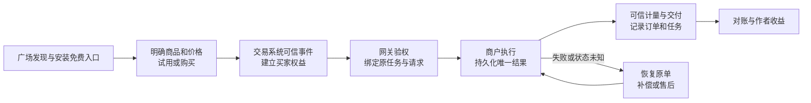

# 智果园 Skill 商业化：阿里、腾讯的可借鉴机制与能力复用路线

调研日期：2026-10-20。本文对应两页汇报材料。以当前公开官网、官方文档、公开服务契约和既有工作区取证为基线，未登录、安装、签约、申请授权或创建交易。“未披露”表示公开证据不足，不代表内部未建设。文中的演进次序、能力归属建议和验收标准属于本次分析。

## 1. 核心判断

**智果园应沿用已经具备的资产共享与访问审批能力，优先连接华为云现有商业底座，把 Skill 资产、可售商品、买家权益及任务履约串起来。** 支付渠道可以接入，云商店交易设施可以评估复用，但 Skill “卖什么、谁能用、能用多久或多少次、失败如何继续”的规则，需要智果园统一组织。

两家平台提供了互补的参照：

- **阿里的长处在商品经营和知识交付。** SkillPay 将完整文件买断与受保护订阅分开，配套试用、权益验证、版本及持续交付。MachinePay 则提供 API/数字资源的 Agent 收款与验付协议，不能把它等同一套完整的 Skill 商品市场。[SkillPay 技术博客](https://skillpay.alipay.com/blog/good-world-skills-get-paid)、[MachinePay 接入指南](https://aipay.alipay.com/docs/ai-receive/MACHINE_PAY.html)
- **腾讯的长处在服务供给、分发及支付协同。** SkillHub 把企业认证、商户身份、定价审核、安装入口和支付宿主连接起来。典型商品允许免费获得 Skill 调用说明，远程服务在验付后提供业务价值。商户仍承担业务后端和结果交付。[SkillHub SkillPay](https://skillhub.cn/skillpay)、[官方接入教程](https://skillhub.cn/tutorials#enterprise-best-practice)、[WorkRally Skill 契约](https://api.skillhub.cn/api/v1/skills/workrally-image/file?path=SKILL.md)

对智果园，首期最可控的路径是 **免费 Skill 调用入口＋付费远程服务**。理由是核心服务端有持续访问控制点，并已有可评估接入的云商店 Agents 网关。知识型 Skill 的源码买断、受保护订阅可按真实需求扩展，避免一开始就同时建设全部交付形态。

## 2. 智果园的实际基线：哪些已经有，哪些不能混写

本次对象是智果园入口连接的 **新版 AI 资产广场**，即 `pangu.huaweicloud.com/gallery/`，对应官方 ModelArts “AI资产广场（新版）”的 Skill 文档。AgentArts 产品内资产广场、旧 HiLens 技能市场、云商店历史“AI资产”商品属于相邻能力，需分开归属。[智果园入口](https://agentorchard.huaweicloud.com/)、[新版广场](https://pangu.huaweicloud.com/gallery/homepage.html)

| 现有能力 | 直接沿用的价值 | 商业化还需要的连接 |
|---|---|---|
| Skill 独立仓库、文件管理、README 与 SKILL.md 规范 | 持续作为制品与描述的来源，沿用 name/description、许可、环境依赖等字段 | 把制品版本与商业版本/价格方案关联；环境声明不等于运行隔离 |
| 行业、任务、语言等分类与发布审核 | 沿用发现、供给组织及发布状态 | 对收费能力增加效果、价格一致性、支付后交付等测试，不能将上架审核直接说成商业质量认证 |
| “指定用户可见”及“申请用户可用” | 保留企业共享与授权审批，不必重做共享体系 | 与买家组织、合同/订单及权益期限绑定，在真正提供服务或交付文件时校验 |
| 审批、拒绝、撤销及下架 | 可作访问治理和售后管理的基础 | 约定退款/到期如何影响未来使用。已交付源码无法仅靠撤销平台审批回收本地副本 |
| 官方 GitHub 与行业 pangu URL 安装入口 | 继续提供跨宿主发现与安装入口 | 增加商业声明、宿主兼容及登录/授权绑定；安装成功与拥有付费服务权益分开记录 |

依据：[托管 Skill](https://support.huaweicloud.com/aimarket-modelarts/ma_gallery_0011.html)、[发布 Skill](https://support.huaweicloud.com/aimarket-modelarts/ma_gallery_0012.html)、[管理 Skill](https://support.huaweicloud.com/aimarket-modelarts/ma_gallery_0013.html)、[首页安装样例](https://pangu.huaweicloud.com/gallery/homepage.html)。

**现状表述的限制：**公开 Skill 创建、发布、管理流程尚未充分披露价格、SKU、支付订单、试用扣次、作者收益和结算闭环。共享前端中能看到通用定价相关代码，但未证明 Skill 已启用该流程。因此不能写“华为完全没有商业化”，也不能据整个平台的“交易”定位认定 Skill 已全链路收费。详细取证见 [华为现状基线](research-huawei-baseline.md)。

## 3. 阿里做得好的地方，以及应学到哪一层

| 值得借鉴的机制 | 平台创造的价值 | 智果园应如何采用 |
|---|---|---|
| 将买断文件与周期使用权区分 | 同一知识资产可以有不同商品契约和交付方式 | 资产 ID 与商品 SKU 分开。每个 SKU 明确交付物、版本、有效期、许可和退款规则 |
| 试用、订阅、版本更新及权益联动 | 降低买前不确定性，让作者持续维护有经营回报 | 把试用额度做成服务端权益，不依赖提示词“提醒已用几次”；明确试用计的是请求、成功任务还是其他单位 |
| 402 后恢复原请求 | 购买后能继续正在做的任务 | 由宿主保留原 URL、方法、业务参数和任务标识，付款后恢复原任务，避免让用户重复提交数据或重复购买 |
| 订阅原文云端隔离、按任务返回指导 | 减少完整知识原文落地和批量复制风险 | 仅在高价值知识型商品需要时建设。评估信息外传、可用性和套取防护，不能用“云端”承诺绝对不可复制 |
| MachinePay 的签名报价、在线验付与回执 | 提供资源请求原生的收款与验真协议 | 作为候选支付适配层。还要做订单匹配、参数绑定、结果持久化、并发幂等，不能只判断 `active=true` 就放行 |

来源：[SkillPay 博客](https://skillpay.alipay.com/blog/good-world-skills-get-paid)、[上架页](https://skillpay.alipay.com/creator/product-new)、[更新日志](https://skillpay.alipay.com/changelog)、[MachinePay 正式指南](https://aipay.alipay.com/docs/ai-receive/MACHINE_PAY.html)、[支付宝官方代码](https://github.com/alipay/ai)。详细原理及代码版本见既有 [阿里深度调研](../alipay-research/alipay-mechanisms.md)。

需要保留的边界：SkillPay 云端返回任务指导，本地 Agent 继续运行工具与形成最终产物，并非云端代执行整个 Skill；当前周期订阅并不自动续费。其云端保护是否向第三方平台提供可直接嵌入的开放服务，公开证据不足。不能把“借鉴商品模式”写成“可直接拿阿里保护服务来用”。

## 4. 腾讯做得好的地方，以及应学到哪一层

| 值得借鉴的机制 | 平台创造的价值 | 智果园应如何采用 |
|---|---|---|
| 免费包承接发现，服务端承接付费价值 | 无需靠隐藏安装文件才能收费。WorkRally 图像生成样例展示 0.36 元/次 | 免费安装行业 Skill，使用时调用受控远程服务。需要自有 API Key 的云服务消费与向 Skill 作者付费单列 |
| 企业认证、商户绑定、开发者身份和价格审核 | 让可信供给能够用较一致的方式进入支付链路 | 复用云商店伙伴机制，建立服务主体、售后责任及商品声明，不把实名认证当业务效果保证 |
| 官方与第三方收费样例、站点/CLI 分发 | 给供给方接入参照，也给用户明确消费入口 | 选择官方和行业伙伴的标杆任务验证完整链路，提供标准 Skill 包、商户适配及故障恢复示例 |
| 微信订单与 AI 支付入口衔接 | 既有商户支付能力可以被支持的 Agent 宿主承接 | 普通扫码、AI 支付工具、用户授权、支付后台验真分别建设。不能只接一个支付链接就宣传任务内 AI 支付已完成 |
| 用稳定任务标识继续取结果 | 支付与长任务生成分开，网络重试可延续原任务 | 持久记录订单、任务、结果和退款状态。重试返同一结果，异步执行失败有补偿和售后 |

来源：[SkillPay FAQ](https://skillhub.cn/skillpay)、[SkillHub 教程](https://skillhub.cn/tutorials)、[WorkRally Skill](https://api.skillhub.cn/api/v1/skills/workrally-image/file?path=SKILL.md)、[调用时序](https://api.skillhub.cn/api/v1/skills/workrally-image/file?path=references%2Finvoke-flow.md)、[微信开发准备](https://pay.wechatpay.cn/doc/v3/merchant/4035576711)。详见 [腾讯原理 v2](../skillhub/skillpay/skillpay-principles-v2.md)。

商户仍需验付及履约，`payment_code` 只是拉起入口，不是付款证明。官网称当前暂不收技术服务费、用户款项直接支付给创作者，不能据此推断平台永久免费或商户无支付成本。付费标签数量及下载量也不能推算 GMV，官网示例收益卡不作为经营证据。

## 5. 哪些能复用，哪些需要智果园补齐

### 5.1 无需重建，但必须完成产品接入的商业底座

华为云云商店已有按商品类型区分的订购、交付、售后和结算制度。Agents 网关已有路由、用户鉴权和根据 `usage` 解析用量的计费能力，当前文档限定默认北京四。此处说明**相邻底座可评估复用**，不声称 Skill 广场已经接通。[商品接入类型](https://support.huaweicloud.com/usermanual-marketplace/sp_topic_0000016.html)、[Agents 网关](https://support.huaweicloud.com/usermanual-marketplace/zh-cn_topic_0000002497990256.html)、[华为支付及分账公告](https://support.huaweicloud.com/bulletin-marketplace/zh-cn_topic_0000002527868130.html)

通用/联营商品、API/SaaS/文件等形态支持的计费及退订方式不同，需先确定合作与商品模式。网关用量可以计费，但用量事件本身不证明用户业务任务成功，退款和结果质量仍需约定。完整条件见 [商业底座专项研究](research-commerce-foundations.md)。

### 5.2 智果园必须统一的五项商业能力

| 能力 | 建议由谁承担 | 可审查交付物与验收 |
|---|---|---|
| Skill 商业契约与商品映射 | 智果园产品编排，连接云商店商品 | `asset_id + artifact_version → product_id/SKU + price_version`，说明卖文件/访问/结果、许可、计费单位与试用 |
| 订单驱动权益 | 智果园权益服务与交易适配方 | 买家/组织、商品、范围、期限、额度可查；仅从可信订单/合同事件发权，退款/到期同步未来访问 |
| 服务端控制与计量 | 网关基础设施与业务提供方，智果园统一口径 | 权益在实际服务端执行；计量事件有可信生产端；调用、重试、失败/部分成功的收费规则一致 |
| 幂等履约及补偿 | 业务提供方保存结果，智果园提供恢复契约与对账 | `execution_id ↔ order_id ↔ entitlement_id` 可追溯；同一业务重试不重复扣费，已付未交付能恢复或进入售后 |
| 供给质量与作者经营 | 智果园运营、伙伴/云商店体系 | 发布具备可运行任务样例、依赖及权限声明、付费链路检查；作者可看订单、有效消费、退款、收益与问题反馈 |

这里的“必须统一”不要求全部由智果园重写底层系统。可以购买、复用或由伙伴实现，但平台需要给出稳定对象、接口责任和一致用户体验。

### 5.3 外部支付的可接入程度

- **MachinePay：有外部服务商接入路径。** 官方指南支持自研应用及第三方授权代调用。可作为候选，但签约、应用/服务登记、买方宿主支付能力和授权都需要验证。它不自带智果园的试用、订阅和跨宿主权益。[正式指南](https://aipay.alipay.com/docs/ai-receive/MACHINE_PAY.html)
- **微信 AI 支付：现行公开路径包含 SkillHub。** 官方准备流程涉及 SkillHub 认证、开通与开发者密钥。智果园独立平台能否接入、怎样签发身份及支持宿主，要另向渠道确认。普通微信扫码的可用性不能替代该结论。[微信开发准备](https://pay.wechatpay.cn/doc/v3/merchant/4035576711)、[微信开发指引](https://pay.wechatpay.cn/doc/v3/merchant/4035576716)
- **阿里 SkillPay 云端保护：可借鉴模式，未证实可直接嵌入。** 需确认开放服务、合作方式和数据边界；不能将支付 API 的开放性延伸到知识保护产品。

## 6. 建设次序与首期验收

**首期建议：选择少量可远程交付、输出可验证的官方及行业伙伴服务，跑通同一业务任务的完整商业闭环。** 本次不设未经评估的日期或收入目标。

首期需以以下场景验收：

1. 用户可在购买前读到提供方、价格单位、依赖、许可与失败处理规则；免费安装不被误解为服务永久免费。
2. 有效权益可继续调用；到期、额度耗尽、退款或撤销后的行为符合商品契约，不能仅靠 Agent 自觉遵守提示词。
3. 重复请求、回调重复和断线重试均不重复扣费/扣次。已产生的业务结果可恢复获取，不重新触发付费生成。
4. 已付款但未交付、服务超时、部分成功、退款处理中有明确可查询状态及处理责任。
5. 任一消费可关联到商品、价格版本、买家、订单、任务和计量记录，作者收益与平台对账可解释。

第二阶段再加入组织订阅/席位预算、跨宿主权益和高价值知识保护。观测与商业验收分开：AgentArts 的 Trace/Metric 可以用于排障，但不直接当扣费账本；CodeArts/OfficeAce 可作为消费触点，但同一资产与权益跨端衔接需要实测。[Skill 观测](https://support.huaweicloud.com/bestpractice-agentarts/agentarts_06_0037.html)、[OfficeAce Skill](https://support.huaweicloud.com/usermanual-officeace/officeace_02_0006.html)

经营评估建议看实际闭环：试用到付费、支付到有效权益、付费到成功交付、重试重复收费、退款/投诉、活跃付费组织、复购及作者持续更新。付费资产占比和下载量只作供给/分发参考，不替代交易与履约成效。

## 7. 证据与内部对齐事项

需要内部确认的关键问题包括：新版 Skill 是否已有未公开商业流程；云商店何种商品/合作模式适用；Skill 资产与商品是否可复用同一组织身份；主消费宿主范围；计量单位和失败计费；服务方/平台的收款、售后、发票责任；高价值知识是否允许进入保护服务。

原始材料保存在 `sources/huawei/` 与 `sources/commerce/`，附各自清单。阿里、腾讯沿用工作区原始官方资料，详细版本与证据差异见对应深度报告。部分文档更新日期及协议样例存在差异，正文采用稳定机制；本次没有用示例代码承诺生产系统的幂等、资金或规模结果。
